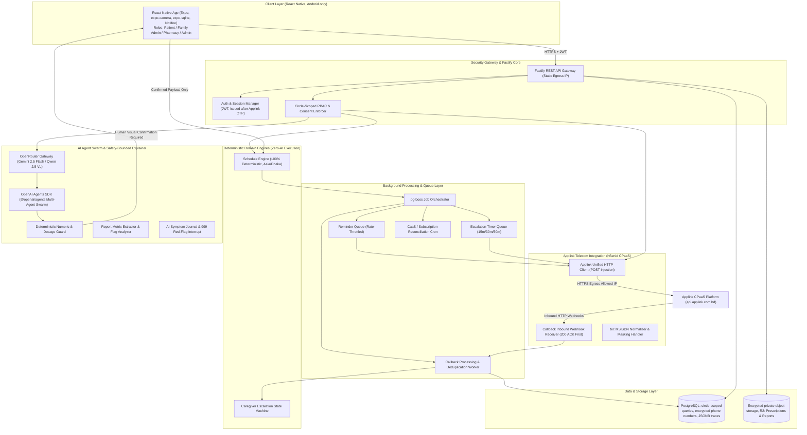
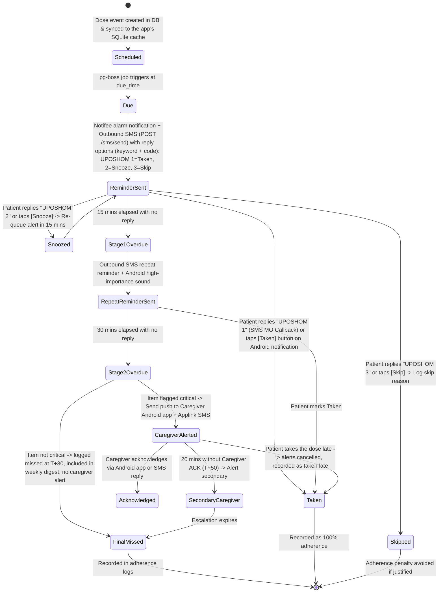
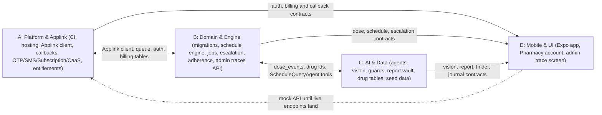
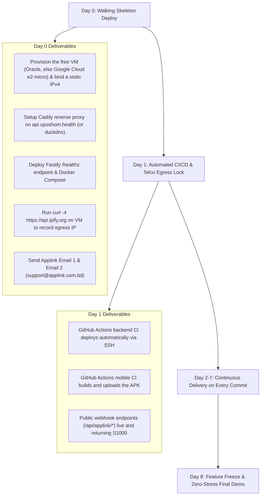

# Uposhom (উপশম): Implementation Plan

Team of 4 · AppQuest 2.0 · 20 to 30 Nov 2026 · Version 2 (React Native app Architecture)

## 1. Ground rules

- Scope: the full project from the final project doc and PDF specifications, built in priority tiers (section 3). A lower tier never starts until the tier above is demo-ready. If time runs out, cuts follow the drop order in section 11, which is decided now.
- Stack: React Native (Expo, development build) Android app + Node.js 22 LTS with Fastify (TypeScript) + PostgreSQL 16 with Drizzle ORM and pg-boss (Node 20 reached end of life in April 2026, so it is not used). Everything is TypeScript except SQL, so the app and the server share zod schemas and types. The schedule engine runs only on the server (at prescription confirm); the app never recomputes doses, it only displays and caches the dose events the server returns. Android only: no web portal and no iOS. Pharmacies use a separate Pharmacy account type inside the same app. The stack is locked at the end of Day 0.
- Mobile: React Native with Expo (development build, Expo Router, TypeScript), Android only (minSdk 26). `expo-camera`, `expo-image-picker` (gallery) and `expo-image-manipulator` for prescription capture, TanStack Query plus `expo-sqlite` for offline schedule caching, `expo-secure-store` (session tokens), `expo-font` (Noto Sans Bengali), `expo-haptics`, `expo-location` (coarse location for pharmacy search), `expo-print` and `expo-sharing` (doctor summary PDF), `expo-audio` and `expo-speech` (voice), Notifee for exact-alarm reminder notifications with Taken/Snooze/Skip action buttons, and Expo Push for caregiver alerts. Pharmacies sign up as a separate Pharmacy account type (own role, own home screens) in the same app. The agent-trace viewer is an admin-only screen in the app.
- Data: synthetic only (hackathon rule 10c). Disclose every AI tool, third-party service and pre-existing asset (rules 04d, 04e).
- Applink: called from the backend only, from a fixed egress IP, with credentials in environment variables only (never hardcoded, committed, or exposed to the mobile app bundle).
- Demo-ready means: APK (`uposhom-v1.0.apk`) installable on Android test devices / emulators and working end-to-end with the deployed backend, uses live Applink APIs on whitelisted numbers, has automated tests wherever it touches dosing or alerts, and has been run once by a teammate who did not build it.
- Early Deployment & Free Hosting: Deploy on Day 0 with a 'Walking Skeleton' rather than waiting for the end. The entire production stack runs on 100% Free Tier infrastructure (one free always-on VM with a fixed IPv4 for Applink allow-listing: Oracle Cloud Always Free first, Google Cloud e2-micro as the free fallback, see 19.1; plus Cloudflare R2 + GitHub Actions).
- Workflow: trunk-based, short branches, automated CI testing on every PR, and continuous CD deployment to the live environment on merge to main.

## 2. Workstreams (assign names today)

This section is the single source of truth for ownership. Section 18 lists the same four workstreams with deliverables and checkpoints; the workstreams run in parallel from Day 0 and meet at the integration points in section 18.

- A, Platform and Applink: repo, CI/CD, hosting, auth and sessions (JWT, refresh), Applink client and the local mock, all four callbacks, OTP, SMS send/receive and the send wrapper, Subscription, CaaS, entitlements and quotas, the Applink-side tables (users, otp\_sessions, consents, subscriptions\_mirror, charges, entitlements, usage\_counters, sms\_log, sms\_opt\_outs, callback\_dedupe), security pass.
- B, Domain and engine: Drizzle setup and migration order, the domain tables (circles, profiles, links, prescriptions, doses, escalations, reports, symptom logs, appointments, pharmacies, agent\_traces, audit\_log), schedule engine package, reminder and escalation state machine, pg-boss jobs, SMS reply-code logic, adherence, and the admin traces endpoint.
- C, AI and data: OpenAI Agents SDK + OpenRouter (Gemini 2.5 Flash / Qwen 2.5 VL), the triage router, multi-agent handoffs, trace logging, explainer, report extraction, generic matching, symptom journaling with 999 emergency guardrail, voice spike, the drug tables and all seed data (drug table, glossary, tips, synthetic prescriptions, reports and history, pharmacies).
- D, Product Mobile & UI: React Native app (Expo, expo-camera, expo-sqlite, Notifee alarms), Pharmacy account screens (stock management, subscription), admin-only agent-trace screen, facts carousel, demo video editing.
- Proposal ownership: P1 to P4 by C, P5 and P6 by A, P7 by D with B on the numbers, P8 diagram by B and D. Everyone reviews P6 against the real flows.

## 3. Scope tiers (the full project)

P0, core loop and Applink (demo-ready by Tue 24 Nov night):

- OTP sign-up and Family Link consent; Family Circle with profiles and roles
- Android prescription capture (expo-camera), AI extraction, side-by-side visual confirm screen, typed-entry fallback
- Deterministic schedule engine; dose log with taken, snooze, skip
- Multi-channel reminders: Android rich push notifications + Applink SMS reminders with reply codes; missed-dose escalation ladder; caregiver acknowledgement
- Subscription (Family Circle plan) with recorded consent
- Simple Bangla explanation of the confirmed prescription

P1 (demo-ready by Thu 26 Nov night):

- Agent router with specialist handoffs and the admin-only agent-trace viewer in the Android app (the viewer reads traces the router writes, so both land on Day 5)
- CaaS pay-per-use (scans over quota, report explanation, doctor summary)
- Free and Premium entitlements and quotas
- Diagnostic report vault and Bangla explainer in Android
- Generic drug alternative finder in Android
- Router with SMS free-text Q&A
- Refill and follow-up appointment reminders; weekly caregiver digest; discreet SMS mode
- High-importance Android notification channels (Notifee); facts carousel component

P2 (demo-ready by Fri 27 Nov night, time-boxed, seeded data allowed):

- AI-guided symptom journaling with doctor summary PDF (Android voice input + text)
- Bangla voice input via `expo-audio` (after the Day 1 spike): used for symptom journaling and for the Android voice schedule-query screen ("what medicine is next?")
- Sickness-pattern analytics over symptom logs and past confirmed prescriptions, with an Android Insights screen, on seeded synthetic history
- Local pharmacy discovery & priority listing in Android; Pharmacy account type (separate sign-up, stock management screens) & pharmacy Subscription

P3 (only if ahead): fasting-day schedule shift.

Out of scope: iOS app, any web portal (consumer or pharmacy), ads or an ad-free tier, a staffed customer-support channel (a published support contact, terms of service and privacy policy are still required for Applink approval, see section 8), daily or weekly billing (monthly only), distributor and manufacturer accounts, real pharmacy stock feeds, real patient data, any diagnosis or dose recommendation.

## 4. Architecture

Monorepo (pnpm workspaces; `.npmrc` sets `node-linker=hoisted` so Metro resolves packages):

- apps/mobile: React Native + Expo app, TypeScript (Expo Router, NativeWind, TanStack Query, Zustand, expo-sqlite, Notifee, Reanimated, i18next, bundled Noto Sans Bengali font)
- apps/api: Fastify REST API, Applink callback receiver, auth, authorization
- apps/worker: pg-boss consumers for reminders, escalation, SMS sending, reconciliation, digests
- packages/schedule-engine: pure TypeScript, no I/O, fully unit-tested
- packages/applink-client: typed wrappers, one tel: normaliser, status-code handling
- packages/ai: OpenAI Agents SDK multi-agent orchestration, OpenRouter client, specialist agents with handoffs, prompts, JSON schemas, numeric guard
- packages/db: Drizzle schema, migrations (drizzle-kit) and queries
- packages/shared: zod schemas and TypeScript types used by both the app and the API
- data/: seed files (drugs, glossary, tips, pharmacies, synthetic prescriptions)

### 4.1 Monorepo & Project Directory Structure

```text
uposhom/
├── .github/
│   └── workflows/
│       ├── mobile-ci.yml            # App typecheck, tests, APK build (expo prebuild + Gradle)
│       └── backend-ci.yml           # Monorepo lint, TypeScript build, test suite
├── apps/
│   ├── mobile/                      # React Native + Expo app (Android only, TypeScript)
│   │   ├── app/                     # Expo Router (file-based navigation)
│   │   │   ├── (auth)/              # OTP request & verify, account type choice
│   │   │   ├── (tabs)/              # Home, Family, Vault (incl. History), Explore
│   │   │   ├── (pharmacy)/          # Pharmacy account: Stock, Subscription, Store profile
│   │   │   ├── scan.tsx             # Camera capture
│   │   │   ├── confirm.tsx          # Side-by-side visual confirm screen
│   │   │   ├── symptoms.tsx         # Symptom journaling & 999 red-flag modal
│   │   │   ├── voice.tsx            # Voice schedule-query screen
│   │   │   ├── insights.tsx         # Sickness history & pattern insights
│   │   │   └── admin/traces.tsx     # Admin-only agent-trace viewer
│   │   ├── src/
│   │   │   ├── api/                 # Typed API client (fetch + zod from packages/shared), auth header
│   │   │   ├── db/                  # expo-sqlite offline cache (doses, profiles)
│   │   │   ├── notifications/       # Notifee channels, exact alarms, action-button handlers, boot re-registration
│   │   │   ├── hooks/               # TanStack Query hooks (useTodayDoses, useConfirmPrescription ...)
│   │   │   ├── store/               # Zustand (session, active profile, confirm-screen draft)
│   │   │   ├── components/          # DoseCard, ConfidenceField, SwipeToConfirm, FactsCarousel ...
│   │   │   ├── i18n/                # Bangla strings (i18next, Bangla default)
│   │   │   ├── theme/               # Color tokens, shared <Text> with explicit lineHeight, spacing
│   │   │   └── utils/               # Bangla numeral converter, Asia/Dhaka date formatters
│   │   ├── assets/
│   │   │   └── fonts/               # NotoSansBengali-Regular/Medium/SemiBold/Bold.ttf
│   │   ├── app.config.ts            # Permissions: CAMERA, RECORD_AUDIO, POST_NOTIFICATIONS, SCHEDULE_EXACT_ALARM, RECEIVE_BOOT_COMPLETED, ACCESS_COARSE_LOCATION, VIBRATE, INTERNET
│   │   ├── package.json
│   │   └── tsconfig.json
│   │
│   ├── api/                         # Fastify Core REST Gateway (Node.js 22 / TypeScript)
│   │   ├── src/
│   │   │   ├── config/              # Env validation, Applink credentials, static IP check
│   │   │   ├── middleware/          # JWT auth, circle-scoped RBAC, rate-limiter, CORS
│   │   │   ├── plugins/             # Fastify Swagger, Multipart, rate-limit (scoped to /api/v1 only, never the callbacks), Postgres (Drizzle) connector
│   │   │   ├── plugins/applink-callbacks.ts  # Encapsulated plugin for the four callback routes: lenient JSON parser, small bodyLimit, error handler that always returns 200 S1000, no rate limiter or JWT/CSRF hooks
│   │   │   ├── routes/
│   │   │   │   ├── auth.ts          # /api/v1/auth (OTP request, verify, JWT issuance, refresh, logout)
│   │   │   │   ├── circles.ts       # /api/v1/circles, /profiles, /links (family circle, profiles, roles, invites, secondary caregiver)
│   │   │   │   ├── devices.ts       # /api/v1/devices (Expo push token registration)
│   │   │   │   ├── account.ts       # /api/v1/account (settings, discreet mode, SMS opt-out, delete-my-data)
│   │   │   │   ├── admin.ts         # /api/v1/admin/traces (admin flag only)
│   │   │   │   ├── prescriptions.ts # /api/v1/prescriptions (upload, OCR parse, confirm)
│   │   │   │   ├── doses.ts         # /api/v1/doses (today's schedule, taken/snooze/skip action)
│   │   │   │   ├── billing.ts       # /api/v1/billing (CaaS micro-charge, Subscription)
│   │   │   │   ├── reports.ts       # /api/v1/reports (lab report upload & flag analysis)
│   │   │   │   ├── symptoms.ts      # /api/v1/symptoms (symptom journal, 999 red flag)
│   │   │   │   ├── generics.ts      # /api/v1/drugs/generics (same-ingredient, strength and form alternatives)
│   │   │   │   ├── pharmacies.ts    # /api/v1/pharmacies (geolocation & stock lookup, owner stock toggle and store profile)
│   │   │   │   └── callbacks/       # Applink Inbound Webhook Handlers
│   │   │   │       ├── sms-receive.ts             # Inbound MO reply processor
│   │   │   │       ├── sms-delivery.ts            # DLR delivery receipts
│   │   │   │       ├── subscriber-notify.ts       # Subscription lifecycle events (password stripped)
│   │   │   │       └── charging-notify.ts         # CaaS transaction settlement
│   │   │   ├── services/            # Business logic services bridging routes & DB
│   │   │   └── index.ts             # Fastify server bootstrap & graceful shutdown
│   │   ├── package.json
│   │   └── tsconfig.json
│   │
│   ├── worker/                      # Asynchronous Background Processor (pg-boss)
│   │   ├── src/
│   │   │   ├── queues/              # Queue names and job payload schemas
│   │   │   ├── jobs/
│   │   │   │   ├── reminder-job.ts         # Dispatches due medication SMS alerts and push
│   │   │   │   ├── sms-send-job.ts         # Throttled outbound SMS queue (E1318 per-second, E1319 per-day limits)
│   │   │   │   ├── refill-appointment-job.ts # Refill-date and follow-up appointment reminders
│   │   │   │   ├── escalation-job.ts       # 15m/30m/50m Caregiver escalation state machine
│   │   │   │   ├── reconciliation-cron.ts  # Daily CaaS P1003 & Subscription reconciliation
│   │   │   │   └── digest-job.ts           # Weekly caregiver adherence summaries
│   │   │   └── index.ts             # pg-boss worker supervisor
│   │   ├── package.json
│   │   └── tsconfig.json
│   │
├── packages/
│   ├── schedule-engine/             # Pure TypeScript Deterministic Dosing Arithmetic
│   │   ├── src/
│   │   │   ├── parser.ts            # Latin/Bangla 1+0+1, OD, BD, TDS, AC/PC grammar
│   │   │   ├── anchors.ts           # Profile meal offsets in Asia/Dhaka time
│   │   │   ├── generator.ts         # Generates immutable dose_events array
│   │   │   └── types.ts             # PrescribedItem, DoseEvent, AnchorTimes
│   │   ├── test/                    # 100% branch coverage unit tests on 30 prescriptions
│   │   ├── package.json
│   │   └── tsconfig.json
│   │
│   ├── applink-client/              # Type-Safe Applink CPaaS Platform Client
│   │   ├── src/
│   │   │   ├── client.ts            # Unified post() with fixed IP egress & credential injection
│   │   │   ├── normalizer.ts        # Single tel: normalizer & masking handler
│   │   │   ├── services/
│   │   │   │   ├── sms.ts           # POST /sms/send wrapper
│   │   │   │   ├── subscription.ts  # POST /subscription/send (register/unregister), query-base, getSubscriberChargingInfo
│   │   │   │   ├── otp.ts           # POST /otp/request & /otp/verify
│   │   │   │   └── caas.ts          # POST /caas/direct/debit & /caas/otp/verify (BDT decimal)
│   │   │   ├── status-codes.ts      # Published status code enumerations & error mappers
│   │   │   └── types.ts             # Request & Response TypeScript interfaces
│   │   ├── package.json
│   │   └── tsconfig.json
│   │
│   ├── ai/                          # OpenAI Agents SDK + OpenRouter Pipeline
│   │   ├── src/
│   │   │   ├── client.ts            # OpenRouter API client (OpenAI SDK compatible, baseURL: openrouter.ai/api/v1)
│   │   │   ├── agents/              # OpenAI Agents SDK definitions
│   │   │   │   ├── triage-agent.ts  # Inbound Bangla router with specialist handoffs
│   │   │   │   ├── schedule-agent.ts# Medication schedule query agent (tool: getTodayDoses)
│   │   │   │   ├── symptom-agent.ts # Slot-filling clinical intake Q&A agent
│   │   │   │   ├── emergency-agent.ts # 999 red-flag safety interrupt agent
│   │   │   │   └── generic-agent.ts # DGDA-sourced same-ingredient alternative finder agent
│   │   │   ├── vision/
│   │   │   │   ├── ocr-extract.ts   # OpenRouter Vision OCR (Gemini 2.5 Flash / Qwen 2.5 VL)
│   │   │   │   └── report-vault.ts  # Lab metric extractor & printed range comparator
│   │   │   ├── guards/
│   │   │   │   ├── numeric-guard.ts # Deterministic dosage sanity guard
│   │   │   │   └── redflag-guard.ts # Immediate emergency keyword interceptor
│   │   │   └── traces/
│   │   │       └── trace-logger.ts  # Captures agent steps & handoffs into agent_traces table
│   │   ├── package.json
│   │   └── tsconfig.json
│   │
│   ├── shared/                      # zod schemas & types shared by mobile and API
│   │   ├── src/
│   │   ├── package.json
│   │   └── tsconfig.json
│   │
│   └── db/                          # Drizzle schema, migrations & queries
│       ├── migrations/              # drizzle-kit generated SQL migrations
│       ├── src/
│       │   ├── schema/              # Drizzle table definitions (users, prescriptions, doses, charges...)
│       │   ├── queries/             # Scoped database query helpers
│       │   └── client.ts            # pg pool + Drizzle client
│       ├── package.json
│       └── tsconfig.json
│
├── data/                            # Curated & Synthetic Seed Data
│   ├── dgda-drugs.json              # 150 verified DGDA generics, brand equivalents & prices, with Bangla names and spelling aliases, and therapeutic class
│   ├── pharmacies.json              # 10 partner pharmacies with mock coordinates
│   ├── glossary.json                # 40 common lab tests with lay-Bangla explanations
│   ├── health-tips.json             # Rotating health advice for facts carousel
│   ├── synthetic-history.json       # Labelled synthetic symptom logs and past prescriptions for the Insights demo
│   └── synthetic-prescriptions/     # 30 test prescriptions (printed + handwritten)
│
├── scripts/                         # DevOps, Testing & Mock Utilities
│   ├── mock-applink.mjs             # Zero-dependency local Applink CPaaS simulation server (copied from the Applink skill's scripts/)
│   ├── test-callbacks.sh            # Posts valid, malformed, wrong-app, partial-payment and duplicate callback payloads at our handlers (copied from the Applink skill's scripts/)
│   └── seed-db.ts                   # Populates PostgreSQL with synthetic seed data
│
├── deploy/                          # Deployment & Container Configuration
│   ├── docker-compose.yml           # Postgres 16, Fastify API (port bound to 127.0.0.1:3000 for the deploy smoke test; Caddy reaches it on the Docker network), Worker (no Redis: pg-boss runs on Postgres)
│   ├── Dockerfile.api
│   ├── Dockerfile.worker
│   ├── Caddyfile                    # Automatic HTTPS & reverse proxy; remote_ip allowlist and rate limits for /api/applink/*
│   └── README.md                    # VM setup commands (swap, Docker, GHCR login, cron) to rebuild the host fast
│
├── .env.example                     # Placeholder-only environment template (no real secrets!)
├── pnpm-workspace.yaml              # Monorepo workspace configuration
├── package.json                     # Root scripts (build, test, lint, dev)
└── README.md
```

Runtime (100% Free-Tier Architecture):

- Compute & Static IP: one free always-on VM with a fixed public IPv4, chosen in this order (details in 19.1): (1) Oracle Cloud Always Free (Ampere A1 if capacity allows, otherwise the AMD E2.1 Micro), (2) Google Cloud Always Free e2-micro in a US region. The fixed IP fulfils Applink's mandatory IP allow-listing, and Caddy v2 gives the public HTTPS callback URL with automatic Let's Encrypt certificates. The VM runs the Fastify API, the pg-boss worker and PostgreSQL 16 in Docker Compose from prebuilt images (nothing is compiled on the VM, so it also works on a 1 GB machine).
- Early Deployment: The live environment is provisioned and deployed on Day 0 ('Walking Skeleton'). We do not wait for the final days. Every git push to main automatically tests and redeploys via GitHub Actions CI/CD.
- Storage: Cloudflare R2 Free Tier (10 GB storage, $0 egress fees) for prescription and report images and generated PDFs. Objects are private (no public bucket), reached only through short-lived signed URLs issued after a circle-scoped access check, and encrypted at rest by R2. This is "encrypted private object storage"; the project makes no HIPAA or other compliance claim.
- Android APK: Built automatically on every push by GitHub Actions (`expo prebuild` + Gradle `assembleRelease`, free 2,000 CI minutes/month). Pushes to main refresh a public `apk-latest` GitHub Release (`uposhom-latest.apk`), and pushing a `v*` tag (for example `v1.0`) publishes `uposhom-v1.0.apk` as a public Release asset. Release assets need no GitHub login and do not expire, unlike Actions artifacts. EAS Build is not used, to avoid free-tier queue delays.
- Observability: UptimeRobot free 5-minute HTTP monitor on `/healthz`, structured JSON logs (no message bodies or OTPs), and Slack/Discord webhooks for Applink error alerting.
- Backups: Nightly automated script runs `pg_dump`, encrypts the dump (AES-256, passphrase file readable by root only, kept outside the repo) and uploads it to Cloudflare R2. Restore one backup into a scratch database once before the demo to prove it works.

## 5. Data model (key tables)

- users (account\_type: individual or pharmacy; plus an admin flag; `phone_enc` for the typed number, encrypted; `subscriber_id` exactly as Applink returned it from OTP verify, opaque and possibly masked, the join key for every callback; `applink_subscription_status`), otp\_sessions (user or pending sign-up, purpose, `reference_no` from /otp/request kept server-side only, attempts, expires at five minutes, consumed at), sessions (user, device, hashed refresh token, expires, revoked), device\_tokens (user, Expo push token, platform), family\_circles, profiles (meal times, quiet hours, allergies, optional own phone as `phone_enc`, and an opaque `subscriber_id` set only from the Family Link OTP verify of the dependent's own number, exactly as Applink returned it, with a partial unique index where it is not null; `subscriber_id` values are unique across `users` and `profiles`, so a number maps to one holder), links (user, profile, role admin/caregiver/viewer, OTP-verified time, consent evidence)
- prescriptions (status draft or confirmed, confirmed by and when, image path), prescription\_items (raw name, drug id, strength, form, raw pattern, parsed pattern, meal relation, duration, pill count for refill dates (optional), as-needed flag, critical flag set by a human, per-field confidence)
- dose\_events (due time, state, stage, idempotency key), dose\_logs (action, channel, reason, time), escalations (stage, notified user, acknowledged time), appointments (profile, title, due date, reminder state, for follow-up reminders)
- reports, report\_values (test, value, unit, printed range, flag); symptom\_logs (structured JSON, red-flag boolean); doctor\_summaries (profile, period, R2 object path, generated at, charge or entitlement that unlocked it)
- drug\_generics (includes therapeutic\_class for pattern analysis), drug\_brands (generic id, name\_en, name\_bn plus a bn\_aliases array for common Bangla spellings, strength, form, indicative price, source, verified flag; trigram indexes on name\_en, name\_bn and bn\_aliases), drug\_info (curated Bangla summary, storage, warnings), glossary, tips
- pharmacies, pharmacy\_stock
- consents (user or profile as the subject, kind, amount, currency, frequency, channel, wording shown, evidence, time; a dependent's Family Link verify writes a consent row against the profile), subscriptions\_mirror (subscriber\_id, status, frequency, plan, last confirmed at and by notification or sweep), charges (external\_trx\_id primary key written before the debit call, purpose, amount, status, request\_correlator, internal\_trx\_id, reference\_id, paid\_amount, balance\_due, fulfilled\_at), entitlements and usage\_counters (granted features such as a doctor summary from a settled charge, monthly scan and SMS quotas), sms\_opt\_outs
- sms\_log (no bodies; Applink request\_id, per-recipient status, latest delivery status), callback\_dedupe (callback type + that callback's documented key), agent\_traces, audit\_log

Database: PostgreSQL 16 self-hosted in Docker on the VM, accessed through Drizzle. The first migration runs `CREATE EXTENSION pg_trgm`. It is the single source of truth. `expo-sqlite` on the phone is only a read cache of the schedule. Agent traces, structured symptom logs and per-field OCR confidence use `jsonb`; everything else is relational.

Sessions: the app holds a short-lived access JWT (15 minutes) and a rotating refresh token (90 days, stored hashed in `sessions`, kept in `expo-secure-store`). Refreshing needs no Applink call, so an elderly user is not forced into a paid OTP when the access token expires. A fresh OTP is only needed on a new device, account recovery, or a step-up before a sensitive action.

Rules: every query is scoped by circle membership; phone numbers are encrypted at the application level (AES-GCM, key in an environment variable) and only masked numbers appear in logs and `sms_log`; a delete-my-data endpoint exists; the audit log records every read of a medical record by a non-owner.

## 6. Safety-critical core

Schedule engine (owner B, written first, tested hardest):

- Input: confirmed prescription items. Output: dose events in Asia/Dhaka time.
- Parses a+b+c and a-b-c patterns in Latin or Bangla digits, fractions like ½, and the abbreviations OD, BD/BID, TDS/TID, QID, HS, SOS/PRN, AC, PC and STAT. Examples from the doc: 1+0+1 BDPC and TID.
- Pattern slots map to the profile's anchors: three slots to morning, noon and night; four slots add evening. Before-meal and after-meal offsets are editable defaults. The table of defaults and abbreviations gets reviewed by a pharmacist or doctor (a mentor or relative). B names the reviewer on Day 0 and the review is done by Fri 27 Nov (Day 7), before the Sat 28 Nov feature freeze.
- Anything ambiguous, conflicting or low confidence becomes needs-manual-input. The engine never guesses.
- Durations count days from a start date, then the course auto-completes. A pill count gives a refill date.
- Tests: table-driven cases from 30 synthetic prescriptions, property tests (event count equals doses per day times days, times are ordered, no duplicates), and 100% branch coverage for this package.

Escalation ladder (state machine in code, timers on pg-boss):

1. Dose due: a Notifee exact-alarm notification (high importance, Taken/Snooze/Skip buttons) fires on the device + Applink SMS to the patient with reply codes 1 taken, 2 snooze, 3 skip (Latin or Bangla digits), sent with the shortcode keyword, for example `UPOSHOM 1`, because an inbound SMS only reaches us with the keyword included.
2. After 15 minutes without an action: one repeat SMS + local alarm.
3. After 30 minutes, the path depends on whether a human flagged the item critical:
   - Non-critical: the dose is logged as missed at T+30, feeds adherence, and appears in the weekly caregiver digest. No caregiver alert is sent.
   - Critical: caregiver alert via Expo Push and SMS.
4. Critical only: the caregiver acknowledges via Android app or SMS reply. After 20 more minutes without acknowledgement (T+50), the secondary caregiver is alerted.
5. Critical only: after the secondary alert window ends, the dose is logged as missed and feeds adherence. If the patient takes the dose late at any point, the late intake is recorded and the missed state is replaced by taken-late, and any pending alerts are cancelled.

If an SMS to the patient comes back UNDELIVERABLE, EXPIRED or REJECTED for a critical dose, the caregiver alert is brought forward instead of waiting for T+30 (non-critical doses keep the normal path).

Defaults live in config. Every stage has an idempotency key, so no message sends twice, even after a restart.

## 7. AI pipeline (OpenAI Agents SDK + OpenRouter)

Principle: AI reads, routes and explains, code decides. No model output sets a dose, time or schedule.

- Gateway & Models: All LLM and Vision requests route through **OpenRouter** (`https://openrouter.ai/api/v1`) using `OPENROUTER_API_KEY`, eliminating direct Google Cloud billing obstacles in Bangladesh. Primary models:
  - Vision extraction: `google/gemini-2.5-flash` (fast, cost-effective, strong Bangla and Southeast Asian prescription comprehension) with fallback to `qwen/qwen2.5-vl-72b-instruct` (this exact slug; `qwen/qwen-2.5-vl-72b-instruct` does not exist on OpenRouter).
  - Conversational & Specialist Agents: `google/gemini-2.5-flash` or `openai/gpt-4o-mini` via OpenRouter.
  - Testing: CI makes no live model calls. It uses recorded fixtures of model outputs. Local sandbox runs use the primary model with a spend cap on the OpenRouter key. There is no free Gemini 1.5 model to rely on.
  - Model IDs are config values. Day 0 check: confirm each configured ID against `GET https://openrouter.ai/api/v1/models` (verified present on 20 Nov 2026: `google/gemini-2.5-flash`, `qwen/qwen2.5-vl-72b-instruct`, `openai/gpt-4o-mini`), and re-check before the freeze because providers retire models.
- Multi-Agent Orchestration (OpenAI Agents SDK):
  The conversational router is implemented using `@openai/agents` with typed tools and explicit handoffs:
  - `TriageAgent`: Inbound Bangla classifier. Inspects incoming free-text SMS or spoken voice messages and executes handoffs to specialist agents.
  - `ScheduleQueryAgent`: Equipped with read-only tools (`getTodayDoses(profileId)`, `getNextDose(profileId)`). Answers schedule inquiries in polite Bangla without modifying state.
  - `SymptomJournalAgent`: Conducts an empathetic slot-filling conversation (at most six turns: onset, duration, severity, triggers, associated symptoms, current medicines) and formats a structured summary for doctor visits.
  - `EmergencyAgent` (Safety Guardrail): Triggers immediate 999 emergency banner if critical symptoms are detected (chest pain, severe dyspnea, severe bleeding, stroke signs). The deterministic `redflag-guard.ts` keyword interceptor runs first on every symptom input, before any model call, and the agent only adds wording around that result.
  - `GenericFinderAgent`: Equipped with tool `searchAlternatives(brandName)` querying the local DGDA-sourced drug table for the same ingredient, strength and form.
- Agent Tracing & Telemetry:
  The OpenAI Agents SDK is configured for OpenRouter in chat-completions mode, and its default OpenAI trace upload is replaced by a custom trace processor. The SDK emits execution traces (agent name, handoffs, tool calls, latency). Every execution is stored in the `agent_traces` table and rendered on an admin-only trace screen in the Android app (backed by an admin-role `GET /api/v1/admin/traces`), directly providing the source evidence and diagram for **Hackathon Proposal Page 8** (Blank Page Challenge) and **Theme 4, Category 11: Agentic AI & Autonomous Systems**.
- Intake (C): the app captures the photo with `expo-camera` and resizes it to WebP (max 1600px) with `expo-image-manipulator`. A single OpenRouter vision call reads the image directly and returns schema-constrained JSON with per-field confidence plus a transcription of the text it read (there is no separate OCR engine, and no bounding boxes). Validators run: brand match with fuzzy search (`pg_trgm`), the pattern parser, unit and range sanity. The confirm screen shows the photo beside the fields, highlights low confidence, and allows edit, add and remove. Nothing is scheduled before a human confirms. Typed entry with autocomplete is the fallback.
- Explainer: simple Bangla from a curated `drug_info` table. It must not give dose advice or diagnoses. A numeric guard rejects any output containing a number that is not in the confirmed data, and falls back to a template.
- Report vault: OpenRouter vision extracts values, units and the range printed on the report. The flag is a plain comparison against that printed range, not our own reference table. Terms are explained from a glossary of about 40 common tests, always ending with a pointer to the doctor.
- Drug-name search (finder and prescription brand matching): Latin input is fuzzy-matched with `pg_trgm` on `name_en`. Bangla input (for example "নাপা", "সেকলো", "প্যারাসিটামল") is matched against `name_bn` and `bn_aliases`, because trigram matching on Latin names cannot match Bangla script. The seed data includes a few common Bangla spelling variants per drug.
- Generic finder: same active ingredient, strength and form, sorted by indicative price, with a note that a doctor or pharmacist confirms any substitution. Do not claim bioequivalence or government approval unless the row has a verified source; the UI and README call these "same-ingredient alternatives" with indicative prices.
- Voice: a Day 1 spike comparing Whisper (API via OpenRouter/OpenAI) and Gemini audio on 10 Bangla recordings. The app records audio with `expo-audio`. The transcript is shown and editable before anything is saved or acted on.
- Voice schedule queries: the Android voice-query screen records Bangla audio, transcribes it, shows the editable transcript, then sends it to the `TriageAgent`, which hands off to `ScheduleQueryAgent` (read-only tools). The answer is shown as Bangla text and read aloud with `expo-speech` (Android text-to-speech). Nothing is modified by a voice query.
- Sickness-pattern analytics: inputs are symptom logs and past confirmed prescriptions (each prescription item joined to a curated `therapeutic_class` on `drug_generics`, for example antibiotic, antihistamine, inhaler, antipyretic). Aggregates (counts by month, symptom category and therapeutic class, such as repeated winter antibiotic or inhaler prescriptions) are computed in SQL, a minimum record count is required, and the model only phrases the summary. Tips are chosen from a curated library. The Android Insights screen shows the charts and summary per profile. Demo on labelled synthetic history.
- Strict Non-LLM Boundaries: Reply codes (`1`, `2`, `3`) **never call an LLM**. They remain 100% deterministic, zero-latency code paths.
- Treat prescription and report text as untrusted input: model outputs are schema-bound JSON only, never executed instructions.

## 8. Applink integration (owner A)

Setup, Day 0:

- Send both approval emails on Day 0 (see 19.2). The `applicationId` and `password` arrive by email only after approval, so until then all work runs against the local mock. When they land (target Day 2), prove credentials, whitelisting and the fixed IP with the free Base Size call (`POST /subscription/query-base`) before anything else. Keep credentials in environment variables.
- Applink config is one endpoint variable per enabled service (`APPLINK_SMS_SEND_URL`, `APPLINK_SUBSCRIPTION_SEND_URL`, `APPLINK_OTP_REQUEST_URL`, `APPLINK_OTP_VERIFY_URL`, `APPLINK_SUBSCRIPTION_QUERY_BASE_URL`, `APPLINK_SUBSCRIPTION_CHARGING_INFO_URL` (the nightly subscription sweep), `APPLINK_CAAS_DEBIT_URL`, `APPLINK_CAAS_OTP_VERIFY_URL`, ...). Charging needs both `APPLINK_CAAS_DEBIT_URL` and `APPLINK_CAAS_OTP_VERIFY_URL` set, or neither: with only one, a started charge cannot be completed, so the config module refuses to boot. An unset variable means that API is not enabled, and the client refuses to call it locally instead of sending a request that fails with E1309. Pointing these at `scripts/mock-applink.mjs` is the only local-versus-live switch. Never branch on `NODE_ENV` to choose a URL.
- Install Applink-as-a-Skill in your coding tool (/plugin marketplace add hSenidMobileCPaaS/Applink-as-a-Skill, then /plugin install applink@applink). Use its CLI (for example node tools/applink.mjs show sms-receive) to read exact request contracts. Never write parameter names from memory. Every scalar request value is a JSON string; the only non-string values are the documented arrays (`destinationAddresses`, `subscriberIds`) and the optional `applicationMetaData` object. Send only the parameters of that endpoint (`version` belongs to SMS only) and omit optional fields instead of sending null.
- Run the local mock server and the callback test script against our handlers.
- Confirm the production egress IP on the server (curl -4 https://api.ipify.org) and add it to the app's allowed host addresses. Register all four callback URLs over HTTPS with a complete certificate chain, publicly reachable (no basic auth, no bot challenge), exempt from our JWT and CSRF middleware but restricted to Applink's source IP ranges (ask support@applink.com.bd for the list). The restriction is enforced in the Caddyfile with a `remote_ip` matcher on `/api/applink/*`, not in application code (the skill's template treats an empty list as allow-all and trusts a client-settable `X-Forwarded-For`). The Day 1 deploy smoke test checks that Docker preserves the real client IP at Caddy. Until Applink's IP list arrives, every callback URL carries a mandatory unguessable path segment (an environment value, `APPLINK_CALLBACK_PATH_KEY`, set on the VM and in the portal registration; the API refuses to boot in production if it is empty), and the Caddy matcher is added the day the list arrives. The four routes are `/api/applink/<key>/sms/receive`, `/sms/report`, `/subscription/notify` and `/caas/charging-notification`. In tests and CI the key is empty, so the skill's `scripts/test-callbacks.sh` runs against the default paths unchanged. Paths stay stable once registered. Whitelist the four team phones plus two or three family phones for Limited Production testing: any other number gets E1343, which looks like nothing happened. Confirm the inbound SMS shortcode and keyword. Confirm that all four services (SMS, Subscription, OTP, CaaS) are enabled on the application, because a service that is not provisioned fails with E1309. Settle the number-masking setting with Applink (see the open questions below), because it is a provisioning choice. Leave the Query Balance endpoint unconfigured unless support has confirmed it is enabled.

Rules that apply everywhere:

- Branch on statusCode, never on HTTP 200. P1003 on CaaS means the OTP was sent, not that anyone paid. Use only the published status codes.
- One tel: normaliser; destination addresses are always arrays.
- Every outbound call has an explicit timeout (10 seconds). Retries happen only on transport errors and transient codes (E1318, E1319, E1341, E1601, E1603), with exponential backoff and a cap of 3 attempts. A call that moves money or sends something is never blindly retried after a timeout: CaaS generation and verification, Register, OTP request and SMS send are resolved from the charging notification, the subscriber notification, `sms_log` and the reconciliation job instead.
- Credentials: separate Applink credentials for development and production. Production values exist only in the VM's `.env` (loaded by the compose `env_file:`, never an `ENV` line in a Dockerfile or a value in a committed compose file) and in the team's password manager. A single config module validates every required variable at startup and the process refuses to boot if one is missing. The GitHub repository is public for judging, so CI runs a secret scan (gitleaks) on every push and pull request. A written rotation procedure (rotate in the portal first, deploy the new value, check SMS volume and charges, purge history if anything leaked) is rehearsed once before the freeze, and one named team member owns the Applink account login.
- Operations: a Slack/Discord alert fires on configuration-class errors (E1303, E1313, E1309), because they mean the integration is down. Failed callback and job processing goes to a pg-boss dead-letter queue that is reviewed daily. Base Size is polled hourly into a small metrics table together with send volume, delivery rate and charge success rate. `deploy/README.md` holds a runbook for E1303, E1313, E1343, a charge stuck at P1003, and a charging dispute (look up the ledger row by `externalTrxId`, check the charging notification, never re-charge).
- Privacy and retention: number masking is requested if Applink allows it, because only the stored `subscriber_id` is needed for SMS and billing (the typed number is kept encrypted only so the app can show a dial button). Retention is enforced by a nightly job: `sms_log` 90 days, `callback_dedupe` 30 days, `agent_traces` 30 days, `otp_sessions` 24 hours after expiry, `audit_log` 1 year. On delete-my-data, or after Applink Unregister when no account remains, the `subscriber_id` and encrypted phone (including a dependent's `profiles.subscriber_id` and `phone_enc`) are deleted or anonymised. Messages, OTPs, `referenceNo` and `requestCorrelator` values are never logged.
- Opted-out users are never re-subscribed without fresh recorded consent. `tel:all` (broadcast to the whole base) is never used: the client refuses it, and there is no broadcast feature. An inbound SMS from a `subscriber_id` that matches neither a `users` row nor a `profiles` row gets no reply and creates nothing (so the shortcode cannot be used as an SMS relay).
- Send everything through the queue and throttle for the per-second (E1318) and per-day (E1319) limits.
- `subscriberId` is opaque. Depending on how the Applink application is set up it may be a masked value, not a phone number. Store exactly what Applink returns (from OTP verify) in `users.subscriber_id`, or in `profiles.subscriber_id` for a dependent who verified their own number through Family Link, and use it for every later call. Inbound callbacks (`sourceAddress`, `destinationAddress`, `subscriberId`) are matched by `subscriber_id` to a user or to a profile (an SMS reply, delivery report or STOP from a dependent's own phone resolves to that profile and its open doses), never by comparing against the phone number the user typed. A STOP from a dependent's number calls Unregister for that `subscriber_id` and records the opt-out against the profile. The typed number is used only to start `/otp/request`. Never put `subscriber_id` in the JWT or any client-visible token.
- Callbacks: acknowledge first with HTTP 200 and `{ "statusCode": "S1000", "statusDetail": "Success" }`, then queue and process out of band. Always return 200, even for payloads we reject (log and discard). Validate the body schema. Verify `applicationId` on the callbacks that carry it (SMS receive, subscriber notification). The delivery report and charging notification do not carry it, so they rely on source-IP restriction plus matching `requestId` / `externalTrxId` against rows we created. Applink signs nothing. Dedupe keys: SMS receive `requestId`; delivery report `requestId` + `deliveryStatus`; subscriber notification `subscriberId` + `status` + `timeStamp`; charging notification `externalTrxId` + `statusCode`. Strip the password from the subscriber notification (by key name, in the logger) before anything is logged. A callback is never authorisation on its own.
- Logs hold identifiers only (`requestId`, `sessionId`, `externalTrxId`, `internalTrxId`, `statusCode`): no message bodies, OTPs, `referenceNo` values or unmasked subscriber ids; subscriber ids show the last 3 digits only.

By API:

- OTP: Applink is not a login API. `/otp/request` sends a paid SMS and counts against the rate limits, and `/otp/verify` **activates the Applink subscription** and returns the `subscriberId`, so a verified OTP is a one-time binding plus an opt-in, not a login check. We issue our own sessions (JWT) after it, and nothing on the login or page-load path calls Applink. OTP is used only for first sign-up (binding), account recovery or a new device, Family Link consent (the dependent's number verifies, and the returned `subscriberId` is stored on `profiles.subscriber_id`), step-up before editing or deleting a schedule or sharing a report, and pharmacy owner onboarding. Mechanics:
  - `/otp/request` returns a `referenceNo`. We store it server-side in `otp_sessions` against the pending sign-up and never send it to the app. `/otp/verify` takes that `referenceNo` plus the `otp` the user typed. The server picks the `referenceNo`, the client never does.
  - An Applink OTP is valid for 5 minutes. We expire our `otp_sessions` row at 5 minutes too, cap verification attempts per `referenceNo` (5), and force a fresh request after that.
  - We rate-limit OTP requests ourselves, per number and per IP, because otherwise the endpoint becomes an SMS-bombing tool against arbitrary numbers at our cost.
  - Because verify activates a subscription, the screen shown before `/otp/request` discloses what the user is opting into (including any charge, amount, currency and frequency), and the consent row is written before the request. The same applies to a dependent verifying a Family Link OTP.
  - Store the `subscriberId` and `subscriptionStatus` from the verify response as given and treat them as opaque. Error handling: E1850 (invalid OTP) re-prompts against the same session, E1851 (expired) needs a new request, E1855 (invalid reference) needs a new request, E1856 and E1603 are surfaced as a retry-later. Sign-up also maps E1317 (number invalid or not served), E1342 (blacklisted: no retry, and no further messages to that number) and E1343 (not whitelisted, which is every number outside the test list during Limited Production) to the friendly Bangla messages in design.md Screen 10, never a raw code.
- SMS: reminders, caregiver alerts, refill and appointment reminders, the weekly digest, SMS Q&A. Every send goes through the queue. `destinationAddresses` is always an array, the top-level `statusCode` is not enough because a multi-recipient send can partly fail (read each entry of `destinationResponses`), and `requestId` is saved in `sms_log` because delivery reports carry it. Send `deliveryStatusRequest: "1"` only for messages whose report we use. Omit `sourceAddress` unless it is a provisioned alias (else E1331). Addresses are sent without a `+`; if SMS returns E1325, try the `+` form for that endpoint only and report it to Applink support. Delivery states are DELIVERED, EXPIRED, DELETED, UNDELIVERABLE, ACCEPTED, UNKNOWN and REJECTED (SMPP spellings such as DELIVRD and UNDELIV are normalised on the way in). ACCEPTED is not DELIVERED, reports arrive late, twice, or never, and repeated UNDELIVERABLE for a number means stop messaging it. Inbound SMS (MO) arrives with the keyword included, so every reminder tells the user to reply with the keyword, for example `UPOSHOM 1`, and the parser trims, collapses whitespace and compares the keyword case-insensitively. STOP, UNSUB and OFF are honoured in every channel immediately, including queued messages, by calling Subscription Unregister. An MO SMS is not authenticated beyond the source address, so it may mark a dose taken, snoozed or skipped but never triggers a charge, a subscription change other than opt-out, or any destructive action. Bangla SMS is Unicode (UCS-2), about 70 characters per part, and each extra part is billed, so templates stay under one segment where possible. Never put an OTP or full personal data in an SMS body. Discreet mode sends a generic time-for-your-medicine text with no drug names. If one number serves several profiles, the message carries a short profile tag so replies match the right dose. The free tier has an SMS quota from config.
- Subscription: the Family Circle plan and the pharmacy plan. Record explicit consent with evidence (what was shown, when, which channel, amount, currency, frequency) before Register, after disclosing amount, currency and frequency. Register and Unregister send only `applicationId`, `password`, `subscriberId` and `action` (`"1"` or `"0"`). Decide the outcome from `subscriptionStatus` in the response, because S1000 only means the request was processed (the unregister sample returns S1000 for someone never registered). Applink has no "already registered" error code, so Register and Unregister are made idempotent by reading `subscriptionStatus`. Only REGISTERED and TRIAL are active states, but an active status alone never unlocks Premium, because `/otp/verify` already returns REGISTERED at free sign-up. The Premium gate is: an active `subscriptions_mirror` row for the subscriber AND a recorded `FAMILY_CIRCLE` (or pharmacy-plan) consent row AND a recorded Register call we made for that plan. `users.applink_subscription_status` (set at OTP verify) is informational only and is never read by the entitlement check. A sign-up REGISTERED with no plan consent and no plan Register stays free. If a later Register for an already-active number returns REGISTERED with no new notification, the plan screen resolves from the Register response itself (status read from `subscriptionStatus`) and the next sweep, not by waiting for a notification that may never come. REG_PENDING means activation is in progress (wait for the notification and do not re-register), TEMPORARY_BLOCKED is a billing failure (show the fix-payment path, do not log out), and UNREGISTERED and INITIAL show the re-subscribe screen. Entitlements read only the local mirror fed by the subscriber notification, and the mirror stores when and by what it was last confirmed. A nightly sweep of `getSubscriberChargingInfo` (at most 10 `subscriberIds` per call, array sent as `subscriberIds`, no space after `tel:`) reconciles stale rows, and branches on each entry's own `statusCode`. No Applink call on any login or page-load path, and if a lookup fails we serve the last known good state. A notification is not authorisation: before unlocking a paid feature it is reconciled against our own consent and subscribe records. Opt-out is available on the Android app and by SMS.
- CaaS: two calls then a callback, and every payment is its own flow with a new `externalTrxId` and a new OTP (a live session or an earlier OTP never authorises a charge). A ledger row (`charges`, status PENDING) is written with `externalTrxId` **before** `/caas/direct/debit` is called. The debit response is P1003 (OTP sent, nothing charged) and carries `requestCorrelator` and `internalTrxId`, which are saved, after asserting the echoed `externalTrxId` matches. `/caas/otp/verify` takes `referenceNo` (= `requestCorrelator`), `otp` and `sourceAddress`; its S1000 only means the charge was submitted. The charging notification is the only thing that settles the ledger. Fulfil only when it arrives with `statusCode` S1000, `paidAmount` covering the amount and `balanceDue` of 0. Partial (P-prefixed) or error (E-prefixed) notifications are recorded, not fulfilled. Never re-run generation to retry a verification: E1850 re-prompts for the OTP against the same `referenceNo`, and E1851 (OTP expired) abandons the charge (the user starts a new payment with a new `externalTrxId`, it is never silently restarted). E1337 (duplicate) means resolve the original from the notification. E1326 (insufficient balance) is shown to the user and not retried immediately. A reconciliation job resolves charges stuck at P1003 or timed out. Amounts are decimal BDT strings (`Currency` has a capital C on this API), come from server-side config keyed by the feature (the app sends only a `featureKey`, never an amount), and must equal what the payment sheet disclosed. `externalTrxId` is a ULID or UUIDv4, unique across all time.
- Test matrix: an SMS STOP (opt-out recorded at once, then Unregister), an SMS reply and a STOP from a dependent's own number resolving to their profile, callbacks with malformed JSON, an oversized body and a wrong content type all returning 200 S1000, duplicate callbacks (each on its own dedupe key), partial payment then full payment (two charging notifications with different `statusCode`), E1313, E1303, E1343, E1326, E1337, E1850, E1851, E1855 and timeouts, all tested from the production IP.
- Before requesting production approval (Applink checks these): the portal application description states accurately what Uposhom does, the Family Circle price (30 BDT per month) and the 5.00 BDT pay-per-use charge are the amounts the app discloses, and terms of service, a privacy policy and a support contact (email and phone, shown in Settings and in the SMS help reply) are published and reachable by users. Limited Production testing with whitelisted numbers is finished first.
- Open questions for the 24 Nov mentoring: (1) which numbers can be billed or messaged. Product rule: anyone can create an account with any Bangladeshi number, so sign-up never filters by operator in our code. Applink itself runs on the Banglalink network, so confirm with Applink that OTP and SMS reach numbers on other networks. If it does not, those numbers come back as E1317 and sign-up needs a fallback (not designed yet); until then they see the generic "number cannot be used" message in Screen 10. Also confirm which numbers can be billed for the paid plans. (2) Because OTP verify activates a subscription, how the Uposhom application is provisioned: whether OTP sign-up (free binding) and the paid Family Circle and pharmacy plans are the same Applink application or separate ones, and whether OTP activation itself triggers a charge. If the Day 0 emails have already gone out, send this as a follow-up now rather than waiting for the mentoring, because the answer decides the Premium gate and the Screen 10 disclosure wording. If they are separate applications the client takes credentials and endpoint variables per plan, and each has its own callback registration. (3) Whether numbers are plain or masked for this application, which decides how `subscriber_id` and the typed number relate.

## 9. Business plumbing

- Free: one profile, a monthly scan quota, capped SMS reminders, basic report storage, and the generic finder and pharmacy search (available on both tiers). Premium Family Circle: up to 6 dependent profiles (plus the admin's own profile), priority SMS queue, caregiver escalation, unlimited storage, analytics, doctor summaries. Caps are config values decided on Day 5 with the mentor.
- Free-tier SMS has a real cost, so quotas and CaaS pay-per-use must show up in the 6-month plan on Page 7.
- Pharmacy tier: pharmacies have a separate account type in the app (account type chosen at sign-up, so a pharmacy owner never shares a Family Circle account). The owner onboards with OTP, subscribes through the same Subscription flow (monthly only), and manages stock from the Pharmacy home screens in the app. One pharmacy account equals one store. Search covers pharmacies within a configurable radius (default 3 km of the user's coarse location) and ranks priority pharmacies first, then by distance, with a visible Partner label. Stock status is whatever the owner last set, shown with its last-updated time; it is not a live stock feed. Promoted generics appear only if they match ingredient, strength and form.
- Seed data: 8 to 10 demo pharmacies and about 150 common drugs. Check what the Directorate General of Drug Administration publishes before assembling the drug table, hand-verify every row, store the source, and label prices indicative.

## 10. Day-by-day plan

Fri 20 Nov, Day 0 (Day 0 Live Deployment & Walking Skeleton)

- All: lock stack and roles, create the monorepo, configure GitHub Actions CI/CD workflows for the backend and the app.
- A: provision the free VM (Oracle Always Free first; if signup or capacity fails within an hour, Google Cloud e2-micro), reserve a static IPv4, add 2 GB swap, configure Caddy HTTPS domain, deploy Day 0 "Walking Skeleton" Fastify API responding to `/healthz`, install Applink skill, run mock, send both Applink approval emails (`support@applink.com.bd`, see 19.2) as soon as the static IP is known.
- B: Drizzle setup and migration order, schedule-engine skeleton, parser grammar and test harness. Name the pharmacist or doctor who will review the abbreviation and meal-offset table.
- C: 15 synthetic prescriptions (printed and handwritten style) and 5 lab reports; OpenRouter API setup and OpenAI Agents SDK skeleton; start the drug table.
- D: Expo project skeleton (development build, Expo Router, NativeWind, Noto Sans Bengali with the shared `<Text>` lineHeight fix), typed API client, first automated APK build in GitHub Actions (push the tag `v0.1-skeleton`, which publishes `uposhom-v0.1-skeleton.apk` as a public Release asset), auth and Family Circle screens. Also test a Notifee exact alarm with Taken/Snooze/Skip buttons on a real phone (including after reboot). This is the go/no-go for the notification library; if it fails, switch to `expo-notifications` and keep SMS as the primary reminder channel.

Sat 21 Nov, Day 1

- A: applink-client, callback receiver, OTP sign-up working on the mock.
- B: parser and engine v1 with tests, migrations.
- C: OpenRouter vision intake to JSON plus numeric guard; one-hour voice spike; the remaining 15 synthetic prescriptions (30 total, needed for the engine tests) and the labelled synthetic history for the Insights demo.
- D: `expo-camera` prescription capture flow, side-by-side visual confirm screen, profile management.

Sun 22 Nov, Day 2

- A: SMS send and receive through the queue.
- B: pg-boss jobs, reminder state machine, escalation.
- C: explainer with numeric guard; brand matching.
- D: Medication schedule view, dose log components (swipe-to-confirm), Notifee channels with action buttons (Taken/Snooze/Skip), Expo Push registration, caregiver view.

Mon 23 Nov, Day 3

- Integration day: prescription to confirm to schedule to SMS to reply to escalation, on the mock. First live SMS to a whitelisted number. A drafts the Subscription consent screens.

Tue 24 Nov, Day 4 (submission portal opens, mentoring starts)

- A: live OTP, Subscription. B: adherence, snooze and skip, course end, refill dates. C: report extraction. D: Subscription consent and Premium upgrade screens, caregiver alert inbox with acknowledge, settings (discreet mode, opt-out, delete data), OTP sign-up polish.
- Book mentor sessions for Applink integration and business model.
- Evening: P0 demo-ready checkpoint. Record a rough full run as insurance.

Wed 25 Nov, Day 5

- A: CaaS flow, charging notification, reconciliation, entitlements. C: OpenAI Agents SDK router with specialist handoffs and trace logging; report explainer and generic finder agent. B: `agent_traces` table and the admin `GET /api/v1/admin/traces` endpoint. D: generic medicine finder and report vault UI in Android, facts carousel component, then the admin-only agent-trace screen once traces exist.

Thu 26 Nov, Day 6

- P1 completion: Notifee exact-alarm hardening (boot re-registration, battery-optimization onboarding screen), discreet SMS, digest, refill reminders, appointment reminders. Proposal full draft (all 8 pages). Publish terms of service, privacy policy and the support contact (email and phone) in the app and the portal description, which Applink checks for approval. P1 demo-ready at night. C starts symptom journaling.

Fri 27 Nov, Day 7

- C: journaling, voice, seeded analytics. D: pharmacy search in Android and the Pharmacy account screens. A: pharmacy Subscription. B: hardening, load test of the reminder queue, test coverage gaps.

Sat 28 Nov, Day 8

- Feature freeze at 6 PM. Bug bash with fresh eyes, security pass (secret scan, PII in logs, access checks), seed-data reset script, final deploy, and release-mode APK generated by pushing the tag `v1.0`, which publishes `uposhom-v1.0.apk` (signed with the debug keystore) as a public Release asset.

Sun 29 Nov, Day 9

- Record the demo video (2 minutes, English, shows Applink working on Android device and live feature phone). Final proposal PDF with the Page 8 diagram. Submit a complete entry that night.

Mon 30 Nov, Day 10

- Buffer. Fixes only. Resubmit if needed. Finish before evening, not at 11:59 PM, because only the latest entry before the deadline counts.

If classes cut hours on weekdays, items move down the drop order below, never the other way.

## 11. Risks and drop order

Drop order if time runs short (cut first to last):

1. P3 items
2. Sickness-pattern analytics (keep as proposal roadmap)
3. Voice input
4. Pharmacy priority listing and dashboard (keep the revenue model and one seeded pharmacy)
5. Symptom journaling
6. Push notifications (fall back to SMS alone)

Never cut: the Android confirm screen, the engine tests, the escalation ladder, and live OTP, SMS, Subscription and CaaS.

Risks:

- Reminders in React Native (the weakest area of the stack): exact alarms, action buttons and reboot persistence must be tested on a real phone by Day 1. SMS reminders are the fallback channel, and the app asks users to exempt it from battery optimization.
- OpenAI Agents SDK with OpenRouter: needs chat-completions mode and a custom trace processor, built on Day 0 to 1.
- pnpm monorepo with Metro: `node-linker=hoisted` in `.npmrc` from Day 0.
- Bangla text clipping on Android: shared `<Text>` component with explicit lineHeight (about 1.4x) and `includeFontPadding: false`.
- OpenRouter rate limits or model fallbacks: cache demo outputs, use reliable fallbacks (google/gemini-2.5-flash with qwen/qwen2.5-vl-72b-instruct), and re-check model IDs against the OpenRouter model list before the freeze, synthetic data only, manual fallback.
- Applink approval or IP problems: mock mode keeps work moving; escalate early via dev.applink.com.bd/contact or +880 1959 97 93 76.
- Handwriting accuracy: present the confirm screen as deliberate safety design and never quote an accuracy figure.
- Hosting that sleeps: use the always-on free VM. Free-tier risk: Oracle capacity, card verification and quota changes. Mitigation: start both Oracle and Google Cloud signups on Day 0 and keep whichever works. Verify the current free limits on the provider's pricing page before relying on them.
- Scope creep: the tier rule and the freeze date.
- Drug data quality and sourcing: seed small, verify by hand, cite sources.
- Claims in the proposal: no HIPAA claim, no bioequivalence claim, no diagnosis claim.

## 12. Demo script (2 minutes)

1. 0:00 to 0:15, the problem and the caregiver and patient split.
2. 0:15 to 0:45, snap a prescription in the Android app, side-by-side confirm screen, schedule appears, Bangla explanation.
3. 0:45 to 1:10, a reminder alert triggers on Android + SMS arrives on a real phone and the reply is 1; then a missed critical dose triggers the caregiver SMS and the caregiver acknowledges it.
4. 1:10 to 1:30, SMS reply codes and STOP on a feature phone.
5. 1:30 to 1:50, OTP link in Android app, Subscription consent, CaaS pay-per-use, generic finder.
6. 1:50 to 2:00, the architecture and safety diagram.

## 13. Submission and after

- Proposal pages: P1 name, team, track; P2 executive summary; P3 problem; P4 solution; P5 technical implementation and safety pipeline; P6 all four Applink flows; P7 revenue model, 6-month plan, promotion plan; P8 orchestration and handoff diagram with a trace screenshot.
- Also required: an accessible GitHub repo with Android source code and backend, the demo video and the submission form. Optional but encouraged: a downloadable APK and the deployed backend URL. Keep the repo, URL and video accessible until the end of the finale.
- Declare earlier code and assets, and list all AI tools used. Declare Theme 2, category 04 (Healthcare, MedTech and Longevity) and Theme 4, category 11 (Agentic AI & Autonomous Systems).
- If shortlisted on 5 Dec: use the 6 to 16 Dec sprint to apply jury feedback and run the Applink go-live checklist (node tools/applink.mjs checklist) against the real project, with live APIs, from the production IP. Two or more members must attend the finale in person.


---

# PART II: DETAILED SYSTEM DESIGN, APPLINK API CONTRACTS & 4-WORKSTREAM DELIVERABLES

## 14. High-Level Architecture & Component Blueprint



---

## 15. Complete End-to-End Execution Flows

### 15.1 Flow 1: Auth & Family Circle Onboarding (Applink OTP)
Applink is **never used as a general login API**. OTP is strictly transactional: used for first-time account registration (the one-time binding of the account to a `subscriberId`), step-up verification, recovery or a new device, and dependent family linking consent. A successful `/otp/verify` also activates the Applink subscription, so the sign-up screen discloses what the user is opting into and a consent row is written before `/otp/request`. Subsequent requests use our own stateless JWTs, which never carry the `subscriberId`.

```mermaid
sequenceDiagram
    autonumber
    actor User as Family Admin / Patient
    participant App as React Native App
    participant API as Fastify API
    participant DB as PostgreSQL
    participant Applink as Applink Platform (api.applink.com.bd)

    User->>App: Enter Mobile Number (e.g. 01973579363), sees the opt-in disclosure
    App->>API: POST /api/v1/auth/otp/request { msisdn }
    API->>API: Rate-limit per number and per IP; record consent; normalize to tel:8801973579363
    API->>Applink: POST /otp/request { applicationId, password, subscriberId } (applicationHash and applicationMetaData optional)
    Applink-->>API: 200 OK { version, statusCode: "S1000", referenceNo, statusDetail }
    API->>DB: Insert otp_sessions (reference_no kept server-side, expires in 5 min, attempts = 0)
    API-->>App: 200 OK { success: true, maskedPhone, expiresInSeconds: 300 }
    
    Note over User,Applink: User receives telco SMS with the OTP (valid 5 minutes)
    User->>App: Enter OTP code (e.g. "482910")
    App->>API: POST /api/v1/auth/otp/verify { msisdn, otp }
    API->>DB: Load the latest unexpired otp_sessions row for this number, check attempts cap
    API->>Applink: POST /otp/verify { applicationId, password, referenceNo, otp }
    Applink-->>API: 200 OK { version, statusCode: "S1000", subscriptionStatus, statusDetail, subscriberId }
    Note over API,Applink: E1850 re-prompt on the same session, E1851 or E1855 need a new request
    
    API->>DB: Upsert users (store subscriber_id and subscriptionStatus as returned, opaque) & family_circles
    API->>API: Generate Uposhom Session JWT (claims: userId, circleId, circle role; no subscriberId)
    API-->>App: 200 OK { token, user, circle }
    App->>App: Store JWT in expo-secure-store; seed the expo-sqlite cache
```

---

### 15.2 Flow 2: Prescription Ingestion, AI Structuring & Visual Confirmation
AI models extract information, but **100% of dosing calculations are delegated to the deterministic Schedule Engine** only *after* human visual confirmation.

```mermaid
sequenceDiagram
    autonumber
    actor User as Patient / Caregiver
    participant App as React Native App (expo-camera)
    participant API as Fastify API
    participant AI as OpenRouter (Gemini 2.5 Flash / Qwen 2.5 VL)
    participant Guard as Deterministic Numeric Guard
    participant Engine as Schedule Engine (packages/schedule-engine)
    participant DB as PostgreSQL

    User->>App: Tap "Scan Prescription" (camera preview)
    User->>App: Capture photo
    App->>App: On-device resize & WebP compression (max 1600px, no auto-crop)
    App->>API: POST /api/v1/prescriptions/upload-and-parse (multipart/form-data)
    API->>DB: Store raw image in Encrypted S3; insert prescription (status: 'DRAFT')
    API->>AI: OpenRouter Vision OCR (schema-constrained JSON extraction)
    AI-->>API: Structured JSON: [{ raw_name, dosage, pattern: "1+0+1", meal: "PC", duration_days: 7 }]
    API->>Guard: Validate numeric bounds, match drug with DGDA generics table
    Guard-->>API: Sanitized draft items with per-field confidence scores
    API-->>App: 200 OK { draftPrescriptionId, items, visualReviewRequired: true }

    Note over User,App: Side-by-side Visual Confirmation Screen.<br/>User reviews OCR highlights and taps 'Confirm'.
    User->>App: Edits if needed & taps "Confirm Prescription"
    App->>API: POST /api/v1/prescriptions/:id/confirm { items, profileId }
    API->>Engine: GenerateSchedule(items, profileAnchorTimes, Asia/Dhaka)
    Engine->>Engine: Parse 1+0+1 BDPC -> 08:30 AM (PC) & 08:30 PM (PC)
    Engine-->>API: Generated Dose Events List (ordered chronologically)
    API->>DB: Transaction: Update prescription ('CONFIRMED') + Bulk insert dose_events
    API-->>App: 201 Created { scheduleSummary, totalDosesScheduled }
    App->>App: Sync dose_events into the expo-sqlite cache; register Notifee exact alarms
```

---

### 15.3 Flow 3: Automated SMS Reminder & Caregiver Escalation State Machine
Handles dose alerts, replies (1 taken, 2 snooze, 3 skip), and multi-stage escalation via `pg-boss`.



---

### 15.4 Flow 4: SMS Reply Codes and STOP
Feature-phone support for patients and rural caregivers rides on plain SMS. Every reminder tells the user to reply with the keyword and a code, and STOP, UNSUB or OFF opts out. Replies are matched by `subscriber_id`, never call an LLM, and can only mark a dose taken, snoozed or skipped, or opt out. Bangla script is possible in SMS (UCS-2, about 70 characters per part).

```mermaid
sequenceDiagram
    autonumber
    actor User as Feature Phone User
    participant Applink as Applink SMS Gateway
    participant Callback as Callback Receiver (/api/applink/sms/receive)
    participant Worker as SMS Reply Processor
    participant DB as PostgreSQL
    participant Client as Applink Client (POST /subscription/send)

    User->>Applink: Replies "UPOSHOM 1" to a reminder
    Applink->>Callback: POST /api/applink/sms/receive { version: "1.0", applicationId, requestId, sourceAddress: "tel:88019...", message: "UPOSHOM 1", encoding: "0" }
    Callback-->>Applink: 200 OK { statusCode: "S1000", statusDetail: "Success" }

    Callback->>Worker: Enqueue MO event (dedupe on requestId; applicationId verified)
    Worker->>DB: Resolve subscriber_id to a user or a dependent profile, query its pending doses -> mark the latest due dose TAKEN (1), snoozed (2) or skipped (3)
    Note over Worker: A sender that matches no user or profile gets no reply and creates nothing

    Note over User,Applink: Opt-out by SMS: STOP, UNSUB or OFF
    User->>Applink: Replies "STOP"
    Applink->>Callback: POST /api/applink/sms/receive { ..., message: "STOP", requestId, sourceAddress }
    Callback-->>Applink: 200 OK { statusCode: "S1000", statusDetail: "Success" }
    Callback->>Worker: Enqueue MO event (dedupe on requestId)
    Worker->>DB: Record opt-out (sms_opt_outs, consent withdrawn) at once; queued messages for this subscriber_id are skipped when they come up
    Worker->>Client: POST /subscription/send { applicationId, password, subscriberId, action: "0" } (retried until subscriptionStatus says UNREGISTERED)
```

---

### 15.5 Flow 5: Premium Subscription Lifecycle (Family Circle Plan)
Recurring carrier micro-billing (e.g. 30 BDT / month) for up to 6 family members.

```mermaid
sequenceDiagram
    autonumber
    actor Admin as Family Admin
    participant App as React Native App
    participant API as Fastify API
    participant DB as PostgreSQL
    participant Client as Applink Client
    participant Applink as Applink Platform
    participant Webhook as Callback Receiver (/api/applink/subscription/notify)

    Admin->>App: Taps "Upgrade to Family Circle Premium (30 BDT/mo)"
    Note over Admin,App: Mandated consent disclosure dialog in the app:<br/>Amount: 30 BDT, Frequency: Monthly, Renewal: Auto
    Admin->>App: Accepts Terms & Taps "Confirm Carrier Subscription"
    App->>API: POST /api/v1/billing/subscription/subscribe { planId: "FAMILY_CIRCLE", consentConfirmed: true }
    
    API->>DB: Record explicit consent in `consents` table (amount, currency, frequency, wording shown, channel, timestamp & IP)
    API->>Client: POST /subscription/send { applicationId, password, subscriberId, action: "1" } (no version field)
    Client->>Applink: Opt-in request
    Applink-->>Client: 200 OK { version, statusCode: "S1000", statusDetail, subscriptionStatus: "REGISTERED" or "REG_PENDING" }
    Client-->>API: Initial response received (outcome decided from subscriptionStatus, not S1000 alone)
    API-->>App: 200 OK { status: "PENDING_NOTIFICATION", message: "Subscription requested" }

    Note over Applink,Webhook: Network settles registration and sends asynchronous notification
    Applink->>Webhook: POST /api/applink/subscription/notify { timeStamp, version, applicationId, password, subscriberId, frequency: "monthly", status: "REGISTERED" }
    Webhook->>Webhook: Validate applicationId, STRIP PASSWORD from payload/logs, dedupe on subscriberId + status + timeStamp
    Webhook-->>Applink: 200 OK { statusCode: "S1000", statusDetail: "Success" }
    
    Webhook->>DB: Reconcile against our consent/subscribe records (a REGISTERED from free OTP sign-up has no FAMILY_CIRCLE consent or Register record, so it does not unlock Premium), then upsert subscriptions_mirror (REGISTERED or TRIAL -> active; plan: 'FAMILY_CIRCLE'; confirmed_at: NOW, confirmed_by: 'notification')
    Webhook->>DB: Audit log entry created
    App->>API: GET /api/v1/billing/subscription/status
    API->>DB: Read subscriptions_mirror (No external Applink call!)
    API-->>App: 200 OK { status: "ACTIVE", tier: "PREMIUM", dependentsAllowed: 6 }
```

---

### 15.6 Flow 6: Pay-Per-Use Micro-Charging (CaaS Two-Step OTP Flow)
When a free user exceeds their scan quota, or requests an AI Doctor Summary PDF, CaaS charges 5.00 BDT via carrier airtime debit.

```mermaid
sequenceDiagram
    autonumber
    actor User as User
    participant App as React Native App
    participant API as Fastify API
    participant DB as PostgreSQL
    participant Client as Applink Client
    participant Applink as Applink CaaS Gateway
    participant Webhook as Callback Receiver (/api/applink/caas/charging-notification)

    User->>App: Requests Extra AI Doctor Summary (5.00 BDT)
    App->>API: POST /api/v1/billing/caas/initiate { featureKey: "DOCTOR_SUMMARY_PDF" }
    API->>API: Generate unique externalTrxId once (ULID or UUIDv4, e.g. "01JDZ3K8Q4W7X2N5T9B6C1VAHE"), never regenerated on retry
    API->>DB: Insert into `charges` (external_trx_id, amount: "5.00", status: 'PENDING') BEFORE calling Applink
    
    API->>Client: POST /caas/direct/debit { applicationId, password, externalTrxId, amount: "5.00", paymentInstrumentName: "Mobile Account", subscriberId: "tel:88019...", Currency: "BDT" }
    Client->>Applink: Step 1: Request Debit OTP
    Applink-->>Client: 200 OK { timeStamp, externalTrxId, statusDetail, requestCorrelator: "8801442233...", internalTrxId, statusCode: "P1003" }
    Note over Client,API: P1003 means OTP is sent to user. Money HAS NOT moved! Assert the echoed externalTrxId matches.
    API->>DB: Update charges set request_correlator = "8801442233...", internal_trx_id, status = 'OTP_SENT'
    API-->>App: 200 OK { externalTrxId, status: "OTP_SENT", message: "Enter SMS OTP to complete 5.00 BDT charge" }

    User->>App: Enters 6-digit payment OTP (e.g. "931204")
    App->>API: POST /api/v1/billing/caas/verify { externalTrxId, otpCode: "931204" }
    API->>DB: Query charge by externalTrxId -> get request_correlator & subscriberId
    API->>Client: POST /caas/otp/verify { applicationId, password, referenceNo: requestCorrelator, otp: "931204", sourceAddress: subscriberId }
    Client->>Applink: Step 2: Verify OTP
    Applink-->>Client: 200 OK { statusCode: "S1000", statusDetail } (charge submitted, not settled; E1850 = re-prompt the same referenceNo, never re-run step 1)
    API-->>App: 200 OK { status: "PROCESSING", message: "Payment submitted, awaiting final carrier confirmation" }

    Note over Applink,Webhook: Network completes debit and fires settlement callback
    Applink->>Webhook: POST /api/applink/caas/charging-notification { timeStamp, TotalAmount: "5.00", externalTrxId, balanceDue: "0", statusDetail, currency: "BDT", version, internalTrxId, paidAmount: "5.00", referenceId, statusCode: "S1000" }
    Webhook-->>Applink: 200 OK { statusCode: "S1000", statusDetail: "Success" }
    Webhook->>DB: Dedupe on externalTrxId + statusCode, match the ledger row, then if statusCode S1000 and paidAmount covers the amount and balanceDue is 0: set status = 'SUCCESS', paid_amount, fulfilled_at = NOW (otherwise record partial or failed, do not fulfil)
    Webhook->>DB: Grant Entitlement (idempotent on externalTrxId): Unlock AI Doctor Summary PDF generation
```

---

## 16. Detailed API Endpoint Specifications

All endpoints adhere strictly to the Applink contract and Fastify API standards.

### 16.1 Applink Inbound Webhook Callbacks (Publicly Registered on VPS)
> [!IMPORTANT]
> - Always return HTTP 200 with `{ "statusCode": "S1000", "statusDetail": "Success" }` immediately, before any other work, to prevent gateway retries and timeouts. Return it even for a payload we reject (log and discard).
> - Strip `password` from the incoming payload **before** any logging occurs (redact by key name in the logger).
> - Process payloads asynchronously using `pg-boss`, deduplicating on each callback's own key (listed per callback below).
> - Payloads are unauthenticated JSON: validate the schema, restrict by Applink source IP (enforced by a `remote_ip` matcher in the Caddyfile, not in app code), and never treat a callback as authorisation on its own.
> - The four route paths are ours, registered in the Applink portal, HTTPS with a full certificate chain, publicly reachable, exempt from JWT/CSRF middleware, and stable once registered. Each carries a mandatory unguessable path segment in production (`APPLINK_CALLBACK_PATH_KEY`, empty only in tests and CI) until Applink's IP list is in the Caddyfile; the paths below are shown without it.
> - The four callback routes live in their own Fastify plugin (see 4.1): a lenient JSON parser, a small `bodyLimit`, an error handler that returns the S1000 acknowledgement, and no app-level rate limiter (rate-limiting is done at Caddy). Fastify's defaults would otherwise answer malformed JSON with 400, an oversized body with 413, an unsupported content type with 415 and the rate limiter with 429, and Applink may retry on any of them.
> - Callback fields such as `sourceAddress`, `destinationAddress` and `subscriberId` are matched to a user through the stored opaque `users.subscriber_id`, or to a dependent profile through `profiles.subscriber_id`, never by the phone number the user typed.

---

#### `POST /api/applink/sms/receive`
Fires when a subscriber sends an SMS to the Applink shortcode with our keyword. **Dedupe key**: `requestId`.
- **Headers**: `Content-Type: application/json;charset=utf-8`
- **Request Body Contract** (every field is present; `encoding` here is `"0"` for text, `"240"` or `"245"`):
```json
{
  "version": "1.0",
  "applicationId": "APP_000375",
  "sourceAddress": "tel:8801973579363",
  "message": "UPOSHOM 1",
  "requestId": "901901031657410001",
  "encoding": "0"
}
```
- **Response**:
```json
{
  "statusCode": "S1000",
  "statusDetail": "Success"
}
```
- **Async Action**:
  - Verify `applicationId` matches server config, validate the schema, dedupe on `requestId`.
  - The message arrives with the keyword included: trim, collapse whitespace, compare the keyword case-insensitively, then parse the code (`UPOSHOM 1` -> command code `1`, Dose Taken; Bangla digits accepted). `STOP`, `UNSUB` and `OFF` call Subscription Unregister and record the opt-out.
  - Resolve `sourceAddress` through `users.subscriber_id` or `profiles.subscriber_id` (a dependent replying from their own phone matches their profile directly; a user's number that serves several profiles uses the profile tag), then find the matching open `dose_event`. Open means any non-terminal reminder state (`REMINDER_SENT`, `REPEAT_SENT`, `SNOOZED`, `CAREGIVER_ALERTED`), not only the first reminder, so a reply after the 15-minute repeat still matches.
  - Transition dose state (`1` TAKEN, `2` SNOOZE, `3` SKIP), record `dose_logs`, cancel pending escalation jobs.
  - An MO SMS is not authenticated beyond its source address, so it can only record those dose actions or opt-out. It never triggers a charge or a subscription change other than Unregister.
  - Dispatch confirmation MT SMS (never echoing the incoming text): `"Thank you. Your dose has been recorded as taken."`

---

#### `POST /api/applink/sms/report`
Delivery status report (DLR) for dispatched medication reminders. Only sent for SMS sent with `deliveryStatusRequest: "1"`. **Dedupe key**: `requestId` + `deliveryStatus`. This payload carries no `applicationId` and no `version`.
- **Request Body Contract**:
```json
{
  "destinationAddress": "tel:8801973579363",
  "timeStamp": "20261120193000",
  "requestId": "101901031657410007",
  "deliveryStatus": "DELIVERED"
}
```
  `deliveryStatus` is one of `DELIVERED`, `EXPIRED`, `DELETED`, `UNDELIVERABLE`, `ACCEPTED`, `UNKNOWN`, `REJECTED` (the SMPP spellings `DELIVRD`, `UNDELIV`, `ACCEPTD` and `REJECTD` are normalised to these). `timeStamp` is documented as `yyMMddHHmm` but the published sample is 14 digits, so it is parsed by length.
- **Response**:
```json
{
  "statusCode": "S1000",
  "statusDetail": "Success"
}
```
- **Async Action**:
  - Match `requestId` against a row in `sms_log` that we created from the `/sms/send` response. Ignore (acknowledge and discard) anything that matches no row.
  - Store the latest status per `requestId`. Reports arrive out of order, late, repeated or never, so the handler is idempotent. `ACCEPTED` is not `DELIVERED`.
  - On `UNDELIVERABLE`, `EXPIRED` or `REJECTED`: mark the message failed. If the dose is critical, bring the caregiver alert forward (non-critical doses keep the normal ladder and go to the digest). Repeated `UNDELIVERABLE` for one subscriber marks the number dead and stops further SMS to it.

---

#### `POST /api/applink/subscription/notify`
Fires when a subscription changes, including changes we did not start (a subscriber texting STOP, an operator-side removal, a failed recurring charge). It is the authoritative source of subscription state. **Dedupe key**: `subscriberId` + `status` + `timeStamp`.
- **Request Body Contract**:
```json
{
  "timeStamp": "20261120190000",
  "version": "1.0",
  "applicationId": "APP_000375",
  "password": "PLAINTEXT_SECRET_STRIPPED_BEFORE_LOGGING",
  "subscriberId": "tel:8801973579363",
  "frequency": "monthly",
  "status": "REGISTERED"
}
```
  `frequency` is lowercase: `daily`, `weekly`, `monthly` or `yearly`. `timeStamp` is documented as `yyMMddHHmm` but the sample is 14 digits, so it is parsed by length.
- **Response**:
```json
{
  "statusCode": "S1000",
  "statusDetail": "Success"
}
```
- **Async Action**:
  - Verify `applicationId` matches server config. The body carries our password, so strip it before logging (and if it is compared at all, compare in constant time and treat it as one signal only).
  - Dedupe, then update `subscriptions_mirror` by `subscriber_id` with the status, frequency, and when and by what it was confirmed. Mapping: `REGISTERED` and `TRIAL` -> active (Premium unlocked); `REG_PENDING` -> activation in progress (wait, do not re-register); `TEMPORARY_BLOCKED` -> billing failure (keep the account, show the fix-payment path); `UNREGISTERED` and `INITIAL` -> inactive (re-subscribe screen).
  - A notification is not authorisation: reconcile against our own consent and subscribe records before unlocking Premium. The gate is the one in Sec. 8 (active status AND a plan consent row AND our own plan Register record); the REGISTERED status that OTP verify returns at free sign-up never unlocks Premium on its own. A notification for an unknown `subscriber_id` or with no matching consent is stored and flagged, not unlocked.
  - Update family circle quotas accordingly.

---

#### `POST /api/applink/caas/charging-notification`
Final settlement callback for CaaS pay-per-use debits. It is the only thing that settles a charge. **Dedupe key**: `externalTrxId` + `statusCode` (so a partial-payment notification followed by a full-payment one are both processed). This payload carries no `applicationId` and no `subscriberId`, so it is matched by `externalTrxId` against a ledger row we created, plus source-IP restriction.
- **Request Body Contract** (note the capital T in `TotalAmount`; `paidAmount` and `balanceDue` are lowercase):
```json
{
  "timeStamp": "15-Nov-2023 11:55",
  "TotalAmount": "5.00",
  "externalTrxId": "01JDZ3K8Q4W7X2N5T9B6C1VAHE",
  "balanceDue": "0",
  "statusDetail": "Request was Successfully processed, Due amount fully paid.",
  "currency": "BDT",
  "version": "1.0",
  "internalTrxId": "9111511550014764",
  "paidAmount": "5.00",
  "referenceId": "8801422222550170004932307900016",
  "statusCode": "S1000"
}
```
  `timeStamp` here is in a different format from every other Applink field (`15-Nov-2023 11:55`), so it is parsed defensively and never used as a key.
- **Response**:
```json
{
  "statusCode": "S1000",
  "statusDetail": "Success"
}
```
- **Async Action**:
  - Deduplicate on `externalTrxId` + `statusCode`. Ignore (acknowledge and discard) any `externalTrxId` with no ledger row.
  - Fulfil only when `statusCode == "S1000"`, `paidAmount` (decimal) is at least the ledger amount and `balanceDue` is 0. A partial notification (`P`-prefixed `statusCode`, or `balanceDue` above 0) is recorded and not fulfilled. An `E`-prefixed `statusCode` marks the charge `FAILED`.
  - Mark the charge row in `charges` as `SUCCESS`, saving `paid_amount`, `balance_due`, `internal_trx_id` and `reference_id`.
  - Release the feature lock (e.g. generate the requested AI Doctor Summary PDF) idempotently on `externalTrxId`, so a repeat or reconciliation never grants it twice.

---

### 16.2 Outbound Applink Client Services (Backend -> api.applink.com.bd)
The core helper `post(path, body)` injects credentials and validates string types:

```typescript
// Universal request wrapper enforces:
// 1. Fixed egress IP host call
// 2. Scalar values are strings (only documented arrays/objects are not)
// 3. tel: normalizer (no "+" after "tel:")
// 4. Branching on statusCode (never HTTP 200)
// 5. Sends only the parameters of that endpoint; omits optional fields instead of sending null
```

| Service | Method & Path | Mandatory Payload | Expected Success Code |
| :--- | :--- | :--- | :--- |
| **Send SMS** | `POST /sms/send` | `{ applicationId, password, version: "1.0", message, destinationAddresses: ["tel:880..."] }` plus optional `deliveryStatusRequest: "1"`, `sourceAddress` (a provisioned alias only), `encoding` | `S1000` (also read each `destinationResponses` entry; save `requestId`) |
| **Register Sub** | `POST /subscription/send` | `{ applicationId, password, subscriberId: "tel:880...", action: "1" }` (no `version`) | `S1000`, outcome from `subscriptionStatus` |
| **Unregister Sub** | `POST /subscription/send` | `{ applicationId, password, subscriberId: "tel:880...", action: "0" }` (no `version`) | `S1000`, outcome from `subscriptionStatus` |
| **Sub Base Size** | `POST /subscription/query-base` | `{ applicationId, password }` | `S1000` (`baseSize` is a string; used as the free connectivity smoke test) |
| **Sub Charging Info** | `POST /subscription/getSubscriberChargingInfo` | `{ applicationId, password, subscriberIds: ["tel:880..."] }` (max 10 items, no space after `tel:`) | `S1000` (then each entry's own `statusCode`) |
| **OTP Request** | `POST /otp/request` | `{ applicationId, password, subscriberId: "tel:880..." }` plus optional `applicationHash`, `applicationMetaData` | `S1000` (returns `referenceNo`, kept server-side) |
| **OTP Verify** | `POST /otp/verify` | `{ applicationId, password, referenceNo, otp }` | `S1000` (returns `subscriptionStatus` and `subscriberId`; failures E1850, E1851, E1855, E1856) |
| **CaaS Debit OTP** | `POST /caas/direct/debit` | `{ applicationId, password, externalTrxId, amount: "5.00", paymentInstrumentName: "Mobile Account", subscriberId: "tel:880...", Currency: "BDT" }` | `P1003` (Returns `requestCorrelator` and `internalTrxId`) |
| **CaaS OTP Verify** | `POST /caas/otp/verify` | `{ applicationId, password, referenceNo (= requestCorrelator), otp, sourceAddress: "tel:880..." }` | `S1000` (charge submitted, not settled) |

---

### 16.3 Core Application REST API (For the React Native app: Patient, Pharmacy and Admin roles)

#### `POST /api/v1/auth/otp/request`
- **Request**:
```json
{
  "msisdn": "01973579363"
}
```
Rate-limited per number and per IP. Calls Applink `/otp/request` and keeps the returned `referenceNo` server-side in `otp_sessions` (never returned to the app).
- **Response (200 OK)**:
```json
{
  "success": true,
  "maskedPhone": "019****9363",
  "expiresInSeconds": 300
}
```

---

#### `POST /api/v1/auth/otp/verify`
- **Request**:
```json
{
  "msisdn": "01973579363",
  "otp": "482910"
}
```
The server looks up the latest unexpired `otp_sessions` row for this number, enforces the attempt cap, and calls Applink `/otp/verify` with the stored `referenceNo` and this `otp`. The returned `subscriberId` is stored as given and never sent to the app. A wrong code (E1850) returns an error that lets the user retry on the same session. An expired or unknown session (E1851, E1855) asks the app to request a new OTP.
- **Response (200 OK)**:
```json
{
  "success": true,
  "token": "eyJhbGciOiJIUzI1NiIsInR5cCI6IkpXVCJ9...",
  "user": {
    "id": "usr_9410294",
    "msisdn": "8801973579363",
    "role": "FAMILY_ADMIN"
  },
  "circle": {
    "id": "cir_55102",
    "tier": "FREE",
    "memberCount": 1
  }
}
```

---

#### `POST /api/v1/prescriptions/upload-and-parse`
- **Headers**: `Authorization: Bearer <JWT>`, `Content-Type: multipart/form-data`
- **Body**: File blob (`image/jpeg` or `image/webp`, max 4MB) captured in the app (expo-camera).
- **Response (200 OK)**:
```json
{
  "draftPrescriptionId": "pre_draft_881920",
  "transcribedText": "Tab Napa Extra 1+0+1 BDPC 5 days\nCap Seclo 20mg 1+0+0 30m AC 14 days",
  "extractedItems": [
    {
      "tempId": "tmp_1",
      "brandName": "Napa Extra",
      "genericName": "Paracetamol + Caffeine",
      "strength": "500mg+65mg",
      "form": "Tablet",
      "pattern": "1+0+1",
      "mealRelation": "PC",
      "durationDays": 5,
      "confidence": 0.94,
      "isCritical": false
    },
    {
      "tempId": "tmp_2",
      "brandName": "Seclo",
      "genericName": "Omeprazole",
      "strength": "20mg",
      "form": "Capsule",
      "pattern": "1+0+0",
      "mealRelation": "AC",
      "durationDays": 14,
      "confidence": 0.98,
      "isCritical": false
    }
  ]
}
```

---

#### `POST /api/v1/prescriptions/:id/confirm`
Human visual confirmation gate before writing to the schedule engine.
- **Headers**: `Authorization: Bearer <JWT>`, `Content-Type: application/json`
- **Request**:
```json
{
  "profileId": "prf_10293",
  "items": [
    {
      "brandName": "Napa Extra",
      "dosageStrength": "500mg+65mg",
      "form": "Tablet",
      "parsedPattern": "1+0+1",
      "mealRelation": "PC",
      "durationDays": 5,
      "isCritical": true
    },
    {
      "brandName": "Seclo",
      "dosageStrength": "20mg",
      "form": "Capsule",
      "parsedPattern": "1+0+0",
      "mealRelation": "AC",
      "durationDays": 14,
      "isCritical": false
    }
  ]
}
```
- **Response (201 Created)**:
```json
{
  "prescriptionId": "pre_confirmed_44120",
  "status": "CONFIRMED",
  "scheduledEventsCount": 24,
  "firstDoseAt": "2026-11-21T08:00:00+06:00",
  "banglaSummary": "আপনার প্রেসক্রিপশনের জন্য মোট ২টি ওষুধ শিডিউল করা হয়েছে। নাপা এক্সট্রা সকালে ও রাতে খাবার পর, এবং সেকলো সকালে খাবার ৩০ মিনিট আগে সেবন করুন।"
}
```

---

#### `GET /api/v1/doses/today`
Returns the day's timeline for patient or caregiver.
- **Headers**: `Authorization: Bearer <JWT>`
- **Response (200 OK)**:
```json
{
  "date": "2026-11-21",
  "timezone": "Asia/Dhaka",
  "doses": [
    {
      "id": "dose_101",
      "time": "08:00 AM",
      "dueAt": "2026-11-21T08:00:00+06:00",
      "medicine": "Seclo 20mg",
      "form": "Capsule",
      "instructions": "খাবার ৩০ মিনিট পূর্বে",
      "status": "TAKEN",
      "takenAt": "2026-11-21T07:55:12+06:00"
    },
    {
      "id": "dose_102",
      "time": "08:30 AM",
      "dueAt": "2026-11-21T08:30:00+06:00",
      "medicine": "Napa Extra",
      "form": "Tablet",
      "instructions": "খাবার পর",
      "status": "SCHEDULED",
      "isCritical": true
    }
  ]
}
```

---

#### `POST /api/v1/doses/:id/action`
Patient action from the app UI or a notification action button.
- **Request**:
```json
{
  "action": "TAKEN", // "TAKEN" | "SNOOZE" | "SKIP"
  "snoozeMinutes": 15,
  "skipReason": "Feeling nauseous"
}
```
- **Response (200 OK)**:
```json
{
  "success": true,
  "doseId": "dose_102",
  "newStatus": "TAKEN",
  "updatedAdherenceRate": 96.5
}
```

---

#### `POST /api/v1/symptoms/journal`
Interactive slot-filling symptom intake (supports text or recorded Bangla voice audio).
- **Request**:
```json
{
  "profileId": "prf_10293",
  "inputText": "বুকের ডানপাশে তীব্র ব্যথা এবং নিঃশ্বাস নিতে কষ্ট হচ্ছে",
  "channel": "VOICE" // "TEXT" | "VOICE"
}
```
- **Response (200 OK with Emergency Interruption)**:
```json
{
  "isRedFlag": true,
  "alertMessage": "সতর্কতা: বুকে তীব্র ব্যথা এবং শ্বাসকষ্টের জন্য দ্রুত নিকটস্থ হাসপাতালে যান অথবা ৯৯৯ এ কল করুন।",
  "emergencyDial": "tel:999",
  "collectedSlots": {
    "symptom": "Chest pain with dyspnea",
    "severity": "CRITICAL"
  },
  "doctorSummaryReady": false
}
```

---

#### Additional endpoints (request and response bodies are defined with zod in `packages/shared` and follow the same conventions: Bearer JWT, circle-scoped, JSON errors)

| Area | Endpoint | Purpose |
| :--- | :--- | :--- |
| Auth | `POST /api/v1/auth/refresh`, `POST /api/v1/auth/logout` | Rotate the refresh token (no Applink call); revoke the session |
| Circles | `GET/POST /api/v1/circles`, `/profiles`, `/links` | Family circle, dependent profiles (meal times, quiet hours, allergies), roles (admin, caregiver, viewer), secondary caregiver |
| Devices | `POST /api/v1/devices` | Register the Expo push token |
| Doses | `POST /api/v1/doses/:id/acknowledge` | Caregiver acknowledges an escalation from the app |
| Billing | `GET /api/v1/billing/subscription/status`, `POST /api/v1/billing/subscription/subscribe`, `POST /api/v1/billing/subscription/unsubscribe`, `POST /api/v1/billing/caas/initiate`, `POST /api/v1/billing/caas/verify`, `GET /api/v1/billing/entitlements` | Premium status from the local mirror, opt-in/opt-out with consent, pay-per-use charge and quota view |
| Reports | `POST /api/v1/reports/upload-and-parse`, `GET /api/v1/reports`, `GET /api/v1/reports/:id` | Lab report vault and explainer |
| Drugs | `GET /api/v1/drugs/search?q=`, `GET /api/v1/drugs/generics?brand=` | Latin and Bangla drug search; same-ingredient alternatives |
| Pharmacies | `GET /api/v1/pharmacies?lat=&lng=`, `PUT /api/v1/pharmacies/me/stock/:drugId`, `PUT /api/v1/pharmacies/me/profile` | Nearby search; owner stock toggle and store profile (pharmacy accounts only) |
| Insights | `GET /api/v1/insights/:profileId`, `POST /api/v1/summaries/doctor` | Sickness history and patterns; doctor summary PDF (entitlement required) |
| Voice | `POST /api/v1/voice/transcribe`, `POST /api/v1/voice/query` | Bangla audio to editable transcript; read-only schedule query through the triage agent |
| Account | `GET/PUT /api/v1/account/settings`, `POST /api/v1/account/opt-out`, `DELETE /api/v1/account` | Discreet mode, SMS and subscription opt-out, delete-my-data |
| Admin | `GET /api/v1/admin/traces` | Agent traces (admin flag only) |

---

## 17. Comprehensive Implementation & Verification Checklist

Agents and engineers must verify each item prior to declaring a milestone complete.

### A. Telco & Security Hygiene
- [ ] **No Hardcoded Secrets**: `applicationId` and `password` exist solely in `.env`, injected via single config module.
- [ ] **Static Egress IP**: Backend API originates exclusively from the whitelisted VPS IP (`curl -4 https://api.ipify.org`).
- [ ] **Password Stripping**: Callback receiver actively sanitizes/strips `password` from `subscriber-notification` prior to logging.
- [ ] **No Raw PII in Logs**: `subscriberId` (last 3 digits only), message contents, OTPs and OTP `referenceNo` values are masked or absent in all structured JSON application logs.
- [ ] **Stateless Client**: The app never calls Applink directly and contains zero Applink secrets or keys (no `EXPO_PUBLIC_` Applink variables).
- [ ] **Opaque subscriberId**: `users.subscriber_id` (and `profiles.subscriber_id` for a dependent's own verified number) is stored exactly as Applink returned it from OTP verify, used for every later call and callback match, and never placed in a JWT or any client-visible token.
- [ ] **Callback Source Restriction**: All four callback routes are reachable only from Applink's source IP ranges (enforced by a Caddy `remote_ip` matcher, with Docker's client-IP preservation tested), over HTTPS with a full certificate chain, outside JWT/CSRF middleware. Until the IP list arrives, each URL carries the mandatory unguessable path segment.
- [ ] **Callbacks always acknowledge**: malformed JSON, an oversized body, a wrong content type and a burst of requests all get HTTP 200 with the S1000 body (`scripts/test-callbacks.sh` passes against the callback plugin).

### B. Applink Protocol Correctness
- [ ] **Status Code Branching**: Code branches on JSON `statusCode` (`S1000`, `P1003`), **never** on HTTP 200.
- [ ] **Two-Step CaaS Verification**: `P1003` is treated strictly as pending. `/caas/otp/verify` is called with `referenceNo` (= `requestCorrelator`), `otp` and `sourceAddress`. Fulfillment occurs only on a `charging-notification` with `statusCode` `S1000`, `paidAmount` covering the amount and `balanceDue` of 0.
- [ ] **CaaS Idempotency**: `externalTrxId` (ULID or UUIDv4) is generated and saved *before* calling debit; never generated fresh on retries; OTP generation is never re-run to retry a verification (E1850 re-prompts on the same `referenceNo`).
- [ ] **OTP Flow**: `/otp/request` returns a `referenceNo` stored server-side only; `/otp/verify` sends `referenceNo` + `otp`; the 5-minute validity, attempt cap and per-number/per-IP request rate limits are enforced on our side; the opt-in is disclosed before the request.
- [ ] **Subscription Requests**: Register and Unregister send only `applicationId`, `password`, `subscriberId` and `action`; the outcome is read from `subscriptionStatus`; no `version` field.
- [ ] **String Values Everywhere**: Scalar request values are strings (`"amount": "5.00"`, `"action": "1"`); only the documented arrays (`destinationAddresses`, `subscriberIds`) and the optional `applicationMetaData` object are not. `version` is sent only to SMS.
- [ ] **Capitalization Rules**: CaaS generation uses `"Currency": "BDT"`; Query Balance uses `"currency"`; the charging notification's `TotalAmount` has a capital T while `paidAmount` and `balanceDue` do not.
- [ ] **Address Normalization**: All MSISDNs are passed through `normalizeMsisdn()` producing `tel:8801...` (no `+`, no space).
- [ ] **Immediate 200 Callback Ack**: Inbound webhooks return `200 OK` with `{ statusCode: "S1000", statusDetail: "Success" }` within <500ms, before any other work.
- [ ] **SMS Handling**: `destinationAddresses` is an array; each `destinationResponses` entry's `statusCode` is read; `requestId` is saved in `sms_log`; delivery states are DELIVERED, EXPIRED, DELETED, UNDELIVERABLE, ACCEPTED, UNKNOWN and REJECTED (there is no FAILED); the MO keyword is trimmed and compared case-insensitively; STOP, UNSUB and OFF call Subscription Unregister.

### C. Safety & Domain Core Integrity
- [ ] **Deterministic Scheduling**: 100% of reminder timestamps are produced by `packages/schedule-engine` with zero LLM guesswork.
- [ ] **Asia/Dhaka Anchor Calculations**: Morning, Noon, Night meal anchors calculate in UTC+6 timezone without drift.
- [ ] **Human-in-the-Loop Confirmation**: Prescription drafts require explicit human visual confirmation via the app UI before dose generation.
- [ ] **Numeric Guard**: AI Bangla explanations are rejected if any dosage number differs from the confirmed prescription item.
- [ ] **Escalation Timers**: Dose misses trigger the 15-min repeat and 30-min Caregiver escalation without duplicate dispatch.
- [ ] **Red-Flag Emergency Interruption**: Symptom inputs with chest pain, severe breathing difficulty, severe bleeding, or stroke signs immediately route to the 999 alert, decided by the deterministic keyword guard before any model call.

### D. React Native App Quality & Packaging
- [ ] **Clean APK Build**: the GitHub Actions workflow (`expo prebuild` + `./gradlew assembleRelease`) passes and produces a release-mode APK with the JS bundle embedded (no Metro dev server needed).
- [ ] **Camera Capture & Compression**: `expo-camera` preview, flash toggle, gallery picker, and on-device WebP resize (<1600px) work on real Android devices.
- [ ] **Bangla Unicode Typography**: App bundles Noto Sans Bengali (Regular, Medium, SemiBold, Bold), and the shared `<Text>` sets explicit lineHeight and `includeFontPadding: false`, so conjuncts and matras do not clip on Android 8.0+ (API 26+).
- [ ] **Notifications**: Notifee channel `medication_reminders` created with high importance and action buttons (`Taken`, `Snooze 15m`, `Skip`); exact alarms fire with the app closed and are re-registered after a reboot; battery-optimization onboarding screen present.
- [ ] **Offline Cache**: the medication schedule and profile load from `expo-sqlite` instantly without network connectivity.
- [ ] **Secure Session**: JWT stored in `expo-secure-store`, never in plain storage.

### E. Automated Test Matrix
- [ ] Unit test suite for `packages/schedule-engine` passes with 100% branch coverage across 30 synthetic prescriptions.
- [ ] Conformance test passes against local `scripts/mock-applink.mjs` with zero `BAD` lines.
- [ ] Callback replay curls verify deduplication on each callback's own key: `requestId` (SMS receive), `requestId` + `deliveryStatus` (delivery report), `subscriberId` + `status` + `timeStamp` (subscriber notification), and `externalTrxId` + `statusCode` (charging notification, including partial payment followed by full payment).
- [ ] Callback and request payloads in the mock and in tests match the published contracts (`node tools/applink.mjs validate <id> '<json>'` passes for every request body we build).

### F. Applink Go-Live Readiness (run `node tools/applink.mjs checklist` before requesting full production approval)
- [ ] **Credentials**: separate dev and production credentials; production only in the VM `.env` via `env_file`; startup validation refuses to boot on a missing variable; gitleaks passes in CI; rotation procedure rehearsed once; a named owner can log in to the Applink portal.
- [ ] **Network**: production egress IP confirmed on the VM with `curl -4 https://api.ipify.org` and added to Allowed Host Addresses; all four callback URLs HTTPS with a full chain, stable, publicly reachable, IP-restricted to Applink's ranges and exempt from JWT/CSRF; TLS verification never disabled.
- [ ] **Provisioning**: SMS, Subscription, OTP and CaaS are all enabled on the application; the shortcode and SMS keyword match what the app and demo say; the masking setting is decided; Query Balance is unconfigured unless confirmed.
- [ ] **Resilience**: explicit 10 s timeout on every call; retries only for transport errors and transient codes, capped at 3; no blind retry of money or send calls; throttle for E1318 and E1319; pg-boss dead-letter queue reviewed.
- [ ] **Charging**: ledger row written before the debit; `requestCorrelator` and `internalTrxId` stored; E1851 abandons; E1337 resolved from the notification; amounts server-side and equal to what was disclosed; reconciliation job tested with a charge stuck at P1003.
- [ ] **Consent and opt-out**: consent evidence stored for every Register and every OTP opt-in; STOP, UNSUB and OFF work by SMS and in the app and cancel queued messages; no re-subscribe without fresh consent; `tel:all` blocked.
- [ ] **Privacy and retention**: subscriber ids masked in logs; no message bodies, OTPs, `referenceNo` or `requestCorrelator` in logs; retention job running; data deleted or anonymised on delete-my-data.
- [ ] **Operations**: alert on E1303, E1313 and E1309; Base Size and delivery and charge success metrics collected; runbook in `deploy/README.md` covers E1303, E1313, E1343, a stuck P1003 and a charging dispute.
- [ ] **Approval pack**: accurate portal application description; terms of service, privacy policy and support contact published in the app; charges match the disclosed amounts; Limited Production testing with whitelisted numbers completed, from the production egress IP.

---

## 18. Workstream Deliverables, Interfaces & Integration Checkpoints

Ownership is defined once, in section 2 (workstreams A to D). This section lists each workstream's deliverables and the checkpoints where the streams meet. The four streams run **in parallel from Day 0**: D builds the app against the shared zod contracts in `packages/shared` and the mock API, and swaps to live endpoints as A, B and C deliver them. Nobody waits for a previous stream to finish. A stream that is blocked uses the agreed interface (schema, mock or fixture) and carries on.



Integration checkpoints (all four attend): Day 1 evening (contracts frozen in `packages/shared`), Day 3 (integration day, section 10), Day 4 evening (P0 demo-ready), Day 6 night (P1 demo-ready), Day 7 night (P2 demo-ready), Day 8 6 PM (feature freeze).

---

### Workstream A: Platform, Applink & Billing
* **Role**: Platform & Telco Infrastructure Architect
* **Core Responsibilities**:
  1. Monorepo, Docker Compose (`postgres:16`, API, worker; pg-boss runs on Postgres, no Redis), CI/CD, the free VM, Caddy, backups.
  2. Migrations for the Applink and billing tables: `users`, `otp_sessions`, `sessions`, `consents`, `subscriptions_mirror`, `charges`, `entitlements`, `usage_counters`, `sms_log`, `sms_opt_outs`, `callback_dedupe` (B owns the Drizzle setup and migration order, see below).
  3. `packages/applink-client`: universal `post()` helper, `tel:` normalizer, type-safe wrappers for SMS, Subscription, OTP and CaaS, one endpoint variable per enabled service.
  4. Fastify callback receivers (`/api/applink/*` (sms/receive, sms/report, subscription/notify, caas/charging-notification)) with immediate HTTP 200 S1000 ACK, password stripping, per-callback dedupe and `pg-boss` job dispatching.
  5. Local mock telco (`scripts/mock-applink.mjs`), auth (OTP sign-up, JWT access plus refresh tokens, step-up) and the SMS send wrapper.
  6. CaaS pay-per-use billing service (ledger row, debit OTP, verify, reconciliation, entitlement release) and Subscription mirror sync, entitlements and quotas.
* **Checkpoint artifacts**:
  - `pnpm test:applink` runs against the mock server with a 100% pass rate, and every request body we build passes `node tools/applink.mjs validate`.
  - Replaying sample Applink callback curls returns instant `{ "statusCode": "S1000" }` and enqueues pg-boss records.
  - CaaS two-step payment test passes end-to-end on the mock, releasing the Doctor Summary PDF entitlement, including a partial-then-full payment case.

---

### Workstream B: Domain, Engine & State Machines
* **Role**: Domain Logic & State Machine Engineer
* **Core Responsibilities**:
  1. Drizzle setup and the migration order for the whole schema. B writes the domain tables: `family_circles`, `profiles`, `links`, `prescriptions`, `prescription_items`, `dose_events`, `dose_logs`, `escalations`, `appointments`, `reports`, `report_values`, `symptom_logs`, `doctor_summaries`, `pharmacies`, `pharmacy_stock`, `device_tokens`, `agent_traces`, `audit_log`. C writes the drug tables (`drug_generics`, `drug_brands`, `drug_info`, `glossary`, `tips`).
  2. `packages/schedule-engine`: pure TypeScript, zero I/O deterministic dose calculator. Parses Latin/Bangla digits (`1+0+1 BDPC`, `½+0+½`, `OD`, `TDS`, `AC/PC`) into exact `Asia/Dhaka` timestamps. It runs on the server only.
  3. pg-boss queue consumers for reminders, refill and appointment reminders, and the weekly digest, with rate-limit throttling.
  4. The Escalation State Machine (section 6): T+0 reminder SMS with reply codes (keyword + 1, 2, 3) and the device alarm; T+15m repeat SMS; T+30m caregiver alert for critical doses (non-critical doses are logged missed at T+30 and go to the digest); T+50m secondary caregiver alert for critical doses, then the dose is logged missed.
  5. The SMS reply-code command processor (the A-owned `sms-receive` hands off to it).
  6. Adherence, the admin `GET /api/v1/admin/traces` endpoint and the `agent_traces` table that C writes into.
* **Checkpoint artifacts**:
  - 100% branch coverage on `packages/schedule-engine` across 30 test prescriptions.
  - Automated integration test simulating a missed critical dose triggers the exact 15m, 30m and 50m sequence, and a missed non-critical dose is logged at T+30 with no caregiver alert.
  - The abbreviation and meal-offset table is reviewed by the named pharmacist or doctor by Day 7.

---

### Workstream C: AI Agents, Medical Catalog & Seed Data
* **Role**: AI Agent Architect & Medical Domain Engineer
* **Core Responsibilities**:
  1. `packages/ai`: OpenRouter client (`baseURL: "https://openrouter.ai/api/v1"`, `OPENROUTER_API_KEY`) and vision extraction (`google/gemini-2.5-flash` with fallback to `qwen/qwen2.5-vl-72b-instruct`), with model IDs checked against the OpenRouter model list.
  2. The multi-agent router using **OpenAI Agents SDK (`@openai/agents`)**:
     - `TriageAgent`: Inbound Bangla classifier handling conversational SMS and voice queries.
     - `ScheduleQueryAgent`: read-only tools over `dose_events` (`getTodayDoses`, `getNextDose`).
     - `SymptomJournalAgent`: slot-filling consultation flow with empathy prompts.
     - `EmergencyAgent`: wording and handoff around the deterministic `redflag-guard.ts`, which runs first and decides the 999 alert without a model call.
     - `GenericFinderAgent`: queries the local DGDA-sourced table for same-ingredient, strength and form alternatives.
  3. Agent tracing: captures execution steps, handoffs and tool calls into the `agent_traces` table (B owns the table and the admin endpoint) to feed the admin trace screen and the Hackathon Proposal Page 8 diagram.
  4. The deterministic numeric guard: validates brand against the DGDA drug table, checks dosage formats, and rejects AI output whose numbers differ from the confirmed data.
  5. Report vault extraction: lab metrics compared against the printed reference range, with Bangla glossary explanations.
  6. The drug tables and all seed data: about 150 hand-verified DGDA drug rows with Bangla names and aliases, 10 partner pharmacies, glossary, health tips, the 30 synthetic prescriptions, synthetic reports and the labelled synthetic symptom and prescription history.
  7. Voice spike (Whisper versus Gemini audio on 10 Bangla recordings), symptom journaling, doctor summary generation and the sickness-pattern aggregates.
* **Checkpoint artifacts**:
  - Test suite verifying multi-agent handoffs on mock queries and trace generation.
  - Test suite verifying that altered OCR dosages are rejected by the numeric guard.
  - Emergency symptom test verifies 100% detection of the listed red-flag phrases by the keyword guard.

---

### Workstream D: React Native App & Full Integration
* **Role**: Mobile App & System Integration Lead
* **Core Responsibilities**:
  1. `apps/mobile`: Expo development build, Expo Router, TypeScript, NativeWind, TanStack Query, Zustand, i18next, Noto Sans Bengali, and the shared `<Text>` component with the Bangla lineHeight fix.
  2. Prescription scanning: `expo-camera` capture, gallery picker (`expo-image-picker`), resize and WebP with `expo-image-manipulator`, multipart upload to `/api/v1/prescriptions/upload-and-parse`.
  3. The safety-mandated **Side-by-Side Visual Confirmation Screen** (captured photo beside editable parsed fields, low-confidence highlighting, a critical-medicine toggle per item, manual add and remove).
  4. The Patient Dashboard: Today's Dose Timeline, swipe-to-confirm card (Reanimated + Gesture Handler), Taken/Snooze/Skip actions, adherence ring, and the `expo-sqlite` offline cache for instant timeline loading.
  5. Reminders: Notifee channels and exact alarms with `Taken`, `Snooze 15m`, `Skip` buttons that call the dose action API, re-registration after reboot, the battery-optimization onboarding screen, and Expo Push token registration for caregiver alerts.
  6. Auth and onboarding screens, Premium upgrade and consent screens, the pay-per-use payment sheet, caregiver alert inbox with acknowledge, settings, caregiver views, Diagnostic Report Vault, Generic Medicine Finder, symptom journaling, the voice schedule-query screen and the sickness history and insights screen (all specified in design.md).
  7. The Pharmacy account type (separate sign-up, stock management, subscription) and the admin-only agent-trace screen.
  8. Executes the entire Verification Checklist (Section 17), builds the release-mode APK by pushing the `v1.0` tag so `uposhom-v1.0.apk` becomes a public Release asset, and rehearses the 2-minute demo video flow.
* **Checkpoint artifacts**:
  - APK (`uposhom-v1.0.apk`) building cleanly in CI and running on Android test devices.
  - End-to-end flow confirmed on a real device: camera capture -> Visual Confirm -> real whitelisted SMS reminder -> reply `UPOSHOM 1` -> dose marked Taken in the app and its SQLite cache.
  - Completed Verification Checklist signed off with all green checkmarks.


---

## 19. Early Deployment Strategy (100% Free Tier) & CI/CD Pipeline

To eliminate the common hackathon anti-pattern of "works locally, fails at the deadline", Uposhom adopts a **Day 0 Living Production Strategy**. The live environment is stood up on Day 0 as a "Walking Skeleton" and maintained continuously through automated CI/CD pipelines.

### 19.1 The $0 Free-Tier Hosting Stack (Architecture & Applink Egress Compliance)

Applink strictly mandates a **fixed public IPv4 address** for allow-listing outbound API calls and reachable public HTTPS endpoints for inbound callbacks. Serverless platforms (e.g. standard Vercel or Render free tiers) rotate outbound egress IPs and fail with `E1303` (IP not provisioned). The architecture below achieves 100% free hosting while meeting every telco requirement:

| Layer | Provider & Tier | Specifications / Free Limits | Purpose & Applink Compliance |
| :--- | :--- | :--- | :--- |
| **Compute & Static IP (primary)** | **Oracle Cloud Infrastructure (OCI) Always Free** | Ampere A1 (check the current OCPU and RAM quota; reports in 2026 say it was reduced) or AMD E2.1 Micro (1 GB RAM) + **1 Reserved Public IPv4** | Free with no time limit. Dedicated static IPv4 satisfies Applink egress IP allow-listing. Runs Docker Compose. |
| **Compute & Static IP (fallback)** | **Google Cloud Always Free e2-micro** | 1 shared-core VM, 1 GB RAM, standard disk, US regions only (us-central1, us-east1, us-west1). Reserve a static external IP | Free per Google's Free Tier page, but check the billing console for any charge on the static IP or on egress above the free allowance. Same Docker Compose setup. |
| **Reverse Proxy & SSL** | **Caddy v2 (Dockerized)** | Automated Let's Encrypt / ZeroSSL TLS certificates | Automatic HTTPS termination for callback webhooks on custom domain or free DuckDNS subdomain. |
| **Database & Queue** | **PostgreSQL 16 on Docker (on the VM)** | Disk volume on the VM | Hosts relational schemas, audit logs, and `pg-boss` background message queues without external cost. No hosted database is used. |
| **Encrypted Storage** | **Cloudflare R2 Free Tier** | 10 GB storage, 0 egress fees, S3-compatible | Private, encrypted-at-rest object storage (signed URLs only) for captured prescription photos and generated lab summary PDFs. No compliance claim is made. |
| **APK Hosting** | **GitHub Releases (public assets) plus Actions artifacts** | 2,000 free CI minutes/month; Release assets do not expire and need no login | Pushes to main refresh the `apk-latest` Release; pushing a `v*` tag (e.g. `v1.0`) publishes `uposhom-v1.0.apk` for jury & team. Actions artifacts expire and require a GitHub login, so they are only a convenience for the team. |
| **Uptime Monitor** | **UptimeRobot Free** | 50 monitors at 5-minute intervals | Monitors `/healthz` and sends instant Telegram/Discord alerts if the backend goes down. |

---

**Choosing the host (decision order, decided on Day 0):**
1. Open an Oracle Cloud Always Free account and a Google Cloud account on the same day.
2. If Oracle's card verification passes and an Ampere A1 or AMD E2.1 Micro instance launches, use it. "Out of host capacity" is common for A1: retry in another availability domain, or take the AMD Micro shape.
3. If Oracle fails or stalls for more than an hour, use the Google Cloud e2-micro with a reserved static IP.
4. Only if both fail, spend a few dollars on a small VPS. This is the last resort, not the plan.

**Easy-to-handle setup (works on any of these hosts, including 1 GB RAM):**
- One VM, one `docker-compose.yml` (API, worker, Postgres) and Caddy for HTTPS. A free DuckDNS subdomain is enough for the callback URL.
- Images are built in GitHub Actions and pushed to GitHub Container Registry (GHCR). The VM only runs `docker compose pull && up -d`, so no builds happen on the VM and it never runs out of memory compiling.
- The deploy job copies `deploy/docker-compose.yml` and `deploy/Caddyfile` to `/opt/uposhom/deploy/` over SSH before every pull, so config changes reach the VM without git or Node there. The `.env` file lives only on the VM and is never in the repo. The API port is published on `127.0.0.1:3000` so the deploy smoke test can reach it, while Caddy reaches it over the Docker network.
- Add 2 GB swap on the VM and keep Postgres settings small (for example `shared_buffers=128MB`, `max_connections=30`).
- Do not run Node tooling, `pnpm install` or Docker builds on the VM.
- A Day 0 snapshot of the setup commands lives in `deploy/README.md`, so rebuilding the VM on another provider takes minutes.

### 19.2 "Deploy on Day 0" Milestone Roadmap



1. **Why Day 0 Deployment is Crucial for Applink**:
   Applink registration requires sending two emails to `support@applink.com.bd` at least 2 days prior to integration (Page 07 of Hackathon Delegate Booklet). By securing the static IP on Day 0 and sending both approval emails immediately, the team is fully approved before Day 2/3 when live SMS and OTP testing begins.
2. **Day 0 "Walking Skeleton" Deliverables**:
   - VM booted with Ubuntu 24.04 LTS on the free host (Oracle Always Free or Google Cloud e2-micro), with 2 GB swap.
   - Reserved static public IPv4 assigned.
   - Docker Compose running Fastify API responding `200 OK` on `https://<domain>/healthz`.
   - Inbound webhook URLs registered with Applink portal (`<key>` is the mandatory unguessable `APPLINK_CALLBACK_PATH_KEY` until Applink's IP list is enforced in the Caddyfile; it stays in the URL afterwards because paths are stable once registered):
     - `https://<domain>/api/applink/<key>/sms/receive`
     - `https://<domain>/api/applink/<key>/sms/report`
     - `https://<domain>/api/applink/<key>/subscription/notify`
     - `https://<domain>/api/applink/<key>/caas/charging-notification`

---

### 19.3 Automated CI/CD Pipeline Specifications (GitHub Actions)

The monorepo utilizes two primary GitHub Actions workflows located in `.github/workflows/`:

#### A. Backend & Services CI/CD (`.github/workflows/backend-ci.yml`)
Triggers on pull requests and pushes to `main`. On merge to `main`, it automatically tests, builds, and deploys to the free VM via SSH.

```yaml
name: Backend CI/CD & Production Deploy

on:
  push:
    branches: [main]
    paths:
      - 'apps/api/**'
      - 'apps/worker/**'
      - 'packages/**'
      - 'deploy/**'
      - '.github/workflows/backend-ci.yml'
  pull_request:
    branches: [main]

jobs:
  test-and-verify:
    name: Lint, Test & Telco Mock Conformance
    runs-on: ubuntu-latest
    steps:
      - name: Checkout Monorepo (full history for the secret scan)
        uses: actions/checkout@v4
        with:
          fetch-depth: 0

      - name: Secret scan (gitleaks)
        uses: gitleaks/gitleaks-action@v2
        env:
          GITHUB_TOKEN: ${{ secrets.GITHUB_TOKEN }}

      - name: Setup pnpm
        uses: pnpm/action-setup@v3
        with:
          version: 9

      - name: Setup Node.js 22
        uses: actions/setup-node@v4
        with:
          node-version: 22
          cache: 'pnpm'

      - name: Install Monorepo Dependencies
        run: pnpm install --frozen-lockfile

      - name: Typecheck & Lint
        run: |
          pnpm --filter "@uposhom/*" typecheck
          pnpm lint

      - name: Test Schedule Engine (100% Branch Coverage)
        run: pnpm --filter "@uposhom/schedule-engine" test:coverage

      - name: Verify Applink Client Against Local Telco Mock
        run: |
          node scripts/mock-applink.mjs --quiet &
          MOCK_PID=$!
          sleep 2
          # The only local-versus-live switch is the endpoint variables (no real credentials in CI)
          export APPLINK_APP_ID=APP_MOCK APPLINK_PASSWORD=mock-not-a-real-password
          export APPLINK_SMS_SEND_URL=http://127.0.0.1:8089/sms/send
          export APPLINK_SUBSCRIPTION_SEND_URL=http://127.0.0.1:8089/subscription/send
          export APPLINK_SUBSCRIPTION_QUERY_BASE_URL=http://127.0.0.1:8089/subscription/query-base
          export APPLINK_OTP_REQUEST_URL=http://127.0.0.1:8089/otp/request
          export APPLINK_OTP_VERIFY_URL=http://127.0.0.1:8089/otp/verify
          export APPLINK_CAAS_DEBIT_URL=http://127.0.0.1:8089/caas/direct/debit
          export APPLINK_SUBSCRIPTION_CHARGING_INFO_URL=http://127.0.0.1:8089/subscription/getSubscriberChargingInfo
          export APPLINK_CAAS_OTP_VERIFY_URL=http://127.0.0.1:8089/caas/otp/verify
          pnpm --filter "@uposhom/applink-client" test
          curl -s http://127.0.0.1:8089/__report | grep -q 'verdict":"BAD' && { echo "Mock reported a BAD request"; exit 1; } || true
          kill $MOCK_PID

  build-and-push-images:
    name: Build & Push Docker Images (GHCR)
    needs: test-and-verify
    if: github.ref == 'refs/heads/main' && github.event_name == 'push'
    runs-on: ubuntu-latest
    permissions:
      contents: read
      packages: write
    steps:
      - name: Checkout Monorepo
        uses: actions/checkout@v4

      - name: Log in to GHCR
        uses: docker/login-action@v3
        with:
          registry: ghcr.io
          username: ${{ github.actor }}
          password: ${{ secrets.GITHUB_TOKEN }}

      # Image names must be lowercase: ghcr.io/<owner>/uposhom-api and uposhom-worker
      - name: Build & push API image
        uses: docker/build-push-action@v6
        with:
          context: .
          file: deploy/Dockerfile.api
          push: true
          tags: |
            ghcr.io/${{ github.repository_owner }}/uposhom-api:latest
            ghcr.io/${{ github.repository_owner }}/uposhom-api:${{ github.sha }}

      - name: Build & push worker image
        uses: docker/build-push-action@v6
        with:
          context: .
          file: deploy/Dockerfile.worker
          push: true
          tags: |
            ghcr.io/${{ github.repository_owner }}/uposhom-worker:latest
            ghcr.io/${{ github.repository_owner }}/uposhom-worker:${{ github.sha }}

  deploy-to-free-vm:
    name: Continuous Deployment (free VM)
    needs: build-and-push-images
    runs-on: ubuntu-latest
    steps:
      - name: Checkout (for deploy/ files)
        uses: actions/checkout@v4

      - name: Copy compose and Caddy config to the VM
        uses: appleboy/scp-action@v0.1.7
        with:
          host: ${{ secrets.PROD_SERVER_IP }}
          username: ${{ secrets.PROD_SERVER_USER }}
          key: ${{ secrets.PROD_SSH_PRIVATE_KEY }}
          source: "deploy/docker-compose.yml,deploy/Caddyfile"
          target: "/opt/uposhom"
          # The .env file lives only on the VM and is never copied or committed.

      - name: Deploy via SSH Key
        uses: appleboy/ssh-action@v1.0.3
        with:
          host: ${{ secrets.PROD_SERVER_IP }}
          username: ${{ secrets.PROD_SERVER_USER }}
          key: ${{ secrets.PROD_SSH_PRIVATE_KEY }}
          script: |
            cd /opt/uposhom
            export IMAGE_TAG=${{ github.sha }}
            # one-time on the VM: docker login ghcr.io with a read-only token
            docker compose -f deploy/docker-compose.yml pull
            docker compose -f deploy/docker-compose.yml run --rm api node dist/migrate.js
            docker compose -f deploy/docker-compose.yml up -d

            # Smoke test live health endpoint
            sleep 5
            curl -f -sS http://localhost:3000/healthz || exit 1
```

---

#### B. Mobile App CI (`.github/workflows/mobile-ci.yml`)
Triggers on changes to `apps/mobile/**` or `packages/shared/**`. Typechecks and tests the app, runs `expo prebuild` to generate the native Android project, builds a release-mode APK with Gradle (the JS bundle is embedded and Expo's default template signs it with the debug keystore), and publishes it as a public GitHub Release asset: pushes to main refresh the `apk-latest` pre-release (`uposhom-latest.apk`), and pushing a `v*` tag (for example `v0.1-skeleton` on Day 0 or `v1.0` on Day 8) publishes `uposhom-<tag>.apk`. Release assets need no GitHub login and do not expire, so judges can download them through the finale. The Actions artifact is kept as a team convenience only (it expires and needs a login).

```yaml
name: Mobile App CI & APK Build

on:
  push:
    branches: [main]
    tags: ['v*']
    paths:
      - 'apps/mobile/**'
      - 'packages/shared/**'
      - '.github/workflows/mobile-ci.yml'
  pull_request:
    branches: [main]
    paths:
      - 'apps/mobile/**'
      - 'packages/shared/**'

permissions:
  contents: write   # needed to create or update the GitHub Release

jobs:
  build-apk:
    name: Test & Build APK
    runs-on: ubuntu-latest
    steps:
      - name: Checkout Monorepo
        uses: actions/checkout@v4

      - name: Setup pnpm
        uses: pnpm/action-setup@v3
        with:
          version: 9

      - name: Setup Node.js 22
        uses: actions/setup-node@v4
        with:
          node-version: 22
          cache: 'pnpm'

      - name: Install Dependencies
        run: pnpm install --frozen-lockfile

      - name: Typecheck, Lint & Unit Tests
        run: |
          pnpm --filter "@uposhom/mobile" typecheck
          pnpm --filter "@uposhom/mobile" lint
          pnpm --filter "@uposhom/mobile" test

      - name: Set up JDK 17
        uses: actions/setup-java@v4
        with:
          java-version: '17'
          distribution: 'temurin'
          cache: gradle

      - name: Generate Native Android Project
        working-directory: apps/mobile
        run: npx expo prebuild --platform android --no-install

      - name: Assemble Release APK
        working-directory: apps/mobile/android
        run: |
          chmod +x gradlew
          ./gradlew assembleRelease --stacktrace

      - name: Rename APK
        run: |
          mkdir -p build-artifacts
          cp apps/mobile/android/app/build/outputs/apk/release/app-release.apk build-artifacts/uposhom-${{ github.sha }}.apk
          cp apps/mobile/android/app/build/outputs/apk/release/app-release.apk build-artifacts/uposhom-latest.apk

      - name: Name the tagged APK (v* tags only)
        if: startsWith(github.ref, 'refs/tags/v')
        run: cp apps/mobile/android/app/build/outputs/apk/release/app-release.apk build-artifacts/uposhom-${{ github.ref_name }}.apk

      - name: Upload APK Artifact (team convenience, expires, needs GitHub login)
        uses: actions/upload-artifact@v4
        with:
          name: uposhom-apk
          path: build-artifacts/uposhom-latest.apk
          retention-days: 30

      - name: Publish APK to a public GitHub Release
        if: github.event_name == 'push'
        uses: softprops/action-gh-release@v2
        with:
          tag_name: ${{ startsWith(github.ref, 'refs/tags/v') && github.ref_name || 'apk-latest' }}
          name: ${{ startsWith(github.ref, 'refs/tags/v') && format('Uposhom {0}', github.ref_name) || 'Latest build (main)' }}
          prerelease: ${{ !startsWith(github.ref, 'refs/tags/v') }}
          files: ${{ startsWith(github.ref, 'refs/tags/v') && format('build-artifacts/uposhom-{0}.apk', github.ref_name) || 'build-artifacts/uposhom-latest.apk' }}
```

---

### 19.4 Zero-Cost Disaster Recovery & Budget Guardrails

1. **Zero-Billing Safety Net**:
   - The VM account uses only **Always Free** resources (Oracle Always Free shape with its 1 Reserved Public IPv4, or the Google Cloud e2-micro with a standard disk in a US free-tier region). Verify the current limits on the provider's pricing page on Day 0.
   - Set a billing alert at a very low amount on whichever cloud account is used, and check the billing console once after Day 0 to confirm the static IP and egress are not being charged.
   - Cloudflare R2 is operated under its permanent $0 tier.
2. **Automated Database Backup to Cloudflare R2**:
   A daily cron on the VM creates a compressed, AES-256-encrypted PostgreSQL dump and uploads it to Cloudflare R2 using AWS CLI / S3 API. The dump contains personal data, so it is encrypted before it leaves the VM. The passphrase file (`/root/.uposhom-backup-pass`, mode 600) and the R2 credentials (`/root/.uposhom-backup-env`, mode 600) live only on the VM and in the team's password manager, never in the repo:
   ```bash
   # /etc/cron.daily/uposhom-backup  (chmod 700)
   set -euo pipefail
   umask 077
   . /root/.uposhom-backup-env     # AWS_ACCESS_KEY_ID, AWS_SECRET_ACCESS_KEY, CF_ACCOUNT_ID
   F=/tmp/uposhom_backup_$(date +%F).sql.gz.enc
   docker exec uposhom-postgres pg_dump -U postgres uposhom | gzip \
     | openssl enc -aes-256-cbc -pbkdf2 -salt -pass file:/root/.uposhom-backup-pass -out "$F"
   aws s3 cp "$F" s3://uposhom-backups/ --endpoint-url https://${CF_ACCOUNT_ID}.r2.cloudflarestorage.com
   rm -f /tmp/uposhom_backup_*.sql.gz.enc
   ```
   Restore: download the file, then `openssl enc -d -aes-256-cbc -pbkdf2 -pass file:/root/.uposhom-backup-pass -in <file> | gunzip | psql -U postgres <scratch_db>`. Do this once into a scratch database before the demo.
3. **Instant Rollback**:
   Every deploy is tagged with the commit SHA. If a deployment fails, redeploy the previous known-good tag:
   `IMAGE_TAG=<previous-sha> docker compose -f deploy/docker-compose.yml up -d`.
4. **Host Loss Recovery**:
   If the free VM is lost or the provider suspends it, rebuild on the other free host (or a small paid VPS) from `deploy/README.md` and the latest R2 backup. The new public IP must be sent to Applink for re-approval, so keep the Applink contact details handy.
