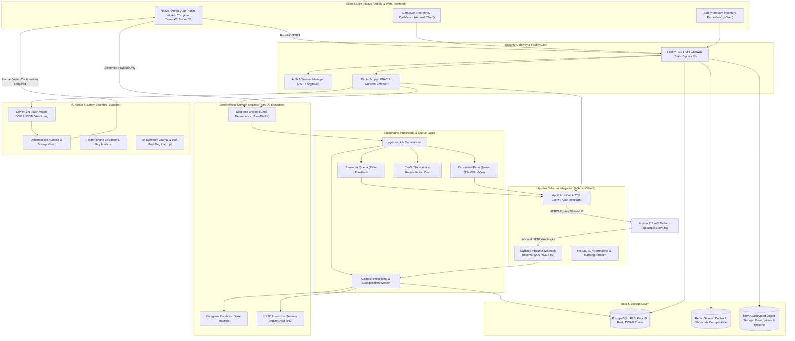
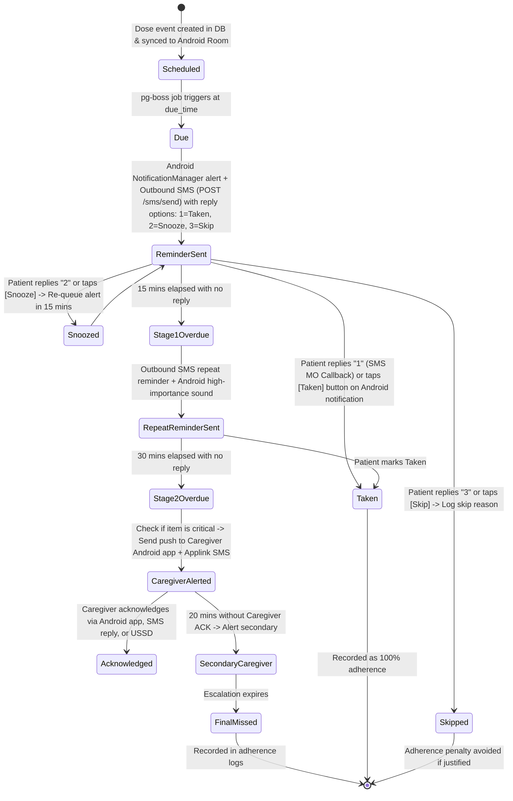
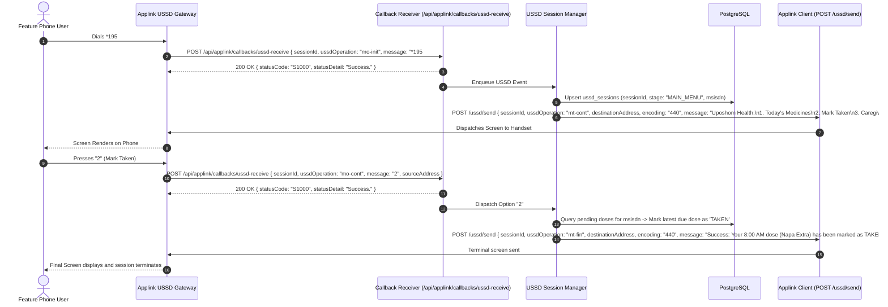
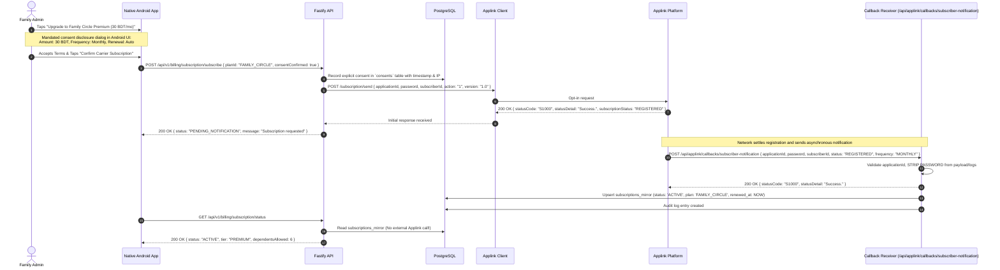
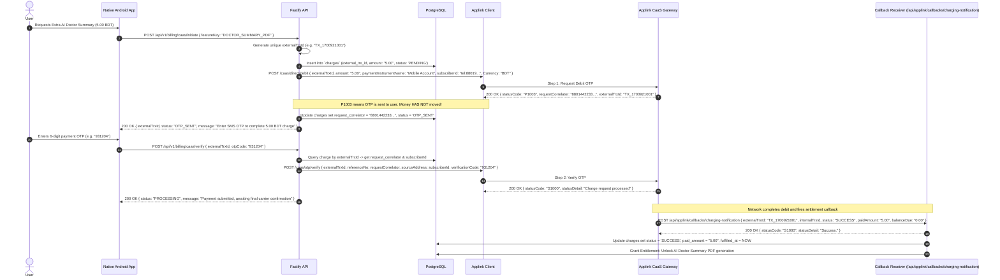
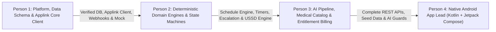
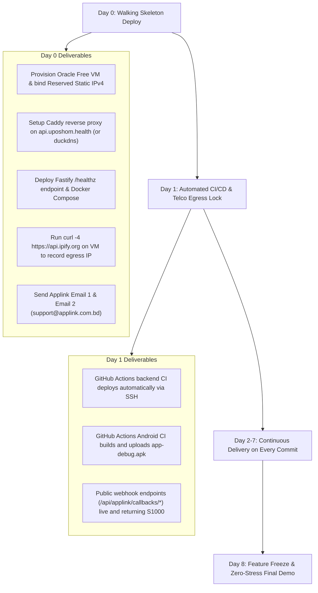

# Uposhom (উপশম): Implementation Plan

Team of 4 · AppQuest 2.0 · 20 to 30 Nov 2026 · Version 2 (Native Android App Architecture)

## 1. Ground rules

- Scope: the full project from the final project doc and PDF specifications, built in priority tiers (section 3). A lower tier never starts until the tier above is demo-ready. If time runs out, cuts follow the drop order in section 11, which is decided now.
- Stack: Native Android App (Kotlin + Jetpack Compose) + Fastify API (TypeScript) + Postgres with pg-boss + Next.js (B2B Pharmacy & Agent-Trace Web Portal). Swap to a Python backend only if the team objects before the end of Day 0.
- Mobile: Native Android App (minSdk 26, targetSdk 34) built in Kotlin and Jetpack Compose. Utilizes CameraX for prescription capture, Room for local offline schedule caching, and Android NotificationManager for rich reminder alerts with actionable notification buttons. A lightweight web dashboard (Next.js) serves B2B pharmacies and admin traces.
- Data: synthetic only (hackathon rule 10c). Disclose every AI tool, third-party service and pre-existing asset (rules 04d, 04e).
- Applink: called from the backend only, from a fixed egress IP, with credentials in environment variables only (never hardcoded, committed, or exposed to the mobile app bundle).
- Demo-ready means: debug APK (`uposhom-v1.0-debug.apk`) installable on Android test devices / emulators and working end-to-end with the deployed backend, uses live Applink APIs on whitelisted numbers, has automated tests wherever it touches dosing or alerts, and has been run once by a teammate who did not build it.
- Early Deployment & Free Hosting: Deploy on Day 0 with a 'Walking Skeleton' rather than waiting for the end. The entire production stack runs on 100% Free Tier infrastructure (Oracle Cloud Always Free VM with a reserved static IPv4 for Applink allow-listing + Vercel + Cloudflare R2 + GitHub Actions).
- Workflow: trunk-based, short branches, automated CI testing on every PR, and continuous CD deployment to the live environment on merge to main.

## 2. Workstreams (assign names today)

- A, Platform and Applink: repo, CI, hosting, Applink client, callbacks, OTP, SMS, USSD, Subscription, CaaS, entitlements, security pass.
- B, Domain and engine: database schema, schedule engine package, reminder and escalation state machine, jobs, adherence, router and agent traces.
- C, AI and data: Gemini intake, explainer, report extraction, generic matching, symptom journaling, voice spike, analytics, and all seed data (drug table, synthetic prescriptions and reports, pharmacies).
- D, Product Mobile & UI: Native Android App (Kotlin, Compose, CameraX, Room, local notification alarms), B2B pharmacy web dashboard, agent-trace dashboard, facts carousel, demo video editing.
- Proposal ownership: P1 to P4 by C, P5 and P6 by A, P7 by D with B on the numbers, P8 diagram by B and D. Everyone reviews P6 against the real flows.

## 3. Scope tiers (the full project)

P0, core loop and Applink (demo-ready by Tue 24 Nov night):

- OTP sign-up and Family Link consent; Family Circle with profiles and roles
- Android CameraX prescription capture, AI extraction, side-by-side visual confirm composable screen, typed-entry fallback
- Deterministic schedule engine; dose log with taken, snooze, skip
- Multi-channel reminders: Android rich push notifications + Applink SMS reminders with reply codes; missed-dose escalation ladder; caregiver acknowledgement
- USSD patient and caregiver menu (*195#)
- Subscription (Family Circle plan) with recorded consent
- Simple Bangla explanation of the confirmed prescription
- Agent-trace dashboard

P1 (demo-ready by Thu 26 Nov night):

- CaaS pay-per-use (scans over quota, report explanation, doctor summary)
- Free and Premium entitlements and quotas
- Diagnostic report vault and Bangla explainer in Android
- Generic drug alternative finder in Android
- Router with SMS free-text Q&A
- Refill and follow-up appointment reminders; weekly caregiver digest; discreet SMS mode
- Android high-importance notification channels; facts carousel composable

P2 (demo-ready by Fri 27 Nov night, time-boxed, seeded data allowed):

- AI-guided symptom journaling with doctor summary PDF (Android voice input + text)
- Bangla voice input via native Android AudioRecord (after the Day 1 spike)
- Sickness-pattern analytics on seeded synthetic history
- Local pharmacy discovery & priority listing in Android; B2B pharmacy web dashboard & pharmacy Subscription

P3 (only if ahead): fasting-day schedule shift, emergency info card via USSD, pharmacy stock toggle by USSD.

Out of scope: iOS native app (Android-first focus for Bangladesh demographic), real pharmacy stock feeds, real patient data, any diagnosis or dose recommendation.

## 4. Architecture

Monorepo (pnpm + Gradle):

- apps/android: Native Android App (Kotlin, Jetpack Compose, CameraX, Room DB, Retrofit/OkHttp, Material 3, bundled Noto Sans Bengali font)
- apps/b2b-web: Next.js Web Portal (Tailwind, React) for pharmacy inventory and agent-trace dashboard
- apps/api: Fastify REST API, Applink callback receiver, auth, authorization
- apps/worker: pg-boss consumers for reminders, escalation, SMS sending, reconciliation, digests
- packages/schedule-engine: pure TypeScript, no I/O, fully unit-tested
- packages/applink-client: typed wrappers, one tel: normaliser, status-code handling
- packages/ai: prompts, JSON schemas, validators, numeric guard
- packages/db: migrations and queries
- data/: seed files (drugs, glossary, tips, pharmacies, synthetic prescriptions)

### 4.1 Monorepo & Project Directory Structure

```text
uposhom/
├── .github/
│   └── workflows/
│       ├── android-ci.yml           # Android lint, unit tests, debug APK artifact build
│       └── backend-ci.yml           # Monorepo lint, TypeScript build, test suite
├── apps/
│   ├── android/                     # Native Android App (Kotlin + Jetpack Compose)
│   │   ├── app/
│   │   │   ├── build.gradle.kts     # Compose, CameraX, Room, Retrofit, Hilt dependencies
│   │   │   ├── proguard-rules.pro
│   │   │   └── src/
│   │   │       ├── main/
│   │   │       │   ├── AndroidManifest.xml # Permissions (CAMERA, POST_NOTIFICATIONS, INTERNET)
│   │   │       │   ├── assets/
│   │   │       │   │   └── fonts/         # Bundled NotoSansBengali-Regular.ttf & Bold.ttf
│   │   │       │   ├── java/com/uposhom/
│   │   │       │   │   ├── UposhomApp.kt  # Application class, notification channels init
│   │   │       │   │   ├── core/
│   │   │       │   │   │   ├── constants/ # API base URLs, channel IDs, SharedPreferences keys
│   │   │       │   │   │   ├── network/   # Retrofit client, Auth token interceptor, Result wrapper
│   │   │       │   │   │   └── util/      # Bangla number converter, date & timezone formatters
│   │   │       │   │   ├── data/
│   │   │       │   │   │   ├── local/     # Room DB (UposhomDatabase), DAOs (DoseDao, ProfileDao)
│   │   │       │   │   │   ├── remote/    # Retrofit API endpoints, request/response DTOs
│   │   │       │   │   │   └── repository/# Repositories (DoseRepository, AuthRepository, PrescriptionRepo)
│   │   │       │   │   ├── di/            # Hilt / Koin dependency injection modules
│   │   │       │   │   ├── domain/        # Domain entities, use cases (GetTodayDoses, MarkDoseAction)
│   │   │       │   │   ├── notifications/ # NotificationHelper, AlarmReceiver, ActionReceiver
│   │   │       │   │   └── ui/
│   │   │       │   │       ├── auth/          # OTP Request & Verify screens (Compose)
│   │   │       │   │       ├── camera/        # CameraX preview, capture & crop composables
│   │   │       │   │       ├── confirm/       # Side-by-side visual confirm composable screen
│   │   │       │   │       ├── dashboard/     # Today's dose timeline, adherence score gauge
│   │   │       │   │       ├── family/        # Family Circle profiles, dependent management
│   │   │       │   │       ├── finder/        # Generic medicine alternative search
│   │   │       │   │       ├── navigation/    # AppNavigation, NavRoutes
│   │   │       │   │       ├── reports/       # Lab report vault & Bangla explainer
│   │   │       │   │       ├── symptoms/      # Symptom journaling & 999 red-flag dialog
│   │   │       │   │       └── theme/         # Material 3 Color, Type (Noto Sans Bengali), Theme
│   │   │       │   └── res/
│   │   │       │       ├── drawable/          # Vector icons, splash screen
│   │   │       │       ├── values/            # strings.xml (Bangla strings), colors.xml
│   │   │       │       └── xml/               # file_paths.xml for CameraX FileProvider
│   │   │       └── test/                      # Android unit tests (ViewModel, Repository, Room)
│   │   ├── build.gradle.kts                   # Project-level Gradle build configuration
│   │   ├── gradle/
│   │   │   └── wrapper/
│   │   └── settings.gradle.kts
│   │
│   ├── api/                         # Fastify Core REST Gateway (Node.js/TypeScript)
│   │   ├── src/
│   │   │   ├── config/              # Env validation, Applink credentials, static IP check
│   │   │   ├── middleware/          # JWT auth, circle-scoped RBAC, rate-limiter, CORS
│   │   │   ├── plugins/             # Fastify Swagger, Multipart, Postgres/Redis connectors
│   │   │   ├── routes/
│   │   │   │   ├── auth.ts          # /api/v1/auth (OTP request, verify, JWT issuance)
│   │   │   │   ├── prescriptions.ts # /api/v1/prescriptions (upload, OCR parse, confirm)
│   │   │   │   ├── doses.ts         # /api/v1/doses (today's schedule, taken/snooze/skip action)
│   │   │   │   ├── billing.ts       # /api/v1/billing (CaaS micro-charge, Subscription)
│   │   │   │   ├── reports.ts       # /api/v1/reports (lab report upload & flag analysis)
│   │   │   │   ├── symptoms.ts      # /api/v1/symptoms (symptom journal, 999 red flag)
│   │   │   │   ├── generics.ts      # /api/v1/drugs/generics (bioequivalent matching)
│   │   │   │   ├── pharmacies.ts    # /api/v1/pharmacies (geolocation & stock lookup)
│   │   │   │   └── callbacks/       # Applink Inbound Webhook Handlers
│   │   │   │       ├── sms-receive.ts             # Inbound MO reply processor
│   │   │   │       ├── sms-delivery.ts            # DLR delivery receipts
│   │   │   │       ├── ussd-receive.ts            # Interactive USSD session processor
│   │   │   │       ├── subscriber-notify.ts       # Subscription lifecycle events (password stripped)
│   │   │   │       └── charging-notify.ts         # CaaS transaction settlement
│   │   │   ├── services/            # Business logic services bridging routes & DB
│   │   │   └── index.ts             # Fastify server bootstrap & graceful shutdown
│   │   ├── package.json
│   │   └── tsconfig.json
│   │
│   ├── worker/                      # Asynchronous Background Processor (pg-boss)
│   │   ├── src/
│   │   │   ├── queues/              # Queue names and job payload schemas
│   │   │   ├── jobs/
│   │   │   │   ├── reminder-job.ts         # Dispatches due medication SMS alerts
│   │   │   │   ├── escalation-job.ts       # 15m/30m/50m Caregiver escalation state machine
│   │   │   │   ├── ussd-worker.ts          # Asynchronous USSD screen dispatcher
│   │   │   │   ├── reconciliation-cron.ts  # Daily CaaS P1003 & Subscription reconciliation
│   │   │   │   └── digest-job.ts           # Weekly caregiver adherence summaries
│   │   │   └── index.ts             # pg-boss worker supervisor
│   │   ├── package.json
│   │   └── tsconfig.json
│   │
│   └── b2b-web/                     # Next.js Web Portal (Tailwind + React)
│       ├── src/
│       │   ├── app/
│       │   │   ├── layout.tsx
│       │   │   ├── page.tsx
│       │   │   ├── pharmacy/        # Pharmacy stock inventory management & subscription
│       │   │   ├── caregiver/       # Web-based Caregiver monitoring dashboard
│       │   │   └── admin/traces/    # Live Agent-Trace and Applink telco logs visualizer
│       │   ├── components/          # Reusable UI widgets, stock toggles, trace tables
│       │   └── lib/                 # API client, session helpers
│       ├── package.json
│       └── next.config.mjs
│
├── packages/
│   ├── schedule-engine/             # Pure TypeScript Deterministic Dosing Arithmetic
│   │   ├── src/
│   │   │   ├── parser.ts            # Latin/Bangla 1+0+1, OD, BD, TDS, AC/PC grammar
│   │   │   ├── anchors.ts           # Profile meal offsets in Asia/Dhaka time
│   │   │   ├── generator.ts         # Generates immutable dose_events array
│   │   │   └── types.ts             # PrescribedItem, DoseEvent, AnchorTimes
│   │   ├── test/                    # 100% branch coverage unit tests on 30 prescriptions
│   │   ├── package.json
│   │   └── tsconfig.json
│   │
│   ├── applink-client/              # Type-Safe Applink CPaaS Platform Client
│   │   ├── src/
│   │   │   ├── client.ts            # Unified post() with fixed IP egress & credential injection
│   │   │   ├── normalizer.ts        # Single tel: normalizer & masking handler
│   │   │   ├── services/
│   │   │   │   ├── sms.ts           # POST /sms/send wrapper
│   │   │   │   ├── ussd.ts          # POST /ussd/send wrapper (encoding 440, mt-cont/mt-fin)
│   │   │   │   ├── subscription.ts  # POST /subscription/send & query-base
│   │   │   │   ├── otp.ts           # POST /otp/request & /otp/verify
│   │   │   │   └── caas.ts          # POST /caas/direct/debit & /caas/otp/verify (BDT decimal)
│   │   │   ├── status-codes.ts      # Published status code enumerations & error mappers
│   │   │   └── types.ts             # Request & Response TypeScript interfaces
│   │   ├── package.json
│   │   └── tsconfig.json
│   │
│   ├── ai/                          # AI Pipeline & Deterministic Safety Guards
│   │   ├── src/
│   │   │   ├── gemini.ts            # Gemini 2.5 Flash Vision OCR structured extraction
│   │   │   ├── numeric-guard.ts     # Deterministic sanity guard (rejects dosage hallucinations)
│   │   │   ├── report-vault.ts      # Lab report metric extractor & printed range comparator
│   │   │   ├── symptom-guard.ts     # Immediate 999 red-flag emergency detector
│   │   │   └── explainer.ts         # Bangla clinical language simplifier
│   │   ├── package.json
│   │   └── tsconfig.json
│   │
│   └── db/                          # Database Schemas, Migrations & Queries
│       ├── migrations/              # SQL migration files (0001_init.sql ... )
│       ├── src/
│       │   ├── schema/              # Table definitions (users, prescriptions, doses, charges...)
│       │   ├── queries/             # Scoped database query helpers
│       │   └── client.ts            # pg pool configuration
│       ├── package.json
│       └── tsconfig.json
│
├── data/                            # Curated & Synthetic Seed Data
│   ├── dgda-drugs.json              # 150 verified DGDA generics, brand equivalents & prices
│   ├── pharmacies.json              # 10 partner pharmacies with mock coordinates
│   ├── glossary.json                # 40 common lab tests with lay-Bangla explanations
│   ├── health-tips.json             # Rotating health advice for facts carousel
│   └── synthetic-prescriptions/     # 30 test prescriptions (printed + handwritten)
│
├── scripts/                         # DevOps, Testing & Mock Utilities
│   ├── mock-applink.mjs             # Zero-dependency local Applink CPaaS simulation server
│   ├── replay-callbacks.mjs         # Test harness simulating telco callbacks (SMS, USSD, CaaS)
│   └── seed-db.ts                   # Populates PostgreSQL with synthetic seed data
│
├── deploy/                          # Deployment & Container Configuration
│   ├── docker-compose.yml           # Postgres 16, Redis 7, Fastify API, Worker
│   ├── Dockerfile.api
│   ├── Dockerfile.worker
│   └── Caddyfile                    # Automatic HTTPS & reverse proxy
│
├── .env.example                     # Placeholder-only environment template (no real secrets!)
├── pnpm-workspace.yaml              # Monorepo workspace configuration
├── package.json                     # Root scripts (build, test, lint, dev)
└── README.md
```

Runtime (100% Free-Tier Architecture):

- Compute & Static IP: Oracle Cloud Always Free VM (Arm Ampere A1 with up to 4 OCPUs, 24GB RAM or AMD E2.1 Micro) provides a permanent reserved static IPv4 at $0 cost forever, fulfilling Applink's mandatory IP allow-listing and public HTTPS callback requirements. Runs Fastify API, pg-boss worker, and PostgreSQL 16 in Docker Compose with Caddy v2 for automatic Let's Encrypt SSL.
- Early Deployment: The live environment is provisioned and deployed on Day 0 ('Walking Skeleton'). We do not wait for the final days. Every git push to main automatically tests and redeploys via GitHub Actions CI/CD.
- Web & Portal: The B2B web app (`apps/b2b-web`) deploys automatically on Vercel's Free Hobby Tier.
- Storage: Cloudflare R2 Free Tier (10 GB storage, $0 egress fees) or Supabase Storage Free Tier for HIPAA-compliant encrypted prescriptions and diagnostic scans.
- Android APK: Built automatically on every push by GitHub Actions (free 2,000 CI minutes/month), producing a downloadable debug APK link immediately for the team and judges.
- Observability: UptimeRobot free 5-minute HTTP monitor on `/healthz`, structured JSON logs (no message bodies or OTPs), and Slack/Discord webhooks for Applink error alerting.
- Backups: Nightly automated script runs `pg_dump` and uploads an encrypted backup to Cloudflare R2.

## 5. Data model (key tables)

- users, family\_circles, profiles (meal times, quiet hours, allergies, optional own phone), links (user, profile, role admin/caregiver/viewer, OTP-verified time, consent evidence)
- prescriptions (status draft or confirmed, confirmed by and when, image path), prescription\_items (raw name, drug id, strength, form, raw pattern, parsed pattern, meal relation, duration, as-needed flag, critical flag set by a human, per-field confidence)
- dose\_events (due time, state, stage, idempotency key), dose\_logs (action, channel, reason, time), escalations (stage, notified user, acknowledged time)
- reports, report\_values (test, value, unit, printed range, flag); symptom\_logs (structured JSON, red-flag boolean)
- drug\_generics, drug\_brands (generic id, strength, form, indicative price, source, verified flag), drug\_info (curated Bangla summary, storage, warnings), glossary, tips
- pharmacies, pharmacy\_stock
- consents (kind, amount, currency, frequency, evidence, time), subscriptions\_mirror (status, plan, updated by notification), charges (external\_trx\_id primary key, purpose, amount, status, request\_correlator, paid\_amount, balance\_due)
- sms\_log (no bodies), ussd\_sessions, callback\_dedupe, agent\_traces, audit\_log

Rules: every query is scoped by circle membership; phone numbers are encrypted at rest; a delete-my-data endpoint exists; the audit log records every read of a medical record by a non-owner.

## 6. Safety-critical core

Schedule engine (owner B, written first, tested hardest):

- Input: confirmed prescription items. Output: dose events in Asia/Dhaka time.
- Parses a+b+c and a-b-c patterns in Latin or Bangla digits, fractions like ½, and the abbreviations OD, BD/BID, TDS/TID, QID, HS, SOS/PRN, AC, PC and STAT. Examples from the doc: 1+0+1 BDPC and TID.
- Pattern slots map to the profile's anchors: three slots to morning, noon and night; four slots add evening. Before-meal and after-meal offsets are editable defaults. The table of defaults and abbreviations gets reviewed by a pharmacist or doctor (a mentor or relative) before the feature freeze.
- Anything ambiguous, conflicting or low confidence becomes needs-manual-input. The engine never guesses.
- Durations count days from a start date, then the course auto-completes. A pill count gives a refill date.
- Tests: table-driven cases from 30 synthetic prescriptions, property tests (event count equals doses per day times days, times are ordered, no duplicates), and 100% branch coverage for this package.

Escalation ladder (state machine in code, timers on pg-boss):

1. Dose due: Android NotificationManager triggers high-priority alert on the device + Applink SMS to the patient with reply codes 1 taken, 2 snooze, 3 skip (Latin or Bangla digits).
2. After 15 minutes without an action: one repeat SMS + local alarm.
3. After 30 minutes: caregiver alert via push and SMS, only for items a human flagged critical. Non-critical misses go to the next digest.
4. The caregiver acknowledges via Android app, SMS reply, or USSD. After 20 more minutes without acknowledgement, the secondary caregiver is alerted.
5. The dose is logged as missed and feeds adherence.

Defaults live in config. Every stage has an idempotency key, so no message sends twice, even after a restart.

## 7. AI pipeline

Principle: AI reads and explains, code decides. No model output sets a dose, time or schedule.

- Intake (C): the Android app compresses the photo via CameraX. Gemini Flash vision returns JSON by schema with per-field confidence. Validators then run: brand match with fuzzy search (pg\_trgm), the pattern parser, unit and range sanity. The Android confirm screen shows the photo beside the fields, highlights low confidence, and allows edit, add and remove. Nothing is scheduled before a human confirms. Typed entry with autocomplete is the fallback.
- Explainer: simple Bangla from a curated drug\_info table. It must not give dose advice or diagnoses. A numeric guard rejects any output containing a number that is not in the confirmed data, and falls back to a template.
- Report vault: Gemini vision (Tesseract for printed reports as fallback) extracts values, units and the range printed on the report. The flag is a plain comparison against that printed range, not our own reference table. Terms are explained from a glossary of about 40 common tests, always ending with a pointer to the doctor.
- Generic finder: same active ingredient, strength and form, sorted by indicative price, with a note that a doctor or pharmacist confirms any substitution. Do not claim bioequivalence or government approval unless the row has a verified source.
- Symptom journaling: a slot-filling conversation of at most six questions (onset, duration, severity, triggers, associated symptoms, current medicines), then a structured summary and PDF. A rule-based red-flag check (chest pain, trouble breathing, severe bleeding, unconsciousness, stroke signs) interrupts with a seek-emergency-care message and the national emergency number 999. Statements about self-harm get a supportive message with crisis contacts the team verifies before freeze. No diagnosis, no prescribing.
- Voice: a Day 1 spike comparing Whisper (API) and Gemini audio on 10 Bangla recordings. The Android app records audio via MediaRecorder. The transcript is shown and editable before anything is saved or acted on.
- Sickness-pattern analytics: aggregates (counts by month and symptom category) are computed in SQL, a minimum record count is required, and the model only phrases the summary. Tips are chosen from a curated library. Demo on labelled synthetic history.
- Router (B): rules first. Reply codes and USSD selections never reach an LLM. Free-text SMS and voice go to an LLM with a fixed tool list: get\_next\_dose, list\_today, log\_dose, explain\_item, find\_generic, add\_symptom, notify\_caregiver. Only log\_dose and add\_symptom write. Nothing can create or change a schedule except the confirm endpoint. Every step is written to agent\_traces, which feeds the dashboard and the Page 8 diagram.
- Treat prescription and report text as untrusted input: model outputs are schema-bound JSON only, never executed instructions.
- Cache outputs for the demo prescriptions and rate-limit calls, so free-tier quotas cannot break the demo.

## 8. Applink integration (owner A)

Setup, Day 0:

- Confirm both approvals landed and the credentials work. Keep credentials in environment variables.
- Install Applink-as-a-Skill in your coding tool (/plugin marketplace add hSenidMobileCPaaS/Applink-as-a-Skill, then /plugin install applink@applink). Use its CLI (for example node tools/applink.mjs show ussd-receive) to read exact request contracts. Never write parameter names from memory. Every request value is a JSON string.
- Run the local mock server and the callback test script against our handlers.
- Confirm the production egress IP on the server (curl -4 https://api.ipify.org) and add it to the app's allowed host addresses. Register all five callback URLs. Whitelist the four team phones plus two or three family phones for Limited Production testing. Confirm the inbound SMS shortcode and keyword.

Rules that apply everywhere:

- Branch on statusCode, never on HTTP 200. P1003 on CaaS means the OTP was sent, not that anyone paid. Use only the published status codes.
- One tel: normaliser; destination addresses are always arrays; explicit timeouts.
- Send everything through the queue and throttle for the per-second (E1318) and per-day (E1319) limits.
- Callbacks: acknowledge first (HTTP 200 with S1000), queue, process out of band, dedupe on the documented key, validate the body, restrict by Applink source IP, always return 200. Strip the password from the subscriber notification before anything is logged.
- Logs hold identifiers only: no message bodies, OTPs or unmasked subscriber ids.

By API:

- OTP: Applink is not a login API. OTP calls are transactions that cost money and count against rate limits. We issue our own sessions. OTP is used for first sign-up, account recovery, Family Link consent (the dependent's number verifies), step-up before editing or deleting a schedule or sharing a report, and pharmacy owner onboarding. Never on page load or on every login.
- SMS: reminders, caregiver alerts, refill and appointment reminders, the weekly digest, SMS Q&A. Delivery reports update dose\_events. STOP and opt-out work in every channel and are honoured immediately, including queued messages. Bangla SMS is Unicode, about 70 characters per segment, so templates stay under one segment where possible. Discreet mode sends a generic time-for-your-medicine text with no drug names. If one number serves several profiles, the message carries a short profile tag so replies match the right dose. The free tier has an SMS quota from config.
- USSD: patient menu (today's medicines, mark taken, next appointment, I need help which alerts the caregiver) and caregiver menu (acknowledge alert, adherence snapshot). The callback response is only an acknowledgement. The screen comes from a separate send call, the sessionId is echoed, and flows end with mt-fin. Session state lives in Postgres. Keep screens short, because sessions time out in seconds.
- Subscription: the Family Circle plan and the pharmacy plan. Record explicit consent with evidence before Register, after disclosing amount, currency and frequency. Decide from subscriptionStatus in the response. Entitlements read only the local mirror fed by the subscriber notification. No Applink call on any login or page-load path. Opt-out is available on the Android app, SMS, and USSD.
- CaaS: two calls then a callback. /caas/direct/debit sends the OTP (P1003), /caas/otp/verify moves the money, and the charging notification reports paidAmount and balanceDue. Persist externalTrxId and requestCorrelator, never re-run generation to retry a verification, fulfil only when the notification shows full payment, and run a reconciliation job for charges stuck at P1003 or timed out. Amounts are decimal BDT strings. Fulfilment is idempotent on externalTrxId.
- Test matrix: duplicate callbacks, partial payment, E1313, E1303, E1326, E1850, E1851 and timeouts, all tested from the production IP.
- Open question for the 24 Nov mentoring: which numbers can be billed or messaged. Assume premium billing needs a Banglalink number, so other users stay on the free tier until confirmed.

## 9. Business plumbing

- Free: one profile, a monthly scan quota, capped SMS reminders, basic report storage, view-only generic finder. Premium Family Circle: up to 6 dependents, priority SMS queue, caregiver escalation, unlimited storage, analytics, doctor summaries. Caps are config values decided on Day 5 with the mentor.
- Free-tier SMS has a real cost, so quotas and CaaS pay-per-use must show up in the 6-month plan on Page 7.
- Pharmacy tier: the owner onboards with OTP, subscribes through the same Subscription flow, and manages stock in a dashboard. Search ranks priority pharmacies first, then by distance, with a visible Partner label. Promoted generics appear only if they match ingredient, strength and form.
- Seed data: 8 to 10 demo pharmacies and about 150 common drugs. Check what the Directorate General of Drug Administration publishes before assembling the drug table, hand-verify every row, store the source, and label prices indicative.

## 10. Day-by-day plan

Fri 20 Nov, Day 0 (Day 0 Live Deployment & Walking Skeleton)

- All: lock stack and roles, create the monorepo, configure GitHub Actions CI/CD workflows for backend and Android.
- A: provision Oracle Cloud Always Free VM, reserve static IPv4, configure Caddy HTTPS domain, deploy Day 0 "Walking Skeleton" Fastify API responding to `/healthz`, install Applink skill, run mock, send Applink IP approval email (`support@applink.com.bd`).
- B: schema, schedule-engine skeleton, parser grammar and test harness.
- C: 15 synthetic prescriptions (printed and handwritten style) and 5 lab reports; Gemini intake prompt v0; start the drug table.
- D: Android project skeleton (Gradle, Kotlin, Jetpack Compose, Material 3, Noto Sans Bengali typography), API client setup with Retrofit, first automated APK build in GitHub Actions (`uposhom-v0.1-skeleton.apk`), auth and Family Circle composables.

Sat 21 Nov, Day 1

- A: applink-client, callback receiver, OTP sign-up working on the mock.
- B: parser and engine v1 with tests, migrations.
- C: intake to JSON plus validators; one-hour voice spike.
- D: CameraX prescription capture flow, side-by-side visual confirm composable screen, profile management.

Sun 22 Nov, Day 2

- A: SMS send and receive through the queue; USSD skeleton.
- B: pg-boss jobs, reminder state machine, escalation.
- C: explainer with numeric guard; brand matching.
- D: Android medication schedule view, dose log composables, local notification channels with action buttons (Taken/Snooze/Skip), caregiver view.

Mon 23 Nov, Day 3

- Integration day: prescription to confirm to schedule to SMS to reply to escalation, on the mock. First live SMS to a whitelisted number. A drafts the Subscription consent screens.

Tue 24 Nov, Day 4 (submission portal opens, mentoring starts)

- A: live OTP, USSD, Subscription. B: adherence, snooze and skip, course end, refill dates. C: report extraction. D: agent-trace dashboard & B2B pharmacy web dashboard.
- Book mentor sessions for Applink integration and business model.
- Evening: P0 demo-ready checkpoint. Record a rough full run as insurance.

Wed 25 Nov, Day 5

- A: CaaS flow, charging notification, reconciliation, entitlements. B: router and traces. C: report explainer and generic finder. D: generic medicine finder and report vault UI in Android, facts carousel composable.

Thu 26 Nov, Day 6

- P1 completion: Android local notifications & AlarmManager fallback, discreet SMS, digest, refill reminders, appointment reminders. Proposal full draft (all 8 pages). P1 demo-ready at night. C starts symptom journaling.

Fri 27 Nov, Day 7

- C: journaling, voice, seeded analytics. D: pharmacy search in Android and B2B web dashboard. A: pharmacy Subscription. B: hardening, load test of the reminder queue, test coverage gaps.

Sat 28 Nov, Day 8

- Feature freeze at 6 PM. Bug bash with fresh eyes, security pass (secret scan, PII in logs, access checks), seed-data reset script, final deploy, and signed debug APK (`uposhom-v1.0-debug.apk`) generated.

Sun 29 Nov, Day 9

- Record the demo video (2 minutes, English, shows Applink working on Android device and live feature phone). Final proposal PDF with the Page 8 diagram. Submit a complete entry that night.

Mon 30 Nov, Day 10

- Buffer. Fixes only. Resubmit if needed. Finish before evening, not at 11:59 PM, because only the latest entry before the deadline counts.

If classes cut hours on weekdays, items move down the drop order below, never the other way.

## 11. Risks and drop order

Drop order if time runs short (cut first to last):

1. P3 items
2. Sickness-pattern analytics (keep as proposal roadmap)
3. Voice input
4. Pharmacy priority listing and dashboard (keep the revenue model and one seeded pharmacy)
5. Symptom journaling
6. Push notifications (fall back to SMS alone)

Never cut: the Android confirm screen, the engine tests, the escalation ladder, and live OTP, SMS, USSD, Subscription and CaaS.

Risks:

- Gemini free-tier quotas or data terms: cache demo outputs, rate-limit, synthetic data only, manual fallback.
- Applink approval or IP problems: mock mode keeps work moving; escalate early via dev.applink.com.bd/contact or +880 1959 97 93 76.
- Handwriting accuracy: present the confirm screen as deliberate safety design and never quote an accuracy figure.
- Hosting that sleeps: use the always-on VPS.
- Scope creep: the tier rule and the freeze date.
- Drug data quality and sourcing: seed small, verify by hand, cite sources.
- Claims in the proposal: no HIPAA claim, no bioequivalence claim, no diagnosis claim.

## 12. Demo script (2 minutes)

1. 0:00 to 0:15, the problem and the caregiver and patient split.
2. 0:15 to 0:45, snap a prescription in the Native Android App via CameraX, side-by-side confirm screen, schedule appears, Bangla explanation.
3. 0:45 to 1:10, a reminder alert triggers on Android + SMS arrives on a real phone and the reply is 1; then a missed critical dose triggers the caregiver SMS and a USSD acknowledgement.
4. 1:10 to 1:30, the feature-phone USSD menu.
5. 1:30 to 1:50, OTP link in Android app, Subscription consent, CaaS pay-per-use, generic finder.
6. 1:50 to 2:00, the architecture and safety diagram.

## 13. Submission and after

- Proposal pages: P1 name, team, track; P2 executive summary; P3 problem; P4 solution; P5 technical implementation and safety pipeline; P6 all five Applink flows; P7 revenue model, 6-month plan, promotion plan; P8 orchestration and handoff diagram with a trace screenshot.
- Also required: an accessible GitHub repo with Android source code and backend, the demo video and the submission form. Optional but encouraged: a deployed URL for the B2B web portal and downloadable debug APK. Keep the repo, URL and video accessible until the end of the finale.
- Declare earlier code and assets, and list all AI tools used. Declare Theme 2, category 04 (Healthcare, MedTech and Longevity).
- If shortlisted on 5 Dec: use the 6 to 16 Dec sprint to apply jury feedback and run the Applink go-live checklist (node tools/applink.mjs checklist) against the real project, with live APIs, from the production IP. Two or more members must attend the finale in person.


---

# PART II: DETAILED SYSTEM DESIGN, APPLINK API CONTRACTS & 4-PERSON RELAY PLAN

## 14. High-Level Architecture & Component Blueprint



---

## 15. Complete End-to-End Execution Flows

### 15.1 Flow 1: Auth & Family Circle Onboarding (Applink OTP)
Applink is **never used as a general login API**. OTP is strictly transactional: used for first-time account registration, step-up verification, and dependent family linking consent. Subsequent requests use our own stateless JWTs.

```mermaid
sequenceDiagram
    autonumber
    actor User as Family Admin / Patient
    participant App as Native Android App (Kotlin)
    participant API as Fastify API
    participant DB as PostgreSQL
    participant Applink as Applink Platform (api.applink.com.bd)

    User->>App: Enter Mobile Number (e.g. 01973579363)
    App->>API: POST /api/v1/auth/otp/request { msisdn }
    API->>API: Normalize to tel:8801973579363
    API->>Applink: POST /otp/request { applicationId, password, subscriberId, applicationHash }
    Applink-->>API: 200 OK { statusCode: "S1000", statusDetail: "Success." }
    API-->>App: 200 OK { success: true, message: "OTP dispatched via SMS" }
    
    Note over User,Applink: User receives telco SMS with 6-digit OTP
    User->>App: Enter OTP code (e.g. "482910")
    App->>API: POST /api/v1/auth/otp/verify { msisdn, code }
    API->>Applink: POST /otp/verify { applicationId, password, subscriberId, offlineHandshakeCode }
    Applink-->>API: 200 OK { statusCode: "S1000", statusDetail: "Success." }
    
    API->>DB: Upsert users & family_circles (Set phone_verified = true)
    API->>API: Generate Uposhom Session JWT (claims: userId, circleId, role: ADMIN)
    API-->>App: 200 OK { token, user, circle }
    App->>App: Store JWT in EncryptedSharedPreferences; seed Room cache
```

---

### 15.2 Flow 2: Prescription Ingestion, AI Structuring & Visual Confirmation
AI models extract information, but **100% of dosing calculations are delegated to the deterministic Schedule Engine** only *after* human visual confirmation.

```mermaid
sequenceDiagram
    autonumber
    actor User as Patient / Caregiver
    participant App as Native Android App (CameraX)
    participant API as Fastify API
    participant AI as Gemini 2.5 Flash
    participant Guard as Deterministic Numeric Guard
    participant Engine as Schedule Engine (packages/schedule-engine)
    participant DB as PostgreSQL

    User->>App: Tap "Scan Prescription" (CameraX active preview)
    User->>App: Capture photo
    App->>App: On-device auto-crop & WebP compression (max 1600px)
    App->>API: POST /api/v1/prescriptions/upload-and-parse (multipart/form-data)
    API->>DB: Store raw image in Encrypted S3; insert prescription (status: 'DRAFT')
    API->>AI: Gemini Vision (schema-constrained JSON extraction)
    AI-->>API: Structured JSON: [{ raw_name, dosage, pattern: "1+0+1", meal: "PC", duration_days: 7 }]
    API->>Guard: Validate numeric bounds, match drug with DGDA generics table
    Guard-->>API: Sanitized draft items with per-field confidence scores
    API-->>App: 200 OK { draftPrescriptionId, items, visualReviewRequired: true }

    Note over User,App: Side-by-side Visual Confirmation Screen in Jetpack Compose.<br/>User reviews OCR highlights and taps 'Confirm'.
    User->>App: Edits if needed & taps "Confirm Prescription"
    App->>API: POST /api/v1/prescriptions/:id/confirm { items, profileId }
    API->>Engine: GenerateSchedule(items, profileAnchorTimes, Asia/Dhaka)
    Engine->>Engine: Parse 1+0+1 BDPC -> 08:00 AM (PC) & 08:00 PM (PC)
    Engine-->>API: Generated Dose Events List (ordered chronologically)
    API->>DB: Transaction: Update prescription ('CONFIRMED') + Bulk insert dose_events
    API-->>App: 201 Created { scheduleSummary, totalDosesScheduled }
    App->>App: Sync dose_events into Room DB; register local notification alarms
```

---

### 15.3 Flow 3: Automated SMS Reminder & Caregiver Escalation State Machine
Handles dose alerts, replies (1 taken, 2 snooze, 3 skip), and multi-stage escalation via `pg-boss`.



---

### 15.4 Flow 4: Interactive USSD Session (*195#)
Features-phone support for patients and rural caregivers using Applink USSD APIs.



---

### 15.5 Flow 5: Premium Subscription Lifecycle (Family Circle Plan)
Recurring carrier micro-billing (e.g. 30 BDT / month) for up to 6 family members.



---

### 15.6 Flow 6: Pay-Per-Use Micro-Charging (CaaS Two-Step OTP Flow)
When a free user exceeds their scan quota, or requests an AI Doctor Summary PDF, CaaS charges 5.00 BDT via carrier airtime debit.



---

## 16. Detailed API Endpoint Specifications

All endpoints adhere strictly to the Applink contract and Fastify API standards.

### 16.1 Applink Inbound Webhook Callbacks (Publicly Registered on VPS)
> [!IMPORTANT]
> - Always return HTTP 200 with `{ "statusCode": "S1000", "statusDetail": "Success." }` immediately to prevent telco gateway retries and timeouts.
> - Strip `password` from the incoming payload **before** any logging occurs.
> - Process payloads asynchronously using `pg-boss`.

---

#### `POST /api/applink/callbacks/sms-receive`
Fires when a subscriber sends an SMS to the Applink shortcode.
- **Headers**: `Content-Type: application/json;charset=utf-8`
- **Request Body Contract**:
```json
{
  "version": "1.0",
  "message": "UPOSHOM 1",
  "requestId": "901901031657410001",
  "encoding": "440",
  "sourceAddress": "tel:8801973579363"
}
```
- **Response**:
```json
{
  "statusCode": "S1000",
  "statusDetail": "Success."
}
```
- **Async Action**:
  - Parse keyword and payload: `UPOSHOM 1` -> command code `1` (Dose Taken).
  - Find matching active `dose_event` for `tel:8801973579363` where status is `REMINDER_SENT`.
  - Transition dose state to `TAKEN`, record `dose_logs`, cancel pending escalation jobs.
  - Dispatch confirmation MT SMS: `"Thank you. Your dose has been recorded as taken."`

---

#### `POST /api/applink/callbacks/sms-delivery`
Delivery status report (DLR) for dispatched medication reminders.
- **Request Body Contract**:
```json
{
  "version": "1.0",
  "requestId": "101901031657410007",
  "deliveryStatus": "DELIVERED",
  "destinationAddress": "tel:8801973579363",
  "timeStamp": "2026-11-20T19:30:00Z"
}
```
- **Response**:
```json
{
  "statusCode": "S1000",
  "statusDetail": "Success."
}
```
- **Async Action**:
  - Look up message in `sms_log` using `requestId`.
  - Update `delivery_status = 'DELIVERED'`, record latency. If `FAILED`, trigger fallback channel (Caregiver notify).

---

#### `POST /api/applink/callbacks/ussd-receive`
Fires when user dials the USSD code or responds to a menu prompt.
- **Request Body Contract**:
```json
{
  "version": "1.0",
  "sessionId": "1330929317043",
  "message": "1",
  "ussdOperation": "mo-cont",
  "sourceAddress": "tel:8801973579363",
  "encoding": "440"
}
```
- **Response**:
```json
{
  "statusCode": "S1000",
  "statusDetail": "Success."
}
```
- **Async Action**:
  - Load session from `ussd_sessions` table by `sessionId`.
  - If `ussdOperation == "mo-init"`, initialize menu and send root screen via `POST /ussd/send` (`mt-cont`).
  - If `ussdOperation == "mo-cont"`, dispatch based on current state (e.g. `1` -> List Medicines).
  - If terminal step, send final message with `ussdOperation: "mt-fin"` to end session cleanly.

---

#### `POST /api/applink/callbacks/subscriber-notification`
Fires when user subscribes, unsubscribes (e.g. texts STOP), or auto-renews.
- **Request Body Contract**:
```json
{
  "version": "1.0",
  "applicationId": "APP_000375",
  "password": "PLAINTEXT_SECRET_STRIPPED_BEFORE_LOGGING",
  "subscriberId": "tel:8801973579363",
  "status": "REGISTERED",
  "frequency": "MONTHLY",
  "timeStamp": "2026-11-20T19:00:00Z"
}
```
- **Response**:
```json
{
  "statusCode": "S1000",
  "statusDetail": "Success."
}
```
- **Async Action**:
  - Verify `applicationId` matches server config.
  - Strip `password` immediately before logging.
  - Update `subscriptions_mirror` table: `status = status == 'REGISTERED' ? 'ACTIVE' : 'INACTIVE'`.
  - Update family circle quotas accordingly.

---

#### `POST /api/applink/callbacks/charging-notification`
Final settlement callback for CaaS pay-per-use debits.
- **Request Body Contract**:
```json
{
  "version": "1.0",
  "externalTrxId": "TX_1700921001",
  "internalTrxId": "9110808020001876",
  "status": "SUCCESS",
  "paidAmount": "5.00",
  "balanceDue": "0.00",
  "subscriberId": "tel:8801973579363",
  "timeStamp": "2026-11-20T19:15:30Z"
}
```
- **Response**:
```json
{
  "statusCode": "S1000",
  "statusDetail": "Success."
}
```
- **Async Action**:
  - Deduplicate on `externalTrxId`.
  - Check `status == "SUCCESS"` and `paidAmount == expectedAmount`.
  - Mark charge row in `charges` as `SUCCESS`.
  - Release feature lock (e.g. generate requested AI Doctor Summary PDF).

---

### 16.2 Outbound Applink Client Services (Backend -> api.applink.com.bd)
The core helper `post(path, body)` injects credentials and validates string types:

```typescript
// Universal request wrapper enforces:
// 1. Fixed egress IP host call
// 2. String values only
// 3. tel: normalizer
// 4. Branching on statusCode (never HTTP 200)
```

| Service | Method & Path | Mandatory Payload | Expected Success Code |
| :--- | :--- | :--- | :--- |
| **Send SMS** | `POST /sms/send` | `{ applicationId, password, version: "1.0", message, destinationAddresses: ["tel:880..."], deliveryStatusRequest: "1" }` | `S1000` |
| **Send USSD Screen** | `POST /ussd/send` | `{ version: "1.0", applicationId, password, sessionId, ussdOperation: ("mt-cont"\|"mt-fin"), destinationAddress: "tel:880...", message, encoding: "440" }` | `S1000` |
| **Register Sub** | `POST /subscription/send` | `{ applicationId, password, subscriberId: "tel:880...", action: "1", version: "1.0" }` | `S1000` (`subscriptionStatus` checked) |
| **Unregister Sub** | `POST /subscription/send` | `{ applicationId, password, subscriberId: "tel:880...", action: "0", version: "1.0" }` | `S1000` |
| **Sub Charging Info** | `POST /subscription/getSubscriberChargingInfo` | `{ applicationId, password, subscriberIds: ["tel:880..."] }` (max 10 items) | `S1000` |
| **CaaS Debit OTP** | `POST /caas/direct/debit` | `{ applicationId, password, externalTrxId, amount: "5.00", paymentInstrumentName: "Mobile Account", subscriberId: "tel:880...", Currency: "BDT" }` | `P1003` (Returns `requestCorrelator`) |
| **CaaS OTP Verify** | `POST /caas/otp/verify` | `{ applicationId, password, externalTrxId, referenceNo, sourceAddress: "tel:880...", verificationCode }` | `S1000` |

---

### 16.3 Core Application REST API (For Native Android App & B2B Web)

#### `POST /api/v1/auth/otp/request`
- **Request**:
```json
{
  "msisdn": "01973579363"
}
```
- **Response (200 OK)**:
```json
{
  "success": true,
  "maskedPhone": "019****9363",
  "expiresInSeconds": 120
}
```

---

#### `POST /api/v1/auth/otp/verify`
- **Request**:
```json
{
  "msisdn": "01973579363",
  "otp": "482910"
}
```
- **Response (200 OK)**:
```json
{
  "success": true,
  "token": "eyJhbGciOiJIUzI1NiIsInR5cCI6IkpXVCJ9...",
  "user": {
    "id": "usr_9410294",
    "msisdn": "8801973579363",
    "role": "ADMIN"
  },
  "circle": {
    "id": "cir_55102",
    "tier": "FREE",
    "memberCount": 1
  }
}
```

---

#### `POST /api/v1/prescriptions/upload-and-parse`
- **Headers**: `Authorization: Bearer <JWT>`, `Content-Type: multipart/form-data`
- **Body**: File blob (`image/jpeg` or `image/webp`, max 4MB) captured via CameraX.
- **Response (200 OK)**:
```json
{
  "draftPrescriptionId": "pre_draft_881920",
  "rawOcrText": "Tab Napa Extra 1+0+1 BDPC 5 days\nCap Seclo 20mg 1+0+0 30m AC 14 days",
  "extractedItems": [
    {
      "tempId": "tmp_1",
      "brandName": "Napa Extra",
      "genericName": "Paracetamol + Caffeine",
      "strength": "500mg+65mg",
      "form": "Tablet",
      "pattern": "1+0+1",
      "mealRelation": "PC",
      "durationDays": 5,
      "confidence": 0.94,
      "isCritical": false
    },
    {
      "tempId": "tmp_2",
      "brandName": "Seclo",
      "genericName": "Omeprazole",
      "strength": "20mg",
      "form": "Capsule",
      "pattern": "1+0+0",
      "mealRelation": "AC",
      "durationDays": 14,
      "confidence": 0.98,
      "isCritical": false
    }
  ]
}
```

---

#### `POST /api/v1/prescriptions/:id/confirm`
Human visual confirmation gate before writing to the schedule engine.
- **Headers**: `Authorization: Bearer <JWT>`, `Content-Type: application/json`
- **Request**:
```json
{
  "profileId": "prf_10293",
  "items": [
    {
      "brandName": "Napa Extra",
      "dosageStrength": "500mg+65mg",
      "form": "Tablet",
      "parsedPattern": "1+0+1",
      "mealRelation": "PC",
      "durationDays": 5,
      "isCritical": true
    },
    {
      "brandName": "Seclo",
      "dosageStrength": "20mg",
      "form": "Capsule",
      "parsedPattern": "1+0+0",
      "mealRelation": "AC",
      "durationDays": 14,
      "isCritical": false
    }
  ]
}
```
- **Response (201 Created)**:
```json
{
  "prescriptionId": "pre_confirmed_44120",
  "status": "CONFIRMED",
  "scheduledEventsCount": 24,
  "firstDoseAt": "2026-11-21T08:00:00+06:00",
  "banglaSummary": "আপনার প্রেসক্রিপশনের জন্য মোট ২টি ওষুধ শিডিউল করা হয়েছে। নাপা এক্সট্রা সকালে ও রাতে খাবার পর, এবং সেকলো সকালে খাবার ৩০ মিনিট আগে সেবন করুন।"
}
```

---

#### `GET /api/v1/doses/today`
Returns the day's timeline for patient or caregiver.
- **Headers**: `Authorization: Bearer <JWT>`
- **Response (200 OK)**:
```json
{
  "date": "2026-11-21",
  "timezone": "Asia/Dhaka",
  "doses": [
    {
      "id": "dose_101",
      "time": "08:00 AM",
      "dueAt": "2026-11-21T08:00:00+06:00",
      "medicine": "Seclo 20mg",
      "form": "Capsule",
      "instructions": "খাবার ৩০ মিনিট পূর্বে",
      "status": "TAKEN",
      "takenAt": "2026-11-21T07:55:12+06:00"
    },
    {
      "id": "dose_102",
      "time": "08:30 AM",
      "dueAt": "2026-11-21T08:30:00+06:00",
      "medicine": "Napa Extra",
      "form": "Tablet",
      "instructions": "খাবার পর",
      "status": "SCHEDULED",
      "isCritical": true
    }
  ]
}
```

---

#### `POST /api/v1/doses/:id/action`
Patient action from Native Android UI or Notification Action Button.
- **Request**:
```json
{
  "action": "TAKEN", // "TAKEN" | "SNOOZE" | "SKIP"
  "snoozeMinutes": 15,
  "skipReason": "Feeling nauseous"
}
```
- **Response (200 OK)**:
```json
{
  "success": true,
  "doseId": "dose_102",
  "newStatus": "TAKEN",
  "updatedAdherenceRate": 96.5
}
```

---

#### `POST /api/v1/symptoms/journal`
Interactive slot-filling symptom intake (supports text or recorded Bangla voice audio).
- **Request**:
```json
{
  "profileId": "prf_10293",
  "inputText": "বুকের ডানপাশে তীব্র ব্যথা এবং নিঃশ্বাস নিতে কষ্ট হচ্ছে",
  "channel": "VOICE" // "TEXT" | "VOICE"
}
```
- **Response (200 OK with Emergency Interruption)**:
```json
{
  "isRedFlag": true,
  "alertMessage": "সতর্কতা: বুকে তীব্র ব্যথা এবং শ্বাসকষ্টের জন্য দ্রুত নিকটস্থ হাসপাতালে যান অথবা ৯৯৯ এ কল করুন।",
  "emergencyDial": "tel:999",
  "collectedSlots": {
    "symptom": "Chest pain with dyspnea",
    "severity": "CRITICAL"
  },
  "doctorSummaryReady": false
}
```

---

## 17. Comprehensive Implementation & Verification Checklist

Agents and engineers must verify each item prior to declaring a milestone complete.

### A. Telco & Security Hygiene
- [ ] **No Hardcoded Secrets**: `applicationId` and `password` exist solely in `.env`, injected via single config module.
- [ ] **Static Egress IP**: Backend API originates exclusively from the whitelisted VPS IP (`curl -4 https://api.ipify.org`).
- [ ] **Password Stripping**: Callback receiver actively sanitizes/strips `password` from `subscriber-notification` prior to logging.
- [ ] **No Raw PII in Logs**: `subscriberId`, message contents, and OTPs are masked in all structured JSON application logs.
- [ ] **Stateless Client**: Android app never calls Applink directly and contains zero Applink secrets or keys.

### B. Applink Protocol Correctness
- [ ] **Status Code Branching**: Code branches on JSON `statusCode` (`S1000`, `P1003`), **never** on HTTP 200.
- [ ] **Two-Step CaaS Verification**: `P1003` is treated strictly as pending. Fulfillment occurs only on `charging-notification` success.
- [ ] **CaaS Idempotency**: `externalTrxId` is generated and saved *before* calling debit; never generated fresh on retries.
- [ ] **String Values Everywhere**: Request bodies contain no JSON numbers (`"amount": "5.00"`, `"version": "1.0"`, `"action": "1"`).
- [ ] **Capitalization Rules**: CaaS generation uses `"Currency": "BDT"`; Query Balance uses `"currency"`.
- [ ] **Address Normalization**: All MSISDNs are passed through `normalizeMsisdn()` producing `tel:8801...`.
- [ ] **Immediate 200 Callback Ack**: Inbound webhooks return `200 OK` with `{ statusCode: "S1000", statusDetail: "Success." }` within <500ms.
- [ ] **USSD Encoding**: All USSD screen responses use ASCII encoding `440` and end with `mt-fin` on terminal screens.

### C. Safety & Domain Core Integrity
- [ ] **Deterministic Scheduling**: 100% of reminder timestamps are produced by `packages/schedule-engine` with zero LLM guesswork.
- [ ] **Asia/Dhaka Anchor Calculations**: Morning, Noon, Night meal anchors calculate in UTC+6 timezone without drift.
- [ ] **Human-in-the-Loop Confirmation**: Prescription drafts require explicit human visual confirmation via Android UI before dose generation.
- [ ] **Numeric Guard**: AI Bangla explanations are rejected if any dosage number differs from the confirmed prescription item.
- [ ] **Escalation Timers**: Dose misses trigger the 15-min repeat and 30-min Caregiver escalation without duplicate dispatch.
- [ ] **Red-Flag Emergency Interruption**: Symptom inputs with chest pain, acute dyspnea, or severe trauma immediately route to 999 alert.

### D. Native Android App Quality & Packaging
- [ ] **Clean Gradle Build**: `./gradlew assembleDebug` passes with zero errors and produces `apps/android/app/build/outputs/apk/debug/app-debug.apk`.
- [ ] **CameraX Capture & Compression**: Camera preview, tap-to-focus, flash toggle, and on-device WebP/JPEG compression (<1600px) function smoothly on real Android devices.
- [ ] **Bangla Unicode Typography**: App bundles `NotoSansBengali-Regular.ttf` and `NotoSansBengali-Bold.ttf`, rendering Bengali conjuncts properly without broken ligatures on Android 8.0+ (API 26+).
- [ ] **Android Notification Channels**: Notification channel `medication_reminders` created with `IMPORTANCE_HIGH`, rendering interactive action buttons (`Taken`, `Snooze 15m`, `Skip`).
- [ ] **Room Local Persistence**: Offline caching for medication schedule and user profile ensures instant app launch even without network connectivity.

### E. Automated Test Matrix
- [ ] Unit test suite for `packages/schedule-engine` passes with 100% branch coverage across 30 synthetic prescriptions.
- [ ] Conformance test passes against local `scripts/mock-applink.mjs` with zero `BAD` lines.
- [ ] Callback replay curls verify deduplication on `requestId`, `sessionId`, and `externalTrxId`.

---

## 18. Sequential 4-Person Relay & Dependency Division Plan

To guarantee zero blocking and seamless architectural handoffs, the project is structured as a **sequential relay pipeline**. Each team member acts as the single primary owner of their stage, completely finishing their verifiable deliverables before the next member builds on top.



---

### 👤 Person 1: Platform Infrastructure, Database Schemas & Applink Core Client
* **Role**: Platform & Telco Infrastructure Architect
* **Builds On**: Clean repository and VPS environment.
* **Core Responsibilities**:
  1. Initialize monorepo structure: Fastify API gateway, Docker Compose (`postgres:16`, `redis:7`, `pg-boss`), and Android Gradle root.
  2. Implement all PostgreSQL database migrations: `users`, `family_circles`, `profiles`, `prescriptions`, `prescription_items`, `dose_events`, `dose_logs`, `ussd_sessions`, `consents`, `subscriptions_mirror`, `charges`, and `sms_log`.
  3. Author `packages/applink-client`: universal `post()` helper, `tel:` normalizer, type-safe wrappers for SMS, USSD, Subscription, OTP, and CaaS.
  4. Build Fastify callback receivers (`/api/applink/callbacks/*`) with immediate HTTP 200 S1000 ACK, password stripping, and `pg-boss` job dispatching.
  5. Setup mock telco environment (`scripts/mock-applink.mjs`) and implement Auth JWT session management.
* **Handover Verification Artifacts**:
  - `pnpm test:applink` runs against mock server with 100% pass rate.
  - Replaying sample Applink callback curls returns instant `{ "statusCode": "S1000" }` and enqueues pg-boss records.
  - Migration script `pnpm db:migrate` creates the full relational schema without errors.

---

### 👤 Person 2: Deterministic Domain Engines & State Machines
* **Role**: Domain Logic & State Machine Engineer
* **Builds On Top Of**: Person 1's Database Schema, pg-boss setup, and Applink Client.
* **Core Responsibilities**:
  1. Author `packages/schedule-engine`: pure TypeScript, zero I/O deterministic dose calculator. Parses Latin/Bangla digits (`1+0+1 BDPC`, `½+0+½`, `OD`, `TDS`, `AC/PC`) into exact `Asia/Dhaka` timestamps.
  2. Implement pg-boss queue consumers for dose reminders (`reminder-queue`), handling rate-limiting throttles.
  3. Implement the 50-minute Caregiver Escalation State Machine:
     - T+0: Dispatch reminder SMS with reply codes (1=Taken, 2=Snooze, 3=Skip) + trigger Android push notification.
     - T+15m: Dispatch repeat SMS.
     - T+30m: Dispatch Caregiver alert SMS for critical doses.
     - T+50m: Dispatch Secondary Caregiver alert; log dose as missed.
  4. Implement SMS MO command processor (decodes `1`, `2`, `3` replies into dose log transitions).
  5. Implement USSD Interactive Session Engine (`ussd-receive` -> Postgres state transition -> `ussd-send` with ASCII 440 menus).
* **Handover Verification Artifacts**:
  - 100% branch coverage on `packages/schedule-engine` across 30 test prescriptions.
  - Automated integration test simulating a missed dose triggers the exact 15m and 30m escalation sequence.
  - Interactive USSD test script dials `*195#` and successfully navigates 3 menu tiers in mock mode.

---

### 👤 Person 3: AI Pipeline, Medical Catalog & Entitlement Billing
* **Role**: AI Engineering & Business Logic Architect
* **Builds On Top Of**: Person 2's Schedule Engine and Person 1's Applink Client/Billing tables.
* **Core Responsibilities**:
  1. Implement Gemini 2.5 Flash Vision OCR intake service with strict JSON schema parsing and per-field confidence scoring.
  2. Implement Deterministic Numeric Guard: validates brand against DGDA drug table, checks dosage formats, and prevents AI hallucinatory modifications.
  3. Build Report Vault extraction service: parses lab metrics (e.g. Blood Glucose, Hemoglobin, Lipid Profile) and compares against printed reference ranges with Bangla glossary explanations.
  4. Build Symptom Journaling service with deterministic Red-Flag Detector: keywords (chest pain, severe breathlessness) immediately halt AI conversation and trigger the 999 emergency banner.
  5. Seed Database: 150 verified DGDA generic drug mappings, 10 partner pharmacies, Bangla health tips carousel, and synthetic prescription catalog.
  6. Implement CaaS Pay-Per-Use billing service (Debit OTP -> Verify -> Entitlement release) and Subscription mirror sync.
* **Handover Verification Artifacts**:
  - Test suite verifying that altered OCR dosages are rejected by the Numeric Guard.
  - CaaS two-step payment test passes end-to-end on mock, releasing the Doctor Summary PDF entitlement.
  - Emergency symptom test verifies 100% detection of critical red-flag symptoms.

---

### 👤 Person 4: Native Android App Lead (Kotlin + Jetpack Compose) & Full Integration
* **Role**: Android Mobile App & System Integration Lead
* **Builds On Top Of**: Person 3's complete REST APIs, Person 2's Engines, and Person 1's Gateway.
* **Core Responsibilities**:
  1. Initialize Native Android project (`apps/android`) with Gradle Kotlin DSL, Jetpack Compose, Material 3, Navigation Compose, and Retrofit 2 networking.
  2. Implement CameraX prescription scanning module: camera preview, tap-to-focus, on-device image compression before multipart upload to `/api/v1/prescriptions/upload-and-parse`.
  3. Implement the safety-mandated **Side-by-Side Visual Confirmation Composable Screen** (displays captured prescription photo alongside parsed fields for user verification and manual correction).
  4. Build the Patient Dashboard: Today's Dose Timeline, 1-click Taken/Snooze/Skip buttons, Adherence score tracker, and Room database for instant offline timeline loading.
  5. Build Android `NotificationManager` channels: high-importance reminder channel with interactive buttons (`Taken`, `Snooze 15m`, `Skip`) communicating with the dose action API.
  6. Implement Caregiver monitoring views, Diagnostic Report Vault view, and Generic Medicine Finder composables.
  7. Build the lightweight B2B Pharmacy Web Portal (`apps/b2b-web`) in React/Next.js for pharmacy inventory updates and agent-trace visualization.
  8. Execute the entire Verification Checklist (Section 17), build the signed debug APK (`uposhom-v1.0-debug.apk`), and rehearse the 2-minute demo video flow.
* **Handover Verification Artifacts**:
  - Signed debug APK (`uposhom-v1.0-debug.apk`) building cleanly and running on Android test devices / emulators.
  - End-to-end flow confirmed on device: CameraX Prescription capture -> Visual Confirm -> Real Whitelisted SMS Reminder -> Reply "1" -> Dose marked Taken in Android UI & Room DB.
  - Completed Verification Checklist signed off with all green checkmarks.


---

## 19. Early Deployment Strategy (100% Free Tier) & CI/CD Pipeline

To eliminate the common hackathon anti-pattern of "works locally, fails at the deadline", Uposhom adopts a **Day 0 Living Production Strategy**. The live environment is stood up on Day 0 as a "Walking Skeleton" and maintained continuously through automated CI/CD pipelines.

### 19.1 The $0 Free-Tier Hosting Stack (Architecture & Applink Egress Compliance)

Applink strictly mandates a **fixed public IPv4 address** for allow-listing outbound API calls and reachable public HTTPS endpoints for inbound callbacks. Serverless platforms (e.g. standard Vercel or Render free tiers) rotate outbound egress IPs and fail with `E1303` (IP not provisioned). The architecture below achieves 100% free hosting while meeting every telco requirement:

| Layer | Provider & Tier | Specifications / Free Limits | Purpose & Applink Compliance |
| :--- | :--- | :--- | :--- |
| **Compute & Static IP** | **Oracle Cloud Infrastructure (OCI) Always Free** | 1 Ampere A1 (up to 4 OCPUs, 24 GB RAM) or AMD E2.1 Micro + **1 Reserved Public IPv4** | Permanently free. Dedicated static IPv4 satisfies Applink egress IP allow-listing. Runs Docker Compose. |
| **Reverse Proxy & SSL** | **Caddy v2 (Dockerized)** | Automated Let's Encrypt / ZeroSSL TLS certificates | Automatic HTTPS termination for callback webhooks on custom domain or free DuckDNS subdomain. |
| **Database & Queue** | **PostgreSQL 16 on Docker (or Supabase Free)** | 10 GB disk volume on VM / Supabase 500 MB free | Hosts relational schemas, audit logs, and `pg-boss` background message queues without external cost. |
| **Encrypted Storage** | **Cloudflare R2 Free Tier** | 10 GB storage, 0 egress fees, S3-compatible | HIPAA/Encrypted storage for captured prescription photos and generated lab summary PDFs. |
| **B2B Web Portal** | **Vercel Hobby (Free)** | Unlimited deployments, global CDN | Continuous Git-driven hosting for `apps/b2b-web` (pharmacy portal & agent-trace visualizer). |
| **Android APK Hosting** | **GitHub Actions Artifacts & Releases** | 2,000 free CI minutes/month, unlimited public storage | Every push builds and publishes downloadable debug APK (`uposhom-v1.0-debug.apk`) for jury & team. |
| **Uptime Monitor** | **UptimeRobot Free** | 50 monitors at 5-minute intervals | Monitors `/healthz` and sends instant Telegram/Discord alerts if the backend goes down. |

---

### 19.2 "Deploy on Day 0" Milestone Roadmap



1. **Why Day 0 Deployment is Crucial for Applink**:
   Applink registration requires sending two emails to `support@applink.com.bd` at least 2 days prior to integration (Page 07 of Hackathon Delegate Booklet). By securing the static IP on Day 0 and sending both approval emails immediately, the team is fully approved before Day 2/3 when live SMS and OTP testing begins.
2. **Day 0 "Walking Skeleton" Deliverables**:
   - VM booted with Ubuntu 24.04 LTS on Oracle Cloud Always Free.
   - Reserved static public IPv4 assigned.
   - Docker Compose running Fastify API responding `200 OK` on `https://<domain>/healthz`.
   - Inbound webhook URLs registered with Applink portal:
     - `https://<domain>/api/applink/callbacks/sms-receive`
     - `https://<domain>/api/applink/callbacks/sms-delivery`
     - `https://<domain>/api/applink/callbacks/ussd-receive`
     - `https://<domain>/api/applink/callbacks/subscriber-notification`
     - `https://<domain>/api/applink/callbacks/charging-notification`

---

### 19.3 Automated CI/CD Pipeline Specifications (GitHub Actions)

The monorepo utilizes two primary GitHub Actions workflows located in `.github/workflows/`:

#### A. Backend & Services CI/CD (`.github/workflows/backend-ci.yml`)
Triggers on pull requests and pushes to `main`. On merge to `main`, it automatically tests, builds, and deploys to the free VM via SSH.

```yaml
name: Backend CI/CD & Production Deploy

on:
  push:
    branches: [main]
    paths:
      - 'apps/api/**'
      - 'apps/worker/**'
      - 'packages/**'
      - 'deploy/**'
      - '.github/workflows/backend-ci.yml'
  pull_request:
    branches: [main]

jobs:
  test-and-verify:
    name: Lint, Test & Telco Mock Conformance
    runs-on: ubuntu-latest
    steps:
      - name: Checkout Monorepo
        uses: actions/checkout@v4

      - name: Setup pnpm
        uses: pnpm/action-setup@v3
        with:
          version: 9

      - name: Setup Node.js 20
        uses: actions/setup-node@v4
        with:
          node-version: 20
          cache: 'pnpm'

      - name: Install Monorepo Dependencies
        run: pnpm install --frozen-lockfile

      - name: Typecheck & Lint
        run: |
          pnpm --filter "@uposhom/*" typecheck
          pnpm lint

      - name: Test Schedule Engine (100% Branch Coverage)
        run: pnpm --filter "@uposhom/schedule-engine" test:coverage

      - name: Verify Applink Client Against Local Telco Mock
        run: |
          node scripts/mock-applink.mjs &
          MOCK_PID=$!
          sleep 2
          APPLINK_MODE=mock pnpm --filter "@uposhom/applink-client" test
          kill $MOCK_PID

  deploy-to-free-vm:
    name: Continuous Deployment (Oracle Free VM)
    needs: test-and-verify
    if: github.ref == 'refs/heads/main' && github.event_name == 'push'
    runs-on: ubuntu-latest
    steps:
      - name: Deploy via SSH Key
        uses: appleboy/ssh-action@v1.0.3
        with:
          host: ${{ secrets.PROD_SERVER_IP }}
          username: ${{ secrets.PROD_SERVER_USER }}
          key: ${{ secrets.PROD_SSH_PRIVATE_KEY }}
          script: |
            cd /opt/uposhom
            git pull origin main
            pnpm install --frozen-lockfile
            pnpm --filter "@uposhom/db" db:migrate
            docker compose -f deploy/docker-compose.yml up -d --build
            
            # Smoke test live health endpoint
            sleep 5
            curl -f -sS http://localhost:3000/healthz || exit 1
```

---

#### B. Android Native App CI (`.github/workflows/android-ci.yml`)
Triggers on changes to `apps/android/**`. Compiles the Kotlin/Compose code, runs unit tests, builds `app-debug.apk`, and uploads it as a downloadable GitHub Action Artifact and Release draft on every push.

```yaml
name: Android App CI & APK Release

on:
  push:
    branches: [main]
    paths:
      - 'apps/android/**'
      - '.github/workflows/android-ci.yml'
  pull_request:
    branches: [main]
    paths:
      - 'apps/android/**'

jobs:
  build-apk:
    name: Build & Publish Debug APK
    runs-on: ubuntu-latest
    steps:
      - name: Checkout Monorepo
        uses: actions/checkout@v4

      - name: Set up JDK 17
        uses: actions/setup-java@v4
        with:
          java-version: '17'
          distribution: 'temurin'
          cache: gradle

      - name: Grant Execute Permission to Gradlew
        run: chmod +x apps/android/gradlew

      - name: Run Android Lint & Unit Tests
        working-directory: apps/android
        run: ./gradlew testDebugUnitTest lintDebug

      - name: Assemble Debug APK
        working-directory: apps/android
        run: ./gradlew assembleDebug --stacktrace

      - name: Rename APK with Commit SHA
        run: |
          mkdir -p build-artifacts
          cp apps/android/app/build/outputs/apk/debug/app-debug.apk build-artifacts/uposhom-debug-${{ github.sha }}.apk
          cp apps/android/app/build/outputs/apk/debug/app-debug.apk build-artifacts/uposhom-latest-debug.apk

      - name: Upload APK Artifact (Direct Download Link)
        uses: actions/upload-artifact@v4
        with:
          name: uposhom-debug-apk
          path: build-artifacts/uposhom-latest-debug.apk
          retention-days: 14
```

---

### 19.4 Zero-Cost Disaster Recovery & Budget Guardrails

1. **Zero-Billing Safety Net**:
   - The Oracle Cloud account is configured strictly with **Always Free** resources (AMD Micro or 4-core Ampere A1, 100 GB storage limit, 1 Reserved Public IPv4). No credit card charges are possible.
   - Cloudflare R2 and Vercel are operated under their permanent $0 tiers.
2. **Automated Database Backup to Cloudflare R2**:
   A daily cron on the Oracle VM creates a compressed PostgreSQL dump and uploads it to Cloudflare R2 using AWS CLI / S3 API:
   ```bash
   # /etc/cron.daily/uposhom-backup
   pg_dump -U postgres uposhom | gzip > /tmp/uposhom_backup_$(date +%F).sql.gz
   aws s3 cp /tmp/uposhom_backup_$(date +%F).sql.gz s3://uposhom-backups/ --endpoint-url https://${CF_ACCOUNT_ID}.r2.cloudflarestorage.com
   rm -f /tmp/uposhom_backup_*.sql.gz
   ```
3. **Instant Rollback**:
   If a deployment fails, the SSH action rolls back to the previous stable Docker image:
   `docker compose -f deploy/docker-compose.yml rollback` or `git checkout HEAD~1 && docker compose up -d --build`.
