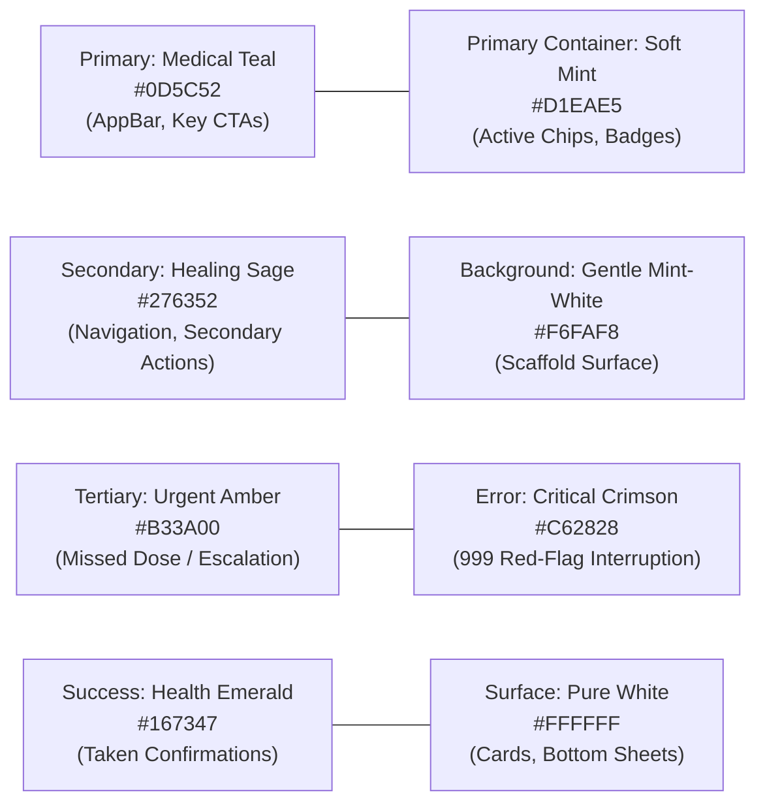

# উপশম (Uposhom) — Design System & UI Specification

> **Platform**: Android only, React Native (Expo, TypeScript, NativeWind). Sizes written as `dp` below are React Native density-independent units.  
> **Target Demographic**: Native Bangla-speaking households, elderly dependents, and family caregivers in Bangladesh  
> **Brand Identity**: Medical Teal & Healing Mint (`primary` `#0D5C52` / `mintTint` `#E8F5E9`) with clinical trust, warm empathy, and ultra-accessible touch ergonomics.

---

## 1. Visual Identity & Brand Philosophy

Uposhom translates medical anxiety into calm reassurance. The visual language uses healing herbal and clinical greens inspired by traditional healthcare and modern digital medicine, contrasted against crisp surfaces and high-contrast dark slate text for maximum legibility.

### 1.1 Brand Attributes
- **শান্ত ও নির্ভরতা (Calm & Trustworthy)**: Cool, deep teal anchors the interface to inspire medical safety and reliability.
- **সহজ ও স্পষ্ট (Accessible & Uncluttered)**: Extra-large touch targets (minimum 56dp), bold Bangla numbers, and high contrast eliminate confusion for elderly eyes.
- **মানবিক ও সতর্ক (Empathetic & Vigilant)**: Gentle mint cards for healthy adherence states, shifting to alert amber/coral for overdue doses, and immediate high-contrast crimson for life-saving 999 emergency triggers.

---

## 2. Color System & Palette

The color system is defined once as design tokens in `apps/mobile/src/theme/colors.ts` and mirrored in the NativeWind (Tailwind) config, so components use token names rather than raw hex values.



### 2.1 Color Tokens Table

| Token Name | Hex Code | Tailwind / TS Token | Intended Usage |
| :--- | :--- | :--- | :--- |
| **`md_theme_primary`** | `#0D5C52` | `colors.primary` | App bar, primary action buttons, FAB, confirmed state highlights |
| **`md_theme_onPrimary`** | `#FFFFFF` | `colors.onPrimary` | Text and icons on primary buttons |
| **`md_theme_mintTint`** | `#E8F5E9` | `colors.mintTint` | Health Advice Carousel card background and other soft highlight panels (text on it uses `onSurface` or `onPrimaryContainer`) |
| **`md_theme_primaryContainer`**| `#D1EAE5` | `colors.primaryContainer` | Active bottom-bar pill, filter chips, dose card morning bucket |
| **`md_theme_onPrimaryContainer`**| `#042B26`| `colors.onPrimaryContainer` | High-contrast text on primary containers |
| **`md_theme_secondary`** | `#276352` | `colors.secondary` | Sub-headings, secondary buttons, profile tag pills |
| **`md_theme_background`** | `#F6FAF8` | `colors.background` | Screen background (reduces eye strain compared to harsh `#FFFFFF`) |
| **`md_theme_surface`** | `#FFFFFF` | `colors.surface` | Card backgrounds, dialogs, bottom sheets, navigation bar |
| **`md_theme_surfaceVariant`** | `#E4EDE9` | `colors.surfaceVariant` | Dividers, search input background, card borders |
| **`md_theme_onSurface`** | `#1A2421` | `colors.onSurface` | Primary body typography (near-black with soft green undertone) |
| **`md_theme_onSurfaceVariant`**| `#3F4D49` | `colors.onSurfaceVariant` | Secondary metadata, Latin drug generics, timestamps |
| **`status_taken_green`** | `#167347` | `colors.status.taken` | "খাওয়া হয়েছে (Taken)" badges, swipe success indicator |
| **`status_snooze_amber`** | `#B33A00` | `colors.status.snooze` | "১৫ মিনিট পরে (Snooze)" badge, missed-dose reminder alert |
| **`status_skip_gray`** | `#566069` | `colors.status.skip` | "বাদ দেওয়া হয়েছে (Skipped)" badge and neutral history |
| **`emergency_red`** | `#C62828` | `colors.emergency` | 999 emergency banner, severe red-flag symptom warnings |

---

## 3. Typography & Bengali Script Specifications

Bengali script features distinct horizontal upper joining lines (*matra*) and vertical vowel diacritics (*kar* and *fola*) that extend above and below the baseline. Standard Android fonts often clip these accents. 

### 3.1 Font Family Integration
- **Primary Font**: `Noto Sans Bengali` (Google Fonts), bundled locally in `apps/mobile/assets/fonts/NotoSansBengali-*.ttf` and loaded with `expo-font`.
- **Secondary Monospace/Numbers**: `Roboto` or `Noto Sans` for Latin medical codes (e.g. `1+0+1 BDPC`, `500mg`).

### 3.2 Bangla Type Scaling & Line-Height Multipliers
> [!IMPORTANT]
> All Bangla text styles specify a line-height of **1.35x to 1.45x the font size** and set `includeFontPadding: false`, to eliminate glyph clipping of top and bottom matras (e.g., `ী`, `ূ`, `ৈ`, `ৌ`, `্র`) on Android. Every screen uses the shared `<Text>` component below and never the raw React Native `Text`.

```ts
// apps/mobile/src/theme/typography.ts
import { TextStyle } from 'react-native';
import { colors } from './colors';

export const fonts = {
  regular: 'NotoSansBengali-Regular',
  medium: 'NotoSansBengali-Medium',
  semibold: 'NotoSansBengali-SemiBold',
  bold: 'NotoSansBengali-Bold',
} as const;

const base: TextStyle = { includeFontPadding: false, color: colors.onSurface };

export const typography = {
  headlineLarge:  { ...base, fontFamily: fonts.bold,     fontSize: 28, lineHeight: 38 },
  headlineMedium: { ...base, fontFamily: fonts.semibold, fontSize: 22, lineHeight: 30 },
  titleLarge:     { ...base, fontFamily: fonts.semibold, fontSize: 18, lineHeight: 26, color: colors.primary },
  bodyLarge:      { ...base, fontFamily: fonts.regular,  fontSize: 16, lineHeight: 24 },
  bodyMedium:     { ...base, fontFamily: fonts.regular,  fontSize: 14, lineHeight: 20, color: colors.onSurfaceVariant },
  labelLarge:     { ...base, fontFamily: fonts.bold,     fontSize: 15, lineHeight: 20, color: colors.onPrimary },
} satisfies Record<string, TextStyle>;
```

```tsx
// apps/mobile/src/components/Text.tsx
import { Text as RNText, TextProps } from 'react-native';
import { typography } from '../theme/typography';

type Props = TextProps & { variant?: keyof typeof typography };

export function Text({ variant = 'bodyLarge', style, ...rest }: Props) {
  return <RNText {...rest} style={[typography[variant], style]} />;
}
```

---

## 4. Accessibility & Touch Ergonomics

Designed specifically for elderly dependents and low-literacy users across rural and urban Bangladesh:
1. **Minimum Touch Target**: Every interactive button, swipe surface, and toggle has a bounding box of at least **56dp × 56dp** (surpassing the common 48dp guideline).
2. **Bengali Numeral Formatting**: All clock times, pill counts, and currency values support localized digits:
   - Example: `08:30 AM` $\rightarrow$ `সকাল ০৮:৩০`
   - Example: `৳5.00` $\rightarrow$ `৳৫.০০`
   - One format everywhere: a part-of-day word followed by Bangla digits (`সকাল ০৮:৩০`, `দুপুর ০১:৩০`, `রাত ০৮:৩০`), never Bangla digits with a Latin `AM`/`PM`.
3. **High Color Contrast Ratio** (measured against the token values in section 2): body text `#1A2421` is about 15.9:1 and secondary text `#3F4D49` about 8.4:1 on the scaffold background, both WCAG AAA (7:1). The status colours are AA (4.5:1 or better) with white text: amber `#B33A00` about 6.0:1, emerald `#167347` about 5.9:1, crimson `#C62828` about 5.6:1, skip gray `#566069` about 6.4:1 on white. Teal `#0D5C52` on `mintTint` is about 7.0:1, so text on mint panels uses `onSurface` or `onPrimaryContainer`.
4. **Haptic & Visual Feedback Dual-Confirmation**:
   - Marking a dose taken triggers a tactile confirmation click (`Haptics.impactAsync(ImpactFeedbackStyle.Medium)` from `expo-haptics`) accompanied by a gentle green ripple and checkmark animation.
   - Escalation warnings trigger a distinct double pulse.

---

## 5. Information Architecture & Navigation

The application uses an accessible **4-Tab Bottom Navigation Bar** with high-contrast active indicator pills and clear dual-language labels.

```text
┌─────────────────────────────────────────────────────────────────┐
│                       UPOSHOM TOP APP BAR                       │
│  [Dropdown: বাবা (Father) ▼]    [🎤]  [🔔 2]   [Camera Scan 📷] │
├─────────────────────────────────────────────────────────────────┤
│                                                                 │
│                         MAIN CONTENT AREA                       │
│                                                                 │
│  Tab 1: হোম (Home / Today's Dose Routine & Timeline)           │
│  Tab 2: পরিবার (Family Circle / Dependents & Caregiver Roles)   │
│  Tab 3: ভল্ট (Health Vault / Prescriptions, Reports & History)  │
│  Tab 4: সেবা (Explore / Generic Drug Finder & Local Stock)      │
│                                                                 │
├─────────────────────────────────────────────────────────────────┤
│                     BOTTOM NAVIGATION BAR                       │
│   [ 🏠 হোম ]      [ 👨‍👩‍👧 পরিবার ]      [ 📁 ভল্ট ]      [ 💊 সেবা ]    │
└─────────────────────────────────────────────────────────────────┘
```

**Screens outside the four tabs and how to reach them:**
- Camera scanner (Screen 2) and visual confirmation (Screen 3): the camera button in the top bar, and `+` in the Vault tab.
- Voice schedule query (Screen 9) and Alerts inbox (Screen 13): the 🎤 and 🔔 buttons in the top bar.
- Symptom journaling (Screen 7): the quick action on Home and a `লক্ষণ জানান` button at the top of the Health Vault tab. Doctor Summary (Screen 16) follows it.
- Sickness History and Insights (Screen 8): the third segment of the Health Vault tab.
- Profile Details (Screen 14) and Settings (Screen 15): from the Family tab (profile card, gear icon). Premium (Screen 11), pay-per-use (Screen 12) and Battery setup (Screen 17) open from prompts and from Settings.
- Sign-up (Screen 10) is shown only before the first sign-in.

---

## 6. Detailed Screen Specifications & Components

### 6.1 Screen 1: Home Dashboard (আজকের রুটিন - Today's Schedule)
The patient's daily command center.

* **Top Header**:
  - Dependent Switcher: Pill dropdown displaying the active profile photo and name (e.g. `👴 বাবা (আবুল কালাম)`).
  - Mic button (🎤): opens the Voice Schedule Query screen (Screen 9).
  - Bell (🔔 with count): opens the Alerts inbox (Screen 13).
  - Date & Adherence Status: Shows today's date in Bangla (`শনিবার, ২১ নভেম্বর ২০২৬`) with a circular adherence progress ring (`৮৫% সম্পন্ন`).
* **Health Advice Carousel**:
  - Auto-swiping card (interval: 6s) with the `mintTint` background token, featuring seasonal health tips, medicine storage temperatures, and antibiotic completion warnings. For elderly users it never moves against their will: auto-swipe pauses while the card is touched, stops when Android's "remove animations" setting is on, and always has manual swipe and position dots.
  - A quick-action row under it: `লক্ষণ জানান` (Log symptoms, opens Screen 7), `ওষুধের কথা জিজ্ঞাসা করুন` (opens Screen 9).
* **Timeline Feed (Grouped into Meal Buckets)**:
  - **সকাল (Morning)**: e.g. `সকাল ০৮:০০`
  - **দুপুর (Noon)**: e.g. `দুপুর ০১:৩০`
  - **বিকাল (Evening)**: e.g. `বিকাল ০৫:০০` (shown only when a four-slot pattern is scheduled)
  - **রাত (Night)**: e.g. `রাত ০৮:৩০`
* **Medication Card with Swipe-to-Confirm Interaction**:
  - Card Dimensions: Full width, 16dp rounded corners (`borderRadius: 16`), 2dp subtle elevation.
  - Drug Display:
    - Bold Bangla brand name: `নাপা এক্সট্রা (Napa Extra)`
    - Form & Strength badge: `ট্যাবলেট • ৫০০+৬৫ মি.গ্রা.`
    - Meal relation indicator chip: `খাবার পর (PC)` in primary container teal.
    - Critical flag: If flagged by doctor/caregiver, displays an amber badge `জরুরি ওষুধ (Critical)`.
  - **Swipe Interaction**:
    - **Swipe Right ($\rightarrow$)**: Reveals vibrant green surface with checkmark icon; releasing marks the dose as `খাওয়া হয়েছে (Taken)`. Prevents accidental one-tap errors.
    - **Action Buttons Below Card**: Quick text buttons for `১৫ মিনিট পরে (Snooze)` and `বাদ দিন (Skip)` with reason selector bottom-sheet.

---

### 6.2 Screen 2: Camera Prescription Scanner
On-device document capture.

* **Viewfinder Overlay**:
  - Full-screen `expo-camera` live preview with a semi-transparent dark vignette and a rounded rectangular target frame (`#0D5C52` border).
  - Live instruction in Bangla: `"প্রেসক্রিপশনটি ফ্রেমের ভেতরে রাখুন এবং স্পষ্ট ছবি তুলুন"` (Keep prescription inside the frame and take a clear photo).
* **Controls**:
  - Top Bar: Close button (`✕`), Flashlight toggle (`⚡`), and Gallery picker icon (`🖼️`).
  - Capture Button: Large circular shutter (72dp) with tactile inner ring and haptic response.
* **On-Device Preprocessing**:
  - Resize to max 1600px and WebP compression (<800KB) with `expo-image-manipulator`. There is no auto-crop; the confirm screen is the safety net before multipart transmission to the Fastify backend.

---

### 6.3 Screen 3: Side-by-Side Visual Confirmation Screen (Safety Critical)
Mandated human-in-the-loop validation barrier before any dosing schedule is generated.

* **Layout Structure (Vertical Split / Pager)**:
  - **Top Half (40% Viewport)**: Zoomable, pannable view of the captured prescription photo. The extraction model returns fields and a transcription but no coordinates, so there are no bounding boxes: the photo is shown as-is for the user to compare by eye, and a collapsible strip `ছবি থেকে পড়া লেখা` (text read from the photo) shows the model's transcription.
  - **Bottom Half (60% Viewport)**: Scrollable editable cards of each parsed item extracted via OpenRouter (Gemini 2.5 Flash / Qwen 2.5 VL).
* **Extracted Item Card Components**:
  - Input field: Medicine Brand Name (with auto-suggest from DGDA drug database).
  - Dosage pattern chip group: `১+০+১`, `০+০+১`, `১+১+১`, four-slot patterns, `প্রয়োজনে (SOS)`, or manual numeric entry.
  - Meal relation segmented button: `খাবার আগে (AC)` | `খাবার পর (PC)` | `খাবারের সাথে`.
  - Duration picker: Number stepper (`৭ দিন`, `১৪ দিন`, `১ মাস`).
  - Optional pill count field, used to compute the refill date.
  - **Critical toggle**: a 56dp switch `জরুরি ওষুধ (Critical)`, off by default. Only a person can turn it on, never the AI. It decides whether a missed dose alerts the caregiver (Home then shows the amber badge). One-line hint under it: `মিস হলে পরিবারের সদস্যকে জানানো হবে` (the caregiver is told if this dose is missed).
  - **Confidence Indicator**:
    - Confidence of 90% or higher: Crisp teal border.
    - Confidence below 90%: Amber alert border with note `"তথ্যটি পুনরায় যাচাই করুন"` (Please re-verify this item).
* **Primary Action Bar**:
  - Fixed bottom container with elevation:
    - Button 1: `+ আরও ওষুধ যোগ করুন` (Add another medicine manually).
    - Button 2 (Primary Teal, 56dp height): `প্রেসক্রিপশন নিশ্চিত করুন (Confirm Prescription)`.

---

### 6.4 Screen 4: Family Circle & Dependent Management
Empowering caregivers to manage multiple dependents remotely.

* **Family Members Carousel / Grid**:
  - Displays the admin's own profile plus up to 6 dependent profiles (Premium; Free has the single own profile), each card with avatar, name, relationship badge (`বাবা`, `মা`, `মেয়ে`), and the current adherence rate.
  - Status indicator:
    - Green dot: All scheduled doses up to now are taken.
    - Pulsing Amber dot: Missed critical dose waiting for caregiver action.
  - A gear icon in the screen header opens Settings (Screen 15). Tapping a profile card opens Profile Details (Screen 14).
* **Add Dependent Modal**:
  - Input name, age, relationship, and optional phone number.
  - If dependent has their own phone: Applink Family Link SMS OTP verification step (the `subscriberId` it returns is stored on that profile, so the dependent's SMS replies and STOP resolve to their own profile) (backend calls `/otp/request` then `/otp/verify`; the app only talks to our own API) to record explicit family-linking consent. A verified Applink OTP also activates a subscription for that number, so the dialog first tells the dependent what they are opting into (including any charge) and the OTP expires after 5 minutes.
  - Meal anchor time customizers: Setting custom morning, noon, and night meal times for that specific dependent.

---

### 6.5 Screen 5: Diagnostic Report Vault & Explainer
Empowering patients to understand complex laboratory test results.

* **Report List View**:
  - Segmented tab: `প্রেসক্রিপশন ভল্ট` | `ল্যাব রিপোর্ট ভল্ট` | `স্বাস্থ্য ইতিহাস` (opens Screen 8, Sickness History & Insights).
  - Card displays report date, diagnostic center name (e.g., `ইবনে সিনা ডায়াগনস্টিক`), and test type (`লিপিড প্রোফাইল / রক্তের শর্করা`).
* **Detailed Metric Card with Flag Analyzer**:
  - Test name: `Fasting Blood Glucose (রক্তের শর্করা)`
  - Recorded value: `8.5 mmol/L`
  - Reference range: `(স্বাভাবিক মাত্রা: 3.9 - 6.1 mmol/L)`
  - Visual Flag: Coral badge with upward arrow `উচ্চ (High)`.
  - **Bangla Explainer Accordion**:
    - Plain Bangla interpretation curated from medical glossary: `"আপনার রক্তের শর্করার মাত্রা স্বাভাবিকের চেয়ে কিছুটা বেশি পাওয়া গেছে। এটি ডায়াবেটিসের লক্ষণ হতে পারে। ওষুধ বা খাদ্যাভ্যাস পরিবর্তনের জন্য চিকিৎসকের পরামর্শ নিন।"`
    - Disclaimer footer: `"উপশম কোনো প্রেসক্রিপশন বা রোগ নির্ণয় প্রদান করে না। চূড়ান্ত সিদ্ধান্তের জন্য ডাক্তারের সাথে যোগাযোগ করুন।"`

---

### 6.6 Screen 6: Generic Drug Finder & Nearby Pharmacy Discovery
Combating medicine price opacity and stock uncertainty.

* **Search Header**:
  - Search bar supporting Bangla and Latin typing (`"নাপা"`, `"প্যারাসিটামল"`, `"সেকলো"`, `"Napa"`). Bangla input is matched against each drug's Bangla name and spelling aliases, so common variant spellings still find the drug.
  - If nothing matches, show `"কোনো ওষুধ পাওয়া যায়নি, বানান পরিবর্তন করে দেখুন"` (no medicine found, try a different spelling).
* **Alternative Comparison Card** (same ingredient, strength and form; never described as "bioequivalent" or "approved"):
  - Original Branded Drug: `Seclo 20mg (Square Pharmaceuticals)` — আনুমানিক দাম: `৳৭.০০/পিস`
  - Lower-priced alternative with the same ingredient, strength and form: `Omeprazole 20mg (Incepta / Beximco)` — আনুমানিক দাম: `৳৪.৫০/পিস`
  - Highlight badge: `প্রায় ৩৬% সাশ্রয়ী (about 36% cheaper)`, computed from the two indicative prices (৳৭.০০ and ৳৪.৫০) and labelled `আনুমানিক` (indicative).
  - Advisory note: `"ওষুধ পরিবর্তনের পূর্বে অবশ্যই আপনার ডাক্তার বা ফার্মাসিস্টের পরামর্শ গ্রহণ করুন।"`
* **Local Pharmacy Stock Listing**:
  - Lists neighborhood pharmacies within a configurable radius (default 3 km) of the phone's coarse location. If location permission is denied, the user types their area instead.
  - Subscribed B2B partner pharmacies highlighted at the top with a `পার্টনার ফার্মেসি (Partner)` badge.
  - Stock status badge, as last set by the pharmacy owner, with its update time (for example `আপডেট: ২ ঘণ্টা আগে`): `🟢 পর্যাপ্ত স্টক আছে (In Stock)` | `🔴 স্টক শেষ`. It is not a live stock feed.
  - Action: Direct phone dial button to confirm order.

---

### 6.7 Screen 7: Voice Symptom Journaling & 999 Emergency Modal
Hands-free voice capture with immediate clinical safety guardrails.

* **Voice Journaling UI**:
  - Centered animated microphone orb (80dp) in Medical Teal with radiating soundwave ripples when active.
  - Instruction: `"আপনার কি সমস্যা হচ্ছে বাংলায় বলুন..."` (Tell us what symptoms you are experiencing in Bangla...).
  - Record-then-transcribe: when the user taps stop, the audio is transcribed and the transcript appears in an editable box (it is not streamed live, and nothing is saved before the user has seen it). A text box is always available instead of voice.
  - Follow-up questions: up to six short Bangla questions, one at a time (onset, duration, severity, triggers, associated symptoms, current medicines). Each is answered by voice or text and can be skipped.
  - Doctor summary: the finished journal entry is shown as a structured summary card with a `ডাক্তারের জন্য সারাংশ` (summary for the doctor) button that opens Screen 16. Reached from the Home quick action or from the Health Vault tab.
* **999 Emergency Interruption Modal (Strict Safety Guardrail)**:
  - Triggered automatically if symptom text contains critical red-flag keywords: বুকে তীব্র ব্যথা (chest pain), শ্বাসকষ্ট (dyspnea), অতিরিক্ত রক্তপাত (severe bleeding), কিংবা স্ট্রোকের লক্ষণ (stroke signs). The check is a deterministic keyword match that runs before any AI call.
  - Visuals: Full-screen modal with solid Crimson header (`#C62828`) and warning triangle icon.
  - Urgent Message: `"সতর্কতা: এটি একটি জরুরি স্বাস্থ্য পরিস্থিতি হতে পারে। অবিলম্বে নিকটস্থ জরুরি বিভাগে যোগাযোগ করুন।"`
  - Direct Action Button: High-contrast white-on-crimson button `জরুরি অ্যাম্বুলেন্স / ৯৯৯ এ কল করুন` (`tel:999`).

---

### 6.8 Screen 8: Sickness History & Insights (স্বাস্থ্য ইতিহাস)
Reached from the Health Vault tab. Shows patterns for the active profile, built from symptom logs and past confirmed prescriptions.

* **Timeline**: month-by-month list mixing symptom entries and prescriptions (date, symptom or medicine, therapeutic class chip).
* **Pattern cards**: each shows a small bar chart of counts by month plus one plain-Bangla sentence, for example `"গত তিন শীতে শ্বাসের সমস্যার জন্য ওষুধ নিতে হয়েছে"` (respiratory medicines were needed in each of the last three winters). A card appears only when the minimum record count is met. Otherwise an empty state reads `"প্যাটার্ন দেখাতে আরও তথ্য প্রয়োজন"` (more records are needed to show a pattern).
* **Prevention tip**: one tip from the curated library under each pattern card, worded as general lifestyle advice, never as a diagnosis or a dose.
* **Premium gate**: Free tier sees the timeline only. Pattern cards are Premium (Family Circle) and show the upgrade prompt on Free.
* **Footer disclaimer**: `"এটি রোগ নির্ণয় নয়। বিস্তারিত জানতে ডাক্তারের সাথে কথা বলুন।"` (This is not a diagnosis. Talk to your doctor for details.)

---

### 6.9 Screen 9: Voice Schedule Query (ওষুধের কথা জিজ্ঞাসা করুন)
Hands-free question screen for elderly and low-literacy users. Opened from a mic button in the Home top bar.

* **Layout**: same animated mic orb as Screen 7, with the prompt `"আপনার ওষুধ সম্পর্কে বাংলায় জিজ্ঞাসা করুন..."` (Ask about your medicines in Bangla).
* **Examples shown as tappable chips**: `"পরের ওষুধ কখন?"` (when is the next medicine?), `"আজ কোন ওষুধ বাকি?"` (which medicines are left today?).
* **Flow**: record, then show the editable transcript, then show the answer. Nothing is acted on before the user sees the transcript.
* **Answer card**: Bangla text from the schedule data, read aloud with `expo-speech` (Android text-to-speech), with a replay button. A voice query is read-only: it never marks a dose or changes a schedule.

---

### 6.10 Pharmacy Account (separate account type)
Chosen at sign-up ("আমি একজন ফার্মেসি মালিক / I am a pharmacy owner"). A pharmacy account never sees Family Circle screens; it gets its own 3-tab bottom bar instead of the 4 tabs in section 5.

* **Tab 1: স্টক (Stock)**: searchable list of the store's medicines with a large In Stock / Out of Stock toggle (56dp) per row.
* **Tab 2: সাবস্ক্রিপশন (Subscription)**: monthly carrier-billed plan, with the same consent disclosure as Family Circle (amount, currency, monthly frequency), plus an opt-out button. Shows Partner status and priority-listing state.
* **Tab 3: প্রোফাইল (Store profile)**: store name, address, location pin, phone, opening hours.

An admin-only **Agent Traces** screen (agent, handoffs, tool calls, latency) appears as a `ডেভেলপার` (Developer) row at the bottom of Settings (Screen 15), shown only when the signed-in account has the admin flag (the demo admin account is set up for the team and judges). It is not part of any consumer or pharmacy navigation.

---

### 6.11 Screen 10: Sign-up & OTP Verification
First screen for a new user. Every step is one question per screen with a 56dp primary button.

* **Step 1, account type**: two large cards, `আমি পরিবারের জন্য ওষুধ দেখি (I manage medicines for myself or my family)` and `আমি একজন ফার্মেসি মালিক (I am a pharmacy owner)`. The choice sets the account type and decides which navigation the user gets (4 tabs or the pharmacy 3 tabs).
* **Step 2, phone number**: Bangladeshi number field with Bangla keypad support. Directly above the button, a disclosure box states what the OTP does: `এই কোড যাচাই করলে আপনার নম্বর উপশম সেবায় নিবন্ধিত হবে।` (verifying this code registers your number with the Uposhom service), together with any charge, amount, currency and frequency if there is one. The button is `কোড পাঠান` (Send code). Too many attempts show a wait message.
* **Step 3, code entry**: 6-digit field, a visible 5-minute countdown, and `আবার কোড পাঠান` (Resend) after the countdown. A wrong code shows `কোডটি সঠিক নয়, আবার চেষ্টা করুন`. An expired code asks for a new one.
* **Sign-up error states** (shown on Step 2 under the number field, in plain Bangla, never a raw error code; the server maps Applink's codes to these):
  - Number not accepted (E1317, invalid or not allowed): `এই নম্বরটি ব্যবহার করা যাচ্ছে না। নম্বরটি আবার দেখে সঠিকভাবে লিখুন।` (This number cannot be used. Check it and enter it again.)
  - Number blocked (E1342): `এই নম্বরে উপশম সেবা চালু করা যাবে না।` (The service cannot be started for this number.) No retry button, and no further messages are sent to that number.
  - Number not on the test list (E1343, which every number outside the whitelist gets during Limited Production): `এই নম্বরটি এখনো পরীক্ষামূলক তালিকায় নেই। সহায়তার জন্য আমাদের সাথে যোগাযোগ করুন।` (This number is not on the test list yet. Contact us for help.) The support contact is shown under it. The message never looks like a silent failure.
  - Service trouble (E1603, E1601, E1856): `এখন সংযোগ করা যাচ্ছে না, একটু পরে আবার চেষ্টা করুন।` (Cannot connect right now, try again shortly.)
* **Step 4, permissions and notification setup**: after sign-in, the app asks for notifications, camera and (later, only when needed) location, one at a time with a plain-Bangla reason, then shows Screen 17.
* Signing in again on the same phone does not ask for a code (the session refreshes silently). A new phone or account recovery repeats this flow.

---

### 6.12 Screen 11: Premium Upgrade & Consent (Family Circle)
Opened from `প্রিমিয়াম নিন` prompts (Free-tier limits, the Insights lock) and from Settings.

* **Plan card**: lists what Premium adds (up to 6 dependent profiles, caregiver alerts, unlimited vault, pattern insights, doctor summaries).
* **Mandatory consent dialog** before anything is requested: `মাসিক চার্জ: ৩০ টাকা (৳৩০) আপনার মোবাইল অ্যাকাউন্ট থেকে কাটা হবে, প্রতি মাসে স্বয়ংক্রিয়ভাবে নবায়ন হবে, যেকোনো সময় বাতিল করা যাবে।` (Amount, currency, charged to the mobile account, monthly renewal, cancel any time). The consent checkbox is unticked by default and the button `নিশ্চিত করুন (Confirm Carrier Subscription)` stays disabled until it is ticked.
* **After confirming**: a `অনুরোধ পাঠানো হয়েছে, নিশ্চিতকরণের অপেক্ষায় আছি` (request sent, waiting for confirmation) state. Premium unlocks only when the server's subscription record says so (the screen refreshes itself), never from the tap alone.
* **Cancel**: a visible `সাবস্ক্রিপশন বাতিল করুন` button on the same screen, with a confirmation. The same opt-out also works by SMS (`STOP`).
* Pharmacy accounts see the same layout in their Subscription tab with the pharmacy plan.

---

### 6.13 Screen 12: Pay-per-use Payment Sheet
A bottom sheet shown when a Free user needs a paid action (a scan over the monthly quota, a doctor summary PDF).

* **Step 1, price**: `এই কাজের জন্য ৫ টাকা (৳৫.০০) আপনার মোবাইল ব্যালেন্স থেকে কাটা হবে।` (৳5.00 will be deducted from your mobile balance; a doctor summary says ২ টাকা (৳২.০০)). The button `কোড পাঠান` (Send code) is the user's explicit consent and sends the payment code by SMS.
* **Step 2, payment code**: 6-digit field. A wrong code can be retried on the same request. Below it, `কোড আসেনি? আবার চেষ্টা করুন` appears only after the code has expired, and it starts a new payment with a new request.
* **Step 3, result**: `প্রক্রিয়া চলছে...` (processing) until the carrier confirms, then `পেমেন্ট সম্পন্ন` and the unlocked action starts. Not enough balance shows `ব্যালেন্স যথেষ্ট নয়`. Nothing is granted until the confirmation arrives.

---

### 6.14 Screen 13: Alerts Inbox & Caregiver Acknowledge
Opened from the 🔔 bell in the top bar. A list of alerts for every profile the user can see, newest first.

* **Missed-dose escalation card** (caregivers): profile name, medicine, due time, how long overdue, and two 56dp buttons `আমি দেখছি (Acknowledge)` and `ফোন করুন (Call)`. Acknowledging stops the secondary-caregiver alert and is recorded with the time.
* **Other cards**: refill due, follow-up appointment, weekly digest (adherence summary per profile), SMS delivery failure for a critical dose.
* Tapping a push notification opens the matching card. Acknowledged cards turn gray and stay in the list.

---

### 6.15 Screen 14: Profile Details
Opened from a profile card in the Family tab.

* **Fields**: name, relationship, age, allergies (free text, shown on the confirm screen as a reminder), meal times (সকাল, দুপুর, বিকাল, রাত) and quiet hours (no non-critical SMS or sound).
* **Roles**: each linked person is shown with a role chip (`অ্যাডমিন`, `যত্নকারী (Caregiver)`, `দর্শক (Viewer)`). The admin can change roles, invite a person, and choose the **secondary caregiver** (alerted if the first caregiver does not acknowledge). Removing a person asks for a step-up code (see Screen 10).
* **Own phone**: shows whether the dependent's number is linked (verified) and allows re-verification. Once linked, the dependent can reply to reminders and send `STOP` from their own phone, and those are matched to this profile. An unlinked number gets a generic reply to register in the app.

---

### 6.16 Screen 15: Settings
Opened from the gear icon in the Family tab header.

* **Reminders**: notification permission status, `ব্যাটারি সেটিংস ঠিক করুন` (opens Screen 17), SMS reminders on/off.
* **Discreet SMS mode** switch: texts say only `ওষুধের সময় হয়েছে` (time for your medicine) with no drug names.
* **Language and text size**: Bangla by default, plus a larger-text option.
* **Subscription**: current plan, `প্রিমিয়াম নিন` or `বাতিল করুন` (Screen 11), and usage this month (scans, SMS).
* **Privacy**: `আমার সব তথ্য মুছে ফেলুন` (delete my data) with a step-up code and a confirmation that explains it cannot be undone. `SMS বন্ধ করুন` (stop SMS) records the opt-out.
* **Help and legal**: `সহায়তা` (support contact: email and phone number), `শর্তাবলী` (terms of service) and `গোপনীয়তা নীতি` (privacy policy), each one tap away. The same support contact is sent in the SMS help reply.
* **Developer** row (admin accounts only): opens Agent Traces (see 6.10).
* **Sign out**.

---

### 6.17 Screen 16: Doctor Summary
Shown after a symptom journal entry or from the Vault.

* A structured card (symptoms, onset, duration, severity, current medicines, recent confirmed prescriptions) with a disclaimer footer `এটি রোগ নির্ণয় নয়।` (This is not a diagnosis).
* Buttons: `PDF দেখুন` (view), `শেয়ার করুন` (share through the Android share sheet). Premium accounts generate it freely. Free accounts see the pay-per-use sheet (Screen 12) first.

---

### 6.18 Screen 17: Battery & Notification Setup
Shown once after sign-in and reachable from Settings. Reminders must keep firing with the app closed and after a restart, so this screen is not skippable on first run.

* Steps with check marks: allow notifications, allow exact alarms, then `ব্যাটারি অপটিমাইজেশন থেকে বাদ দিন` (exclude from battery optimisation), which opens the system settings page.
* A `পরীক্ষা করুন` (test) button fires a sample reminder alarm so the user hears it before relying on it. If a step is missing, Home shows a small amber banner until it is fixed. SMS reminders continue regardless.

---

### 6.19 Feature-phone SMS Replies
Not an app screen, but part of the experience for users without smartphones or data.

* **SMS reply**: every reminder SMS tells the user to reply with the keyword and a code, for example `UPOSHOM 1` (taken), `UPOSHOM 2` (snooze), `UPOSHOM 3` (skip). Bangla SMS is limited to about 70 characters per part, so reminder text is short.
* **Stop**: replying `STOP`, `UNSUB` or `OFF` unregisters the number and stops all queued messages (and cancels a paid plan too). This is the SMS opt-out that Screen 11 refers to. No confirmation SMS is sent.

---

## 7. Motion, Micro-Interactions & Feedback Specs

| Interaction | Animation Specs | Haptic Feedback |
| :--- | :--- | :--- |
| **Dose Swipe-to-Taken** | Reanimated spring (`withSpring`, `damping: 14, stiffness: 150`); background transforms from White to Health Emerald (`#167347`). | `Haptics.impactAsync(Medium)` on threshold release |
| **Prescription Capture** | 100ms white shutter flash overlay followed by card shrink-and-slide into processing drawer. | Heavy impact tactile click |
| **Missed Dose Warning** | Gentle 2-cycle card shake animation (`±8dp` horizontal oscillation over 300ms) with amber pulse. | Double pulse vibration |
| **Voice Mic Orb** | Continuous sinusoidal scale pulse between `1.0f` and `1.15f` tied to audio input decibel amplitude. | Gentle click on start & stop |
| **Tab Transition** | Fade and horizontal slide (Reanimated `SlideInRight` + `FadeIn`, 200ms). | Subtle navigation tick |

---

## 8. Theme Implementation (React Native + NativeWind)

Ready-to-use token and Tailwind configuration:

```ts
// apps/mobile/src/theme/colors.ts
export const colors = {
  primary: '#0D5C52',
  onPrimary: '#FFFFFF',
  primaryContainer: '#D1EAE5',
  onPrimaryContainer: '#042B26',
  mintTint: '#E8F5E9',
  secondary: '#276352',
  onSecondary: '#FFFFFF',
  tertiary: '#B33A00',      // urgent amber
  onTertiary: '#FFFFFF',
  error: '#C62828',         // 999 emergency
  onError: '#FFFFFF',
  background: '#F6FAF8',
  onBackground: '#1A2421',
  surface: '#FFFFFF',
  onSurface: '#1A2421',
  surfaceVariant: '#E4EDE9',
  onSurfaceVariant: '#3F4D49',
  outline: '#B2C7C1',
  status: { taken: '#167347', snooze: '#B33A00', skip: '#566069' },
  emergency: '#C62828',
} as const;
```

```js
// apps/mobile/tailwind.config.js
const { colors } = require('./src/theme/colors');
module.exports = {
  content: ['./app/**/*.{ts,tsx}', './src/**/*.{ts,tsx}'],
  presets: [require('nativewind/preset')],
  theme: { extend: { colors } },
};
```

Uposhom enforces a single light, high-contrast theme for healthcare accessibility. Dark mode is not offered, and the app sets `userInterfaceStyle: 'light'` in `app.config.ts`.
