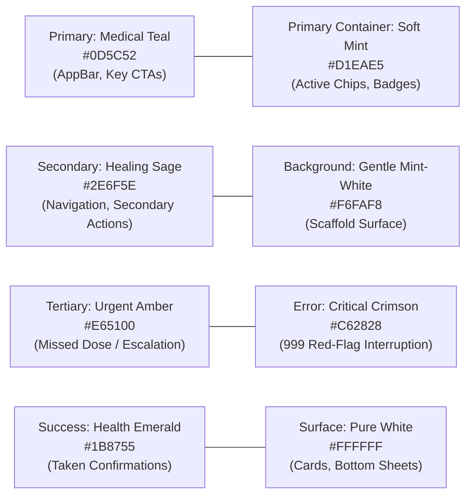

# উপশম (Uposhom) — Design System & UI Specification

> **Platform**: Native Android (Kotlin + Jetpack Compose, Material 3)  
> **Target Demographic**: Native Bangla-speaking households, elderly dependents, and family caregivers in Bangladesh  
> **Brand Identity**: Medical Teal & Healing Mint (`#0D5C52` / `#E8F5E9`) with clinical trust, warm empathy, and ultra-accessible touch ergonomics.

---

## 1. Visual Identity & Brand Philosophy

Uposhom translates medical anxiety into calm reassurance. The visual language uses healing herbal and clinical greens inspired by traditional healthcare and modern digital medicine, contrasted against crisp surfaces and high-contrast dark slate text for maximum legibility.

### 1.1 Brand Attributes
- **শান্ত ও নির্ভরতা (Calm & Trustworthy)**: Cool, deep teal anchors the interface to inspire medical safety and reliability.
- **সহজ ও স্পষ্ট (Accessible & Uncluttered)**: Extra-large touch targets (minimum 56dp), bold Bangla numbers, and high contrast eliminate confusion for elderly eyes.
- **মানবিক ও সতর্ক (Empathetic & Vigilant)**: Gentle mint cards for healthy adherence states, shifting to alert amber/coral for overdue doses, and immediate high-contrast crimson for life-saving 999 emergency triggers.

---

## 2. Color System & Material 3 Palette

The color system is mapped directly to Material 3 Jetpack Compose color tokens (`ColorScheme`).



### 2.1 Color Tokens Table

| Token Name | Hex Code | Compose Resource | Intended Usage |
| :--- | :--- | :--- | :--- |
| **`md_theme_primary`** | `#0D5C52` | `Color(0xFF0D5C52)` | App bar, primary action buttons, FAB, confirmed state highlights |
| **`md_theme_onPrimary`** | `#FFFFFF` | `Color(0xFFFFFFFF)` | Text and icons on primary buttons |
| **`md_theme_primaryContainer`**| `#D1EAE5` | `Color(0xFFD1EAE5)` | Active bottom-bar pill, filter chips, dose card morning bucket |
| **`md_theme_onPrimaryContainer`**| `#042B26`| `Color(0xFF042B26)` | High-contrast text on primary containers |
| **`md_theme_secondary`** | `#2E6F5E` | `Color(0xFF2E6F5E)` | Sub-headings, secondary buttons, profile tag pills |
| **`md_theme_background`** | `#F6FAF8` | `Color(0xFFF6FAF8)` | Screen background (reduces eye strain compared to harsh `#FFFFFF`) |
| **`md_theme_surface`** | `#FFFFFF` | `Color(0xFFFFFFFF)` | Card backgrounds, dialogs, bottom sheets, navigation bar |
| **`md_theme_surfaceVariant`** | `#E4EDE9` | `Color(0xFFE4EDE9)` | Dividers, search input background, card borders |
| **`md_theme_onSurface`** | `#1A2421` | `Color(0xFF1A2421)` | Primary body typography (near-black with soft green undertone) |
| **`md_theme_onSurfaceVariant`**| `#52605C` | `Color(0xFF52605C)` | Secondary metadata, Latin drug generics, timestamps |
| **`status_taken_green`** | `#1B8755` | `Color(0xFF1B8755)` | "খাওয়া হয়েছে (Taken)" badges, swipe success indicator |
| **`status_snooze_amber`** | `#E65100` | `Color(0xFFE65100)` | "১৫ মিনিট পরে (Snooze)" badge, missed-dose reminder alert |
| **`status_skip_gray`** | `#6C757D` | `Color(0xFF6C757D)` | "বাদ দেওয়া হয়েছে (Skipped)" badge and neutral history |
| **`emergency_red`** | `#C62828` | `Color(0xFFC62828)` | 999 emergency banner, severe red-flag symptom warnings |

---

## 3. Typography & Bengali Script Specifications

Bengali script features distinct horizontal upper joining lines (*matra*) and vertical vowel diacritics (*kar* and *fola*) that extend above and below the baseline. Standard Android fonts often clip these accents. 

### 3.1 Font Family Integration
- **Primary Font**: `Noto Sans Bengali` (Google Fonts), bundled locally in `apps/android/app/src/main/assets/fonts/NotoSansBengali-*.ttf`.
- **Secondary Monospace/Numbers**: `Roboto` or `Noto Sans` for Latin medical codes (e.g. `1+0+1 BDPC`, `500mg`).

### 3.2 Bangla Type Scaling & Line-Height Multipliers
> [!IMPORTANT]
> All Bangla text styles specify a minimum of **+25% line-height (1.35x to 1.45x font size)** to eliminate glyph clipping of top and bottom matras (e.g., `ী`, `ূ`, `ৈ`, `ৌ`, `্র`).

```kotlin
// Compose Typography Definition (theme/Type.kt)
val NotoSansBengali = FontFamily(
    Font(R.font.noto_sans_bengali_regular, FontWeight.Normal),
    Font(R.font.noto_sans_bengali_medium, FontWeight.Medium),
    Font(R.font.noto_sans_bengali_semibold, FontWeight.SemiBold),
    Font(R.font.noto_sans_bengali_bold, FontWeight.Bold)
)

val UposhomTypography = Typography(
    headlineLarge = TextStyle(
        fontFamily = NotoSansBengali,
        fontWeight = FontWeight.Bold,
        fontSize = 28.sp,
        lineHeight = 38.sp,
        color = Color(0xFF1A2421)
    ),
    headlineMedium = TextStyle(
        fontFamily = NotoSansBengali,
        fontWeight = FontWeight.SemiBold,
        fontSize = 22.sp,
        lineHeight = 30.sp,
        color = Color(0xFF1A2421)
    ),
    titleLarge = TextStyle(
        fontFamily = NotoSansBengali,
        fontWeight = FontWeight.SemiBold,
        fontSize = 18.sp,
        lineHeight = 26.sp,
        color = Color(0xFF0D5C52)
    ),
    bodyLarge = TextStyle(
        fontFamily = NotoSansBengali,
        fontWeight = FontWeight.Normal,
        fontSize = 16.sp,
        lineHeight = 24.sp,
        color = Color(0xFF1A2421)
    ),
    bodyMedium = TextStyle(
        fontFamily = NotoSansBengali,
        fontWeight = FontWeight.Normal,
        fontSize = 14.sp,
        lineHeight = 20.sp,
        color = Color(0xFF52605C)
    ),
    labelLarge = TextStyle(
        fontFamily = NotoSansBengali,
        fontWeight = FontWeight.Bold,
        fontSize = 15.sp,
        lineHeight = 20.sp,
        color = Color(0xFFFFFFFF)
    )
)
```

---

## 4. Accessibility & Touch Ergonomics

Designed specifically for elderly dependents and low-literacy users across rural and urban Bangladesh:
1. **Minimum Touch Target**: Every interactive button, swipe surface, and toggle has a bounding box of at least **56dp × 56dp** (surpassing standard Material 48dp).
2. **Bengali Numeral Formatting**: All clock times, pill counts, and currency values support localized digits:
   - Example: `08:30 AM` $\rightarrow$ `সকাল ০৮:৩০`
   - Example: `৳5.00` $\rightarrow$ `৳৫.০০`
3. **High Color Contrast Ratio**: All primary body text achieves a contrast ratio of **7.2:1** against surface backgrounds, complying with WCAG AAA standards.
4. **Haptic & Visual Feedback Dual-Confirmation**:
   - Marking a dose taken triggers a tactile confirmation click (`HapticFeedbackType.LongPress`) accompanied by a gentle green ripple and checkmark animation.
   - Escalation warnings trigger a distinct double pulse.

---

## 5. Information Architecture & Navigation

The application uses an accessible **4-Tab Bottom Navigation Bar** with high-contrast active indicator pills and clear dual-language labels.

```text
┌─────────────────────────────────────────────────────────────────┐
│                       UPOSHOM TOP APP BAR                       │
│  [Dropdown: বাবা (Father) ▼]          [🔔 2]   [Camera Scan 📷] │
├─────────────────────────────────────────────────────────────────┤
│                                                                 │
│                         MAIN CONTENT AREA                       │
│                                                                 │
│  Tab 1: হোম (Home / Today's Dose Routine & Timeline)           │
│  Tab 2: পরিবার (Family Circle / Dependents & Caregiver Roles)   │
│  Tab 3: ভল্ট (Health Vault / Prescriptions & Lab Reports)       │
│  Tab 4: সেবা (Explore / Generic Drug Finder & Local Stock)      │
│                                                                 │
├─────────────────────────────────────────────────────────────────┤
│                     BOTTOM NAVIGATION BAR                       │
│   [ 🏠 হোম ]      [ 👨‍👩‍👧 পরিবার ]      [ 📁 ভল্ট ]      [ 💊 সেবা ]    │
└─────────────────────────────────────────────────────────────────┘
```

---

## 6. Detailed Screen Specifications & Composables

### 6.1 Screen 1: Home Dashboard (আজকের রুটিন - Today's Schedule)
The patient's daily command center.

* **Top Header**:
  - Dependent Switcher: Pill dropdown displaying the active profile photo and name (e.g. `👴 বাবা (আবুল কালাম)`).
  - Date & Adherence Status: Shows today's date in Bangla (`শনিবার, ২১ নভেম্বর ২০২৬`) with a circular adherence progress ring (`৮৫% সম্পন্ন`).
* **Health Advice Carousel**:
  - Auto-swiping card (interval: 6s) with soft mint background (`#E8F5E9`), featuring seasonal health tips, medicine storage temperatures, and antibiotic completion warnings.
* **Timeline Feed (Grouped into Meal Buckets)**:
  - **সকাল (Morning)**: e.g. `০৮:০০ AM`
  - **দুপুর (Noon)**: e.g. `০১:৩০ PM`
  - **রাত (Night)**: e.g. `০৮:৩০ PM`
* **Medication Card with Swipe-to-Confirm Interaction**:
  - Card Dimensions: Full width, 16dp rounded corners (`RoundedCornerShape(16.dp)`), 2dp subtle elevation.
  - Drug Display:
    - Bold Bangla brand name: `নাপা এক্সট্রা (Napa Extra)`
    - Form & Strength badge: `ট্যাবলেট • ৫০০+৬৫ মি.গ্রা.`
    - Meal relation indicator chip: `খাবার পর (PC)` in primary container teal.
    - Critical flag: If flagged by doctor/caregiver, displays an amber badge `জরুরি ওষুধ (Critical)`.
  - **Swipe Interaction**:
    - **Swipe Right ($\rightarrow$)**: Reveals vibrant green surface with checkmark icon; releasing marks the dose as `খাওয়া হয়েছে (Taken)`. Prevents accidental one-tap errors.
    - **Action Buttons Below Card**: Quick text buttons for `১৫ মিনিট পরে (Snooze)` and `বাদ দিন (Skip)` with reason selector bottom-sheet.

---

### 6.2 Screen 2: CameraX Prescription Scanner
Seamless, on-device document capture.

* **Viewfinder Overlay**:
  - Full-screen CameraX live preview with a semi-transparent dark vignette and a rounded rectangular target frame (`#0D5C52` border).
  - Live instruction in Bangla: `"প্রেসক্রিপশনটি ফ্রেমের ভেতরে রাখুন এবং স্পষ্ট ছবি তুলুন"` (Keep prescription inside the frame and take a clear photo).
* **Controls**:
  - Top Bar: Close button (`✕`), Flashlight toggle (`⚡`), and Gallery picker icon (`🖼️`).
  - Capture Button: Large circular shutter (72dp) with tactile inner ring and haptic response.
* **On-Device Preprocessing**:
  - Automatic perspective crop, rotation correction, and WebP compression (max 1600px, <800KB) before multipart transmission to the Fastify backend.

---

### 6.3 Screen 3: Side-by-Side Visual Confirmation Screen (Safety Critical)
Mandated human-in-the-loop validation barrier before any dosing schedule is generated.

* **Layout Structure (Vertical Split / Pager)**:
  - **Top Half (40% Viewport)**: Zoomable, pannable view of the captured prescription photo with extracted text bounding boxes outlined.
  - **Bottom Half (60% Viewport)**: Scrollable editable cards of each parsed item extracted via OpenRouter (Gemini 2.5 Flash / Qwen 2.5 VL).
* **Extracted Item Card Components**:
  - Input field: Medicine Brand Name (with auto-suggest from DGDA drug database).
  - Dosage pattern chip group: `১+০+১`, `০+০+১`, `১+১+১`, or manual numeric entry.
  - Meal relation segmented button: `খাবার আগে (AC)` | `খাবার পর (PC)` | `খাবারের সাথে`.
  - Duration picker: Number stepper (`৭ দিন`, `১৪ দিন`, `১ মাস`).
  - **Confidence Indicator**:
    - High Confidence (>90%): Crisp teal border.
    - Low Confidence (<90%): Amber alert border with note `"তথ্যটি পুনরায় যাচাই করুন"` (Please re-verify this item).
* **Primary Action Bar**:
  - Fixed bottom container with elevation:
    - Button 1: `+ আরও ওষুধ যোগ করুন` (Add another medicine manually).
    - Button 2 (Primary Teal, 56dp height): `প্রেসক্রিপশন নিশ্চিত করুন (Confirm Prescription)`.

---

### 6.4 Screen 4: Family Circle & Dependent Management
Empowering caregivers to manage multiple dependents remotely.

* **Family Members Carousel / Grid**:
  - Displays up to 6 profile cards with avatar, name, relationship badge (`বাবা`, `মা`, `মেয়ে`), and real-time adherence rate.
  - Status indicator:
    - Green dot: All scheduled doses up to now are taken.
    - Pulsing Amber dot: Missed dose waiting for caregiver action.
* **Add Dependent Modal**:
  - Input name, age, relationship, and optional phone number.
  - If dependent has their own phone: Applink Family Link SMS OTP verification step (`POST /otp/request` & `/otp/verify`) to record explicit family-linking consent.
  - Meal anchor time customizers: Setting custom morning, noon, and night meal times for that specific dependent.

---

### 6.5 Screen 5: Diagnostic Report Vault & Explainer
Empowering patients to understand complex laboratory test results.

* **Report List View**:
  - Segmented tab: `প্রেসক্রিপশন ভল্ট` | `ল্যাব রিপোর্ট ভল্ট`.
  - Card displays report date, diagnostic center name (e.g., `ইবনে সিনা ডায়াগনস্টিক`), and test type (`লিপিড প্রোফাইল / রক্তের শর্করা`).
* **Detailed Metric Card with Flag Analyzer**:
  - Test name: `Fasting Blood Glucose (রক্তের শর্করা)`
  - Recorded value: `8.5 mmol/L`
  - Reference range: `(স্বাভাবিক মাত্রা: 3.9 - 6.1 mmol/L)`
  - Visual Flag: Coral badge with upward arrow `উচ্চ (High)`.
  - **Bangla Explainer Accordion**:
    - Plain Bangla interpretation curated from medical glossary: `"আপনার রক্তের শর্করার মাত্রা স্বাভাবিকের চেয়ে কিছুটা বেশি পাওয়া গেছে। এটি ডায়াবেটিসের লক্ষণ হতে পারে। ওষুধ বা খাদ্যাভ্যাস পরিবর্তনের জন্য চিকিৎসকের পরামর্শ নিন।"`
    - Disclaimer footer: `"উপশম কোনো প্রেসক্রিপশন বা রোগ নির্ণয় প্রদান করে না। চূড়ান্ত সিদ্ধান্তের জন্য ডাক্তারের সাথে যোগাযোগ করুন।"`

---

### 6.6 Screen 6: Generic Drug Finder & Nearby Pharmacy Discovery
Combating medicine price opacity and stock uncertainty.

* **Search Header**:
  - Search bar supporting Bangla phonetic typing (`"নাপা"`, `"প্যারাসিটামল"`, `"সেকলো"`).
* **Bioequivalent Comparison Card**:
  - Original Branded Drug: `Seclo 20mg (Square Pharmaceuticals)` — আনুমানিক দাম: `৳৭.০০/পিস`
  - Cheaper Generic bioequivalent: `Omeprazole 20mg (Incepta / Beximco)` — আনুমানিক দাম: `৳৪.৫০/পিস`
  - Highlight badge: `৩৫% সাশ্রয়ী (35% Savings)`.
  - Advisory note: `"ওষুধ পরিবর্তনের পূর্বে অবশ্যই আপনার ডাক্তার বা ফার্মাসিস্টের পরামর্শ গ্রহণ করুন।"`
* **Local Pharmacy Stock Listing**:
  - Lists neighborhood pharmacies within a 3km radius.
  - Subscribed B2B partner pharmacies highlighted at the top with a `পার্টনার ফার্মেসি (Partner)` badge.
  - Real-time stock status badge: `🟢 পর্যাপ্ত স্টক আছে (In Stock)` | `🔴 স্টক শেষ`.
  - Action: Direct phone dial button to confirm order.

---

### 6.7 Screen 7: Voice Symptom Journaling & 999 Emergency Modal
Hands-free voice capture with immediate clinical safety guardrails.

* **Voice Journaling UI**:
  - Centered animated microphone orb (80dp) in Medical Teal with radiating soundwave ripples when active.
  - Instruction: `"আপনার কি সমস্যা হচ্ছে বাংলায় বলুন..."` (Tell us what symptoms you are experiencing in Bangla...).
  - Real-time streaming Bangla text transcript box.
* **999 Emergency Interruption Modal (Strict Safety Guardrail)**:
  - Triggered automatically if symptom text contains critical red-flag keywords: বুকে তীব্র ব্যথা (chest pain), শ্বাসকষ্ট (dyspnea), অতিরিক্ত রক্তপাত (severe bleeding), কিংবা স্ট্রোকের লক্ষণ (stroke signs).
  - Visuals: Full-screen modal with solid Crimson header (`#C62828`) and warning triangle icon.
  - Urgent Message: `"সতর্কতা: এটি একটি জরুরি স্বাস্থ্য পরিস্থিতি হতে পারে। অবিলম্বে নিকটস্থ জরুরি বিভাগে যোগাযোগ করুন।"`
  - Direct Action Button: High-contrast white-on-crimson button `জরুরি অ্যাম্বুলেন্স / ৯৯৯ এ কল করুন` (`tel:999`).

---

## 7. Motion, Micro-Interactions & Feedback Specs

| Interaction | Animation Specs | Haptic Feedback |
| :--- | :--- | :--- |
| **Dose Swipe-to-Taken** | Spring physics (`dampingRatio = 0.75f, stiffness = Spring.StiffnessMedium`); background transforms from White to Health Emerald (`#1B8755`). | `HapticFeedbackType.LongPress` on threshold release |
| **Prescription Capture** | 100ms white shutter flash overlay followed by card shrink-and-slide into processing drawer. | Heavy impact tactile click |
| **Missed Dose Warning** | Gentle 2-cycle card shake animation (`±8dp` horizontal oscillation over 300ms) with amber pulse. | Double pulse vibration |
| **Voice Mic Orb** | Continuous sinusoidal scale pulse between `1.0f` and `1.15f` tied to audio input decibel amplitude. | Gentle click on start & stop |
| **Tab Transition** | Fade and horizontal slide (`EnterTransition.slideInHorizontally + fadeIn`, 200ms). | Subtle navigation tick |

---

## 8. Android Jetpack Compose Theme Implementation

Ready-to-use Compose theme configuration file:

```kotlin
// apps/android/app/src/main/java/com/uposhom/ui/theme/Theme.kt
package com.uposhom.ui.theme

import androidx.compose.foundation.isSystemInDarkTheme
import androidx.compose.material3.MaterialTheme
import androidx.compose.material3.lightColorScheme
import androidx.compose.material3.darkColorScheme
import androidx.compose.runtime.Composable
import androidx.compose.ui.graphics.Color

private val LightColorScheme = lightColorScheme(
    primary = Color(0xFF0D5C52),
    onPrimary = Color(0xFFFFFFFF),
    primaryContainer = Color(0xFFD1EAE5),
    onPrimaryContainer = Color(0xFF042B26),
    secondary = Color(0xFF2E6F5E),
    onSecondary = Color(0xFFFFFFFF),
    tertiary = Color(0xFFE65100),
    onTertiary = Color(0xFFFFFFFF),
    error = Color(0xFFC62828),
    onError = Color(0xFFFFFFFF),
    background = Color(0xFFF6FAF8),
    onBackground = Color(0xFF1A2421),
    surface = Color(0xFFFFFFFF),
    onSurface = Color(0xFF1A2421),
    surfaceVariant = Color(0xFFE4EDE9),
    onSurfaceVariant = Color(0xFF52605C),
    outline = Color(0xFFB2C7C1)
)

@Composable
fun UposhomTheme(
    darkTheme: Boolean = isSystemInDarkTheme(),
    content: @Composable () -> Unit
) {
    // Uposhom enforces light high-contrast theme for healthcare accessibility
    MaterialTheme(
        colorScheme = LightColorScheme,
        typography = UposhomTypography,
        shapes = UposhomShapes,
        content = content
    )
}
```
